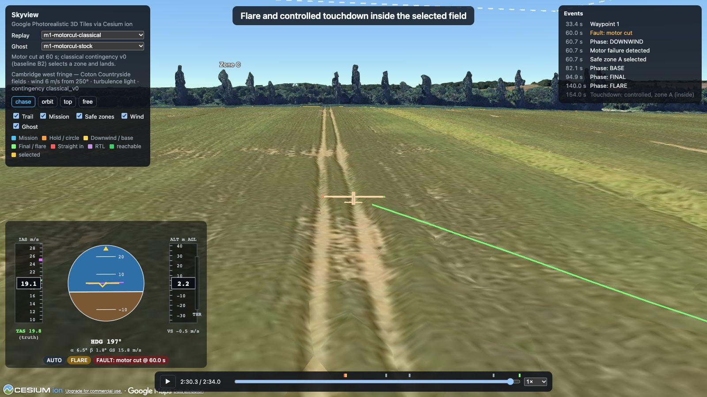

# AeroAdapt-UAV

**An autonomous pilot for fixed-wing UAVs that adapts to aircraft it has never flown, works out what broke when something fails, keeps the aircraft flying, and puts it down where nobody gets hurt.**

AeroAdapt is built simulation-first. It is validated rigorously and compared against strong classical baselines. The aim is to move from simulation to a real aircraft once the simulated system is proven.

> **Status:** Milestone M2 (the fleet) complete except V20's 90 % target; two Should items (the JSBSim Rascal and the GPU throughput run) are pending. M1's vertical slice (a UAV flying over the Coton fields west of Cambridge, with a classical motor-failure contingency) now has a fleet, faults, a benchmark and a live mode:
>
> - **10,000 generated aircraft** in five classes, built from geometry (AeroSandbox buildup, NeuralFoil polars, mass and propulsion sizing, glTF) and filtered in the JAX simulator.
> - **Every aircraft configures and tunes its own autopilot.** It is our ArduPlane-style stack: physics-based gains, then a robust offline AUTOTUNE analogue. **85.5 % of 1,000 pass** the acceptance flight (V20); the target is 90 %, and the misses are characterised.
> - **faultlab v1:** 30 fault kinds plus gusts, shear and thermals, and five deliberately confounded fault pairs.
> - **Live mode:** `aeroadapt serve` plus Skyview. Inject or clear faults, change the wind, or switch aircraft mid-flight; every session re-flies byte for byte.
> - **Bench v0:** 1,000 random scenarios flown by the stock stack (B1) and with the classical contingency (B2). Motor-cut survival is **12 % → 94 %**, overall survival 83 % → 86 %. Shown at once in Skyview's **fleet view**.
> - **Throughput:** 0.85 M simulator steps/s on a laptop CPU for a heterogeneous fleet with faults.
> - **Evidence:** [M2 write-up](docs/demo/m2.md) (with its fidelity and limits), the [week-by-week log](docs/05_m2_technical_spec.md#14-implementation-log-living-section) and the [validation report](docs/validation/m2_report.md). M1: [write-up](docs/demo/m1.md), [frozen report](docs/validation/m1_report.md).
>
> Now: **Txt2Fly** (weeks 9–10, [spec](docs/06_txt2fly_spec.md)): tell the aircraft where to go in plain words. Week 9 built the deterministic core. A typed plan ("patrol fields A, B and C", "circle the church at 30 m") is built for the aircraft flying and the wind blowing. A checker then explains, in plain words, what cannot fly and why: turn radius, no-fly areas from OpenStreetMap, height, battery, glide reach. Plans are previewed on the map and flown live from the next chunk. Week 10 adds the language layer (Claude Haiku 5.5). Then M3, one learned policy flying airframes it never trained on.



## Plan and design documents

| Doc | What |
|---|---|
| [01 — State of the art](docs/01_sota_review_and_research_direction.md) | Literature review, open problems, research framing |
| [02 — Vision](docs/02_aeroadapt_vision_architecture_roadmap.md) | Original vision and evaluation philosophy (now superseded by 03) |
| [03 — AeroAdapt-UAV plan](docs/03_uav_architecture_and_six_month_roadmap.md) | **Current plan**: architecture, fleet, benchmarks, six-month roadmap |
| [04 — M1 technical spec](docs/04_m1_technical_spec.md) | Interfaces, models, validation plan and work plan for M1 |
| [05 — M2 technical spec](docs/05_m2_technical_spec.md) | The fleet: tabulated aero, airframe generator, JSBSim backend, auto-configuration, faultlab v1, bench v0, live mode |
| [06 — Txt2Fly spec](docs/06_txt2fly_spec.md) | Plain-language missions: typed plans, a wind- and airframe-aware builder, a checker, the language layer and its evaluation |
| [ADRs](docs/adr/) | Architecture decision records |

## Quick start

Requires [uv](https://docs.astral.sh/uv/) and Node 22 (for the viewer).

```bash
make setup      # Python env (uv) + web dependencies
make check      # lint, type check, import contracts, fast test tier
make validate   # full validation tier (slow)
```

Fly a scenario and replay it in Skyview:

```bash
uv run aeroadapt run m1-motorcut-classical          # → runs/m1-motorcut-classical (replay bundle)
uv run aeroadapt run m1-motorcut-stock
uv run aeroadapt export-viz runs/m1-motorcut-classical
uv run aeroadapt export-viz runs/m1-motorcut-stock
cp web/skyview/.env.example web/skyview/.env.local   # optional: add a Cesium ion token for 3D tiles
make web-dev   # open http://localhost:5173/?replay=m1-motorcut-classical&ghost=m1-motorcut-stock
```

Live mode, the fleet and the bench:

```bash
uv run aeroadapt serve                 # then open http://localhost:5173/?live=ws://localhost:8765
uv run aeroadapt fleet m2-fleet --n 10000            # generate the fleet (generator extra; ~1 h)
uv run aeroadapt fleet-accept m2-fleet --n 1000      # V20: configure, tune and accept (~1.7 h on a laptop)
uv run aeroadapt bench-run b0                        # bench v0: B1/B2 over 1,000 scenarios (~13 min)
uv run aeroadapt export-fleet runs/bench/b0          # then open http://localhost:5173/?fleet=b0
```

Txt2Fly plans (typed, week 9; plain words in week 10):

```bash
uv run aeroadapt serve --scenario txt2fly-demo                      # the Plan tab in Skyview's live mode
uv run aeroadapt plan check configs/txt2fly/plans/church_30m.yaml   # build and check: reasons, suggestions
uv run aeroadapt plan fly configs/txt2fly/plans/patrol_abc.yaml     # fly it → runs/txt2fly/patrol_abc
```

Other commands: `aeroadapt campaign m1-mini` (the 50-cut V12 mini-campaign), `make report` (validation report), `make demo` and `tools/make_demo_m2.py` (demo videos from seeds), `aeroadapt bench` and `tools/bench_fleet.py` (throughput).

## Repository layout

| Path | Contents |
|---|---|
| `src/aeroadapt/core` | Frames, quaternions, WGS84 geodesy (ADR-001) |
| `src/aeroadapt/airframes` | Airframe schema, loader and fleet bundles |
| `src/aeroadapt/generator` | Offline procedural airframe generator (never imported by the simulator or the stack) |
| `src/aeroadapt/bench` | Bench v0: scenario sampler, splits, B1/B2 runner, statistics |
| `src/aeroadapt/live` | Live server and sessions (WebSocket + msgpack) |
| `src/aeroadapt/txt2fly` | Txt2Fly planner: plans, the site gazetteer, the airframe- and wind-aware builder with its preview, the checker (docs/06) |
| `src/aeroadapt/sim/aerojax` | JAX 6-DoF fixed-wing simulator, written as a pure functional core (ADR-002): actuators, battery, atmosphere and turbulence, sensors, trim |
| `src/aeroadapt/faultlab` | Fault specifications, fixed-shape fault slots and ground-truth labels (ADR-003) |
| `src/aeroadapt/scenarios` | Sites, scenario schema and resolver, runner, campaigns, V12 evaluation, golden flights |
| `src/aeroadapt/telemetry` | Recording schema, events and replay bundles (ADR-005) |
| `src/aeroadapt/stack` | Flight stack: navigator, L1, TECS, attitude loops, modes and mission, classical motor-failure contingency, and the `FlightStack` host shell. It runs on sensor data only and must not import the simulator or a vehicle backend (ADR-006). |
| `src/aeroadapt/vehicle` | The `Vehicle` interface (ADR-004) and the `AerojaxVehicle` adapter, with privileged truth access (ADR-006) |
| `src/aeroadapt/harness` | Closed loop (simulator + stack) in one `lax.scan`, vmap-able; V11 acceptance; auto-configuration and auto-tuning; V20; confounded pairs |
| `src/aeroadapt/cli.py` | `aeroadapt run / campaign / validate / report / bench / export-viz / fleet / fleet-accept / fleet-sample / bench-run / export-fleet / serve / plan` |
| `validation/` | Validation report builder (outside the package: it uses the reference implementation) |
| `reference/bm_numpy` | Independent NumPy reference implementation, used only for N-version validation |
| `configs/` | Airframes, sites (with their OpenStreetMap extracts), stack parameters, scenarios, campaigns, Txt2Fly example plans |
| `web/skyview` | Skyview: replay player, live mode with the fault panel, fleet view (CesiumJS, React, Arrow) |

## Validation philosophy

Every model is backed by evidence. The simulator is checked three ways:

- **Against an independent reference implementation**, which must agree to machine precision.
- **Against physical invariants and analytic approximations.**
- **Against an independent simulator** (JSBSim, planned for M2).

See the [M1 spec, §12](docs/04_m1_technical_spec.md).

## Licence

Apache-2.0, see [LICENSE](LICENSE). Third-party data attributions are listed in [NOTICE](NOTICE).
