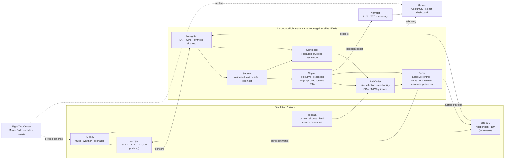

# AeroAdapt: Vision, Flagship Demo, Architecture and Roadmap

> **Superseded (vehicle, simulation, fleet, benchmarks, roadmap) by [03 — AeroAdapt-UAV](03_uav_architecture_and_six_month_roadmap.md).** The project now targets fixed-wing UAVs instead of the C172. The philosophy here still applies: oracle-normalised evaluation, "learned where it wins", signature visuals, dashboard concept, and engineering practices.

*Draft for discussion · 13 Oct 2026 · Supersedes the "research-first" framing of [01](01_sota_review_and_research_direction.md). That document's literature review and baseline analysis still apply.*

**Objective (as restated):** build an exceptionally ambitious, technically credible, visually striking autonomous-flight system in 6–12 months, solo and simulation-first.
- It should be rigorously evaluated against strong classical baselines.
- It must show measurable generalisation.
- It should make top autonomy, aerospace and AI teams stop scrolling.

Scientific novelty is a bonus.

---

## 0. Executive summary

**The pitch.**
> **Garmin Autoland can land a healthy aircraft when the pilot can't fly. AeroAdapt lands a *broken* aircraft when the physics have changed. It shows its reasoning while it does so.**

Garmin's system had its first real-world activation in December 2025, landing a King Air 200 after a pressurisation failure, so the comparison is current and recognisable. AeroAdapt goes after the harder half of the problem:
- sensors that lie;
- control surfaces that jam;
- engines that quit;
- weather that fights back.

**The system.** A full-stack autonomous AI pilot for fixed-wing aircraft:
- it detects a failure;
- reasons about its possible causes with calibrated confidence;
- stabilises the aircraft with adaptive control;
- re-learns what the damaged aircraft can still do;
- picks where it can still land safely, weighing risk to people on the ground;
- flies an energy-managed approach and touchdown;
- explains every decision.

**How it is shown.**
- **A real-time 3D web simulator over real-world terrain**, with a mission-control dashboard that shows *what the sensors say* next to *what the AI believes is true*.
- **A "Chaos Console"** where anyone can break the aircraft and watch it cope.
- **A Flight Test Center**: 10,000+ randomised emergencies, in which every number links to its 3D replay.

**Key decisions I recommend.**

| Decision | Recommendation | Why |
|---|---|---|
| Vehicle | **Fixed-wing general aviation (Cessna 172-class) as primary.** Other JSBSim airframes are held out to test generalisation. A twin is a stretch goal. | Engine-out forced landings are the most relatable, visual and consequential emergency. JSBSim's C172 models are mature, the procedures (POH) are public, and everyone understands "glide to a field". |
| Training simulator | **Your own GPU-vectorised JAX flight-dynamics model ("aerojax")** | Millions of steps per second for RL and diagnosis training. Owning the fault injection is itself a strong engineering signal. |
| Evaluation simulator | **JSBSim, used zero-shot** (independent, industry-standard) | Cross-simulator transfer is hard evidence that you are not overfitting your own simulator. |
| Visualisation | **CesiumJS + React web app** (Google Photorealistic 3D Tiles), plus an optional Unreal Engine 5 cinematic for the hero video | A shareable URL beats a video. Recruiters can open it in a browser. |
| Learning vs classical | **"Learned where it wins, classical where it's proven, runtime-assured everywhere."** Every learned component gets an A/B test against its classical counterpart. | This is what separates a serious autonomy engineer from an RL hobbyist. |
| Role of "Adaptation under Ambiguity" | **Kept as the "Sentinel + Captain" component.** It is the system's showcase of *reasoning*, not the whole project. | It produces the signature moment: the AI refuses to trust a lying sensor. |

---

## 1. Reassessing "Adaptation under Ambiguity"

**What stays.** The core idea is *the intelligence centrepiece*: represent competing explanations, hedge when they conflict, probe to disambiguate when that is safe, and admit when nothing fits. It is still the rarest capability in learned flight control. It also produces the single most memorable demo beat. An airspeed indicator falls because ice blocks the pitot tube. A conventional autopilot believes it, pitches down and overspeeds, or stalls. AeroAdapt instead:
1. holds a safe pitch-and-power attitude;
2. cross-checks GPS ground speed, its wind estimate, angle of attack and engine data;
3. runs a small pitch probe;
4. concludes "pitot blockage, 94%";
5. switches to a synthetic airspeed estimate.

**What changes.**

| Dropped | Retained / reframed |
|---|---|
| Formal probe-or-hedge frontier theory | The same logic as a practical **active diagnosis policy** over a library of real troubleshooting actions: carb heat, fuel tank switch, alternate static source, magneto check, pitch/throttle doublets, control-surface exercise |
| Hardware experiments | Real-world grounding through the ALFA real fixed-wing fault logs (diagnoser evaluation) and real terrain and airport data |
| "Paper-first" framing | **Optional bonus:** the "confounded-fault" test set and the comparison against an end-to-end RL agent can become a workshop paper or blog post at almost no extra cost, because the infrastructure already exists |

---

## 2. The ultimate vision

### 2.1 Capability ladder (also the build order)

| Level | Capability | What it looks like on screen |
|---|---|---|
| L1 **Fly** | Robust autopilot in turbulence and wind shear | Smooth flight over real terrain under Dryden turbulence |
| L2 **Notice** | Detect anomalies in seconds, with very few false alarms | Health matrix flips amber; detection timestamp in the decision log |
| L3 **Understand** | Calibrated belief over 40+ fault hypotheses, including "unknown" | Live hypothesis bars and conformal "it's one of these" sets that shrink as evidence arrives |
| L4 **Adapt** | Keep control of a changed aircraft (jammed aileron, shifted CG, icing, partial power) | Control-surface animation shows the rudder compensating for a jammed aileron |
| L5 **Re-learn itself** | Estimate the degraded performance envelope: glide ratio, stall speed, roll authority | Envelope panel shows nominal vs current, with uncertainty bands |
| L6 **Decide** | Choose a landing site using reachability, surface, wind and risk to people | A reachability dome on the 3D terrain shrinks as altitude is lost; candidate sites are ranked and annotated |
| L7 **Land** | Energy-managed glide, approach, flare and touchdown | Planned path drawn as a ribbon; touchdown scorecard |
| L8 **Explain** | Natural-language reasoning and ATC-style Mayday calls, from a read-only narrator | Radio transcript plus voice; "why this field?" answered from the decision log |

### 2.2 What makes it extraordinary to senior engineers

1. **It is a system, not an algorithm.** It covers estimation, fault diagnosis, adaptive control, self-modelling, guidance, decision-making, runtime assurance and communication, all closed-loop. Most portfolio projects are one RL agent in one gym environment.
2. **It knows the limits of physics.** Every scenario is scored against a **privileged oracle**: a planner that knows the true fault and true dynamics and decides whether a safe landing was *physically possible at all*. AeroAdapt is measured on the fraction of *landable* emergencies it actually lands. When a landing is impossible, it is scored on minimising harm (an open field instead of a town). This is a rigour move most people never think of.
3. **It is honest about uncertainty.** Its confidence is calibrated, so "70% sure" means right 70% of the time, and that is checked. It flags "I don't recognise this failure". Its failure cases are published and can be replayed.
4. **It generalises in ways that are hard to fake.** It is trained in its own simulator and evaluated *zero-shot* in a different one (JSBSim). It is tested on aircraft it never trained on (PA-28, C182, J3 Cub) and on fault types and weather held out from training. It also faces a **blind red-team set**: scenarios designed by someone else after the models are frozen.
5. **It speaks aerospace.** It implements real procedures (POH checklists, unreliable-airspeed technique, high-key/low-key forced-landing patterns) and a real safety architecture (Simplex-style runtime assurance, envelope protection, frozen-weight adaptation). That reads as "this person could work on our flight software", not "this person likes drones".

### 2.3 Scope decisions

- **Fixed-wing only.**
  - Multirotor rotor-loss demos are already well covered (RAPTOR, learned FTC).
  - Spreading across multirotor, fixed-wing and VTOL would dilute depth.
  - A fixed-wing *forced landing* combines continuous control, long-horizon planning and high-stakes decisions in one scenario, which multirotors don't.
- **Aircraft roster** (all bundled with JSBSim).

  | Role | Aircraft | Purpose |
  |---|---|---|
  | Primary | **c172p** | Development, flagship demo, training-family centre |
  | Held-out generalisation | **pa28** (low wing), **c182** (heavier, constant-speed prop), **J3Cub** (taildragger, slow) | Never seen in training |
  | Stretch | **c310** or **DHC6** (twins) | Throttle-only control after total control loss |
  | Moonshot | **MD11** | Homage to NASA's 1995 throttle-only MD-11 landing |

  JSBSim model fidelity in edge regimes must be checked per airframe.
- **Training world: a procedural aircraft family.** Mass, inertia, CG, aero coefficients and engine power are randomised around C172-class values. The held-out airframes then test *real* extrapolation.

---

## 3. The flagship demonstration

### 3.1 "Flight 0": the hero scenario (2–3 minute video, reproducible live)

**Setting.** A C172 departs a real airport over real 3D terrain. The Bay Area / Santa Cruz Mountains is a good candidate: mixed hills, water, fields and dense city, so ground-risk trade-offs are visible. The Alps would be more dramatic but offer fewer landing options. Choose by how good the 3D tiles look.

| Beat | Event (injected; unknown to the AI) | What the AI does | What the viewer sees | Subsystem shown |
|---|---|---|---|---|
| 0:00 | Cruise at 6,500 ft, light turbulence | Normal autopilot | Cinematic chase camera; calm dashboard | Reflex, Navigator |
| 0:15 | **Pitot tube ices**: indicated airspeed decays | Detects disagreement. Hypotheses: *pitot blockage* vs *real deceleration* vs *other*. **Hedges** by holding a known-safe pitch and power. **Probes** with a small pitch change. Cross-checks GPS minus wind, angle of attack and RPM. | Airspeed tape splits: **indicated** (red) vs **AI-believed** (cyan). Hypothesis bars move. A "futures fan" shows a predicted trajectory for each hypothesis, which collapses into one. **Ghost baseline** (conventional autopilot trusting the sensor) noses down, overspeeds and departs. | Sentinel, Captain (hedge → probe → commit) |
| 0:45 | **Engine failure**: oil pressure drops, then RPM falls | Pitches for best glide. Runs the restart checklist (tank switch, mixture, carb heat, magnetos) while computing the wind-corrected glide footprint. Ranks airports and fields by reachability, surface, wind and population. Picks one. | Translucent **reachability dome** projected on the terrain, shrinking with altitude. Candidate sites with scores; populated areas shaded red. Mayday call heard (TTS) and shown in the radio panel. | Self-model, Pathfinder, Captain, Narrator |
| 1:30 | **Aileron jams** at 4° plus gusty crosswind on approach | Adaptive controller re-allocates (rudder, cross-control, different bank strategy). Self-model reports reduced roll authority, and the planner reshapes the path (wider turns, a different pattern). | The control-surface view shows the jam; envelope panel shows "max bank 20° (was 45°)"; ribbon re-plans. | Reflex, Self-model, Pathfinder |
| 2:15 | Short final, flare | Energy management (S-turn / slip), flare, touchdown | Touchdown scorecard: sink rate, bank, distance from aim point. "3 faults diagnosed · 0 human inputs." | Pathfinder, Reflex |
| 2:30 | Cut to evidence | — | Headline results from the Flight Test Center *(numbers produced by the campaign, not promised in advance)* | Evaluation |

### 3.2 The Chaos Console (interactive)

This is the demo for interviews: "Go ahead, break it."
- **Setup:** pick an aircraft, a location, the weather and the time of day.
- **Mystery fault mode:** press **BREAK SOMETHING**. A random fault, or a combination, is injected at a random moment. It is hidden from the AI and optionally from the viewer. At the end, the AI's diagnosis is revealed next to the ground truth.
- **Manual mode:** stack faults yourself, for example "pitot blockage + carb ice + microburst".
- **Ghost race:** the baseline autopilot and the end-to-end RL agent fly the identical scenario as translucent ghosts.
- **Hosting:** the backend runs on CPU, since JSBSim and the policies are cheap. Curated **interactive replays** are hosted statically, so the public demo costs nothing to serve.

### 3.3 The Flight Test Center (where credibility lives)

An auto-generated results site showing:
- survival and landing-quality statistics per method;
- per-fault heatmaps, calibration plots and generalisation splits;
- a gallery of failure cases.

**Every point is clickable and opens the 3D replay of that exact scenario.** Senior engineers will go straight for the failures, so make them easy to find.

### 3.4 Signature visuals (the "jaw-drop" inventory)

1. **Truth overlay:** instruments show *indicated* and *believed* values side by side. This is the visual that explains sensor-fault reasoning in one glance.
2. **Futures fan:** world-model rollouts conditioned on each hypothesis, drawn as coloured trails ahead of the aircraft. They converge as the diagnosis converges.
3. **Reachability dome:** the wind-corrected glide footprint as a 3D volume or terrain overlay. It visibly shrinks as altitude is lost, and sites "go dark" as they become unreachable.
4. **Ghost aircraft:** the baseline flying the same scenario, failing in real time.
5. **Risk map:** population and obstacle shading under the glide footprint, showing the trade-off being made.
6. **Decision ledger:** a timestamped, structured log of each decision, the alternatives considered and their scores. The narrator turns it into speech.

### 3.5 Dashboard layout (wireframe)

```
┌──────────────────────────────────── 3D VIEW (CesiumJS) ────────────────────────────────────┐
│  aircraft + ghost · futures fan · reachability dome · site markers · risk map · path ribbon │
└────────────────────────────────────────────────────────────────────────────────────────────┘
┌ PFD: indicated vs believed ───┐┌ SENTINEL: what broke? ───────┐┌ PATHFINDER: where to land? ──┐
│ IAS ▌ 62 kt (ind)  ▌ 91 (est) │ │ pitot blockage     ████ 0.71 │ │ ✓ Field 3   score .82  +610ft│
│ attitude · alt · VSI · AoA    │ │ real deceleration  █    0.18 │ │   KXYZ 27   score .64  +120ft│
│ stall margin ▓▓▓▓░░           │ │ unknown            ▏    0.03 │ │ ✗ Field 1   unreachable      │
│                               │ │ 90% set: {pitot}   probe: ↑2°│ │ energy margin  ▓▓▓▓▓░  +610ft│
└───────────────────────────────┘└──────────────────────────────┘└──────────────────────────────┘
┌ HEALTH MATRIX ───────────────┐┌ REFLEX & ASSURANCE ──────────┐┌ LEDGER · RADIO ──────────────┐
│ engine ■ pitot ■ AoA ■ IMU ■ │ │ controller: learned (adaptive)│ │ 00:47 ENGINE FAIL detected   │
│ ail ■ elev ■ rud ■ GNSS ■    │ │ RTA monitor ▓▓▓▓▓░ OK        │ │ 00:49 best glide, restart #1 │
│ envelope: max bank 20° (45°) │ │ envelope protection: active  │ │ 00:52 "MAYDAY MAYDAY MAYDAY…"│
└──────────────────────────────┘└──────────────────────────────┘└──────────────────────────────┘
                        [ timeline scrubber · playback speed · BREAK SOMETHING ]
```

---

## 4. Technical architecture

### 4.1 System diagram



### 4.2 Layer by layer

| Module | Responsibility | Classical core (also the baseline and fallback) | Learned / advanced component | Key tech |
|---|---|---|---|---|
| **aerojax** | Training simulator | 6-DoF rigid body; aero tables ported from JSBSim C172 XML; propeller and engine model; ISA atmosphere; touchdown handled as a terminal event rather than full gear dynamics | Procedural aircraft family; fully vectorised and differentiable | JAX (`jit`/`vmap`), Equinox |
| **JSBSim** | Evaluation simulator | Industry-standard FDM, including ground reactions and built-in Milspec/Tustin turbulence | — | `jsbsim` Python bindings |
| **faultlab** | One fault/weather spec applied *identically* to both simulators | ~40 faults:<br>• **sensors:** pitot total/static blockage, AoA vane freeze/bias, IMU bias/scale/saturation, GNSS dropout/drift/**spoofing**, baro, magnetometer, engine gauges<br>• **actuators:** surface jam/float/loss of effectiveness, trim runaway<br>• **propulsion:** total/partial power loss, carb icing, fuel starvation, propeller damage<br>• **airframe:** icing, asymmetric damage, CG shift<br>• **atmosphere:** Dryden turbulence, wind shear, gust fronts, microburst (Oseguera–Bowles model) | Compound-fault and "mystery" generators | Typed dataclasses / YAML scenario DSL |
| **geodata** | Where can we land, and who is below? | Runways from OurAirports (public domain); fields from ESA WorldCover 10 m plus OSM landuse; obstacles such as power lines from OSM; terrain from Copernicus DEM GLO-30; population from GHSL | Pre-tiled site database and ground-risk raster | GDAL/rasterio, DuckDB |
| **Navigator** | Estimate the true state | EKF (attitude, position, wind); innovation χ² tests; synthetic airspeed from GPS minus wind, cross-checked against a lift-equation estimate | — | NumPy / JAX |
| **Sentinel** | What broke? | Residual generators plus CUSUM; IMM/MMAE bank over the main fault modes | **Transformer over 10–30 s of telemetry → amortised posterior over hypotheses and severities**:<br>• trained by simulation-based inference on millions of fault episodes;<br>• temperature-scaled, with **conformal prediction sets**;<br>• an anytime-valid **"unknown fault"** test on prediction residuals | JAX/Flax, ONNX export |
| **Captain** | Decide what to do | Hierarchical state machine / behaviour tree (NORMAL → ANOMALY → DIAGNOSE → STABILISE → ASSESS → PLAN → EXECUTE → TOUCHDOWN → SECURE); executable POH checklists; **Simplex-style runtime assurance** (switch to the fallback controller when monitors trip) | **Active diagnosis policy (the ambiguity component):**<br>• hedge with safe defaults when hypotheses conflict;<br>• otherwise pick the probe or troubleshooting action with the highest expected information gain, subject to a safety margin;<br>• commit when confident | Python; behaviour-tree library or a hand-rolled state machine |
| **Self-model** | What can this aircraft still do? | Recursive least-squares / EKF estimation of aero parameters → glide ratio, best-glide speed, stall speed, roll authority | **Physics-structured world model:** nominal aero plus a learned residual with an in-context latent (or an ensemble). Provides hypothesis-conditioned rollouts (the futures fan) and an *uncertain* envelope | JAX |
| **Pathfinder** | Where and how to land | Wind-corrected glide footprint (trochoidal / Dubins-airplane paths); multi-criteria site scoring; high-key/low-key patterns; TECS energy management; classical flare law | • **Amortised landability network:** predicts P(success at site s \| state, belief) in microseconds, trained on oracle outcomes, so thousands of candidate sites can be ranked<br>• **Successive convexification (SCvx)** trajectory optimisation for the approach under the adapted model<br>• MPC tracking | JAX (batched footprints), cvxpy + Clarabel (SCvx), acados (NMPC) |
| **Reflex** | Fly the aircraft | PID autopilot (GA-autopilot-like) + TECS; **INDI** inner loop; envelope protection (AoA, bank, load factor, overspeed) | **Recurrent in-context adaptive policy:**<br>• trained with PPO across the procedural aircraft family and fault library;<br>• privileged teacher → student distillation (RMA/RAPTOR-style);<br>• evaluated both standalone and as a residual on INDI;<br>• control-barrier-function safety filter | JAX (PureJaxRL-style PPO), ONNX |
| **Narrator** | Explain and communicate | Templated radio calls | LLM converts the decision ledger into explanations and Mayday calls, and answers "why?" questions. **Strictly read-only; it never commands the aircraft.** | LLM API + TTS |
| **Skyview** | Visualise | — | Signature visuals (§3.4) | TypeScript, React, Vite, CesiumJS (Resium), Google Photorealistic 3D Tiles (Cesium World Terrain fallback), glTF aircraft with animated surfaces, uPlot (high-rate telemetry), D3/visx; FastAPI + WebSocket (MessagePack) |
| **Flight Test Center** | Prove it | Scenario sampler; parallel Monte Carlo on JSBSim; **privileged oracle** | Auto-generated report site with drill-down to replays | Ray or multiprocessing, Parquet + DuckDB, a static site |
| *Cinematic (stretch)* | Hero video | — | Same telemetry stream rendered in Unreal Engine 5 + Cesium for Unreal | UE5 Movie Render Queue |

### 4.3 Where learning earns its place (honest expectations)

| Component | Learned vs classical: expected outcome | Why |
|---|---|---|
| Sentinel (diagnosis) | **Clear win likely** | 40 fault types, compound faults and subtle cases (carb ice vs fuel starvation vs partial failure) are hard to hand-threshold. A model trained on millions of simulated episodes wins on speed, accuracy and calibration. |
| Landability network | **Clear win on speed**; accuracy is checked against the oracle | Amortises expensive reachability and trajectory optimisation, so thousands of sites can be scored |
| Self-model | Likely win under compound or structural faults; roughly a tie on simple ones | An in-context latent adapts faster than recursive least-squares when excitation is poor |
| Reflex (inner loop) | **Uncertain. INDI is strong.** A residual-on-INDI design is the most likely winner. | Report the result either way; an honest tie is still credible |
| Guidance | **Classical optimisation should dominate** | End-to-end RL is poor at long-horizon, constrained, safety-critical planning. *Show* this with an end-to-end RL baseline. |

Being seen to choose the right tool per layer, with the evidence, is itself a differentiator.

### 4.4 Engineering practices (visible in the repo)

- **One stack, two simulators.** The flight stack talks to a narrow `Vehicle` interface (sensors in, actuators out). `aerojax`, JSBSim and, later, PX4 SITL are interchangeable adapters behind it.
- **Determinism and reproducibility.**
  - Seeded scenarios, versioned scenario sets and pinned environments (uv, Docker).
  - Hydra configs.
  - Experiment tracking (Weights & Biases or MLflow).
  - `make reproduce-figure-3` style commands.
- **Testing as flight-test culture.**
  - Unit and property tests for the dynamics model: energy checks, trim states that match JSBSim.
  - A **"FDM validation report"** comparing aerojax with JSBSim on trims, step responses and glide performance.
  - A **CI regression flight-test suite**: every merge flies ~200 scenarios and fails on regression.
- **Performance budgets, published.**
  - Simulator throughput target: at least 1M environment-steps/s on one GPU.
  - Control-loop latency.
  - ONNX inference time.
  - Real-time factor of the full stack.
- **Docs.** MkDocs site with architecture decision records ("why INDI as the fallback", "why the LLM is out of the loop").

### 4.5 Compute and cost (rough estimates; verify current prices)

- **Development:** a Mac is enough. JAX on CPU and JSBSim are fine for building and small runs.
- **Training:** rented A100/H100-class GPUs for the policy, diagnoser and landability network. Plausibly a few hundred US dollars over the project.
- **Monte Carlo campaigns:** cheap spot CPU instances, since JSBSim parallelises across cores.
- **3D tiles:** Google Photorealistic 3D Tiles via Cesium ion or the Map Tiles API. A portfolio likely fits free or low tiers; keep Cesium World Terrain plus imagery as a fallback and check current terms and attribution rules. Data licences need care: OSM is ODbL (attribution and share-alike for derived databases); ESA WorldCover is CC-BY 4.0.

---

## 5. Evaluation design (rigour)

- **Primary metric: oracle-normalised landing rate.**
  - **Oracle:** a privileged planner (true fault, true dynamics, perfect state) runs SCvx trajectory optimisation over all candidate sites. If the oracle cannot land, the scenario is labelled *unlandable*.
  - **Landable scenarios:** report AeroAdapt's success rate on these.
  - **Unlandable scenarios:** report *harm minimisation*, i.e. touchdown energy × population density at the impact site, compared with the oracle's best crash site.
- **Touchdown criteria.** Tiers of *normal*, *hard but survivable* and *crash*, defined from sink rate, attitude, speed and surface. Fix the thresholds from Part 23 emergency-landing criteria and accident literature. Claims cover touchdown only; rollout over rough terrain is not modelled faithfully.
- **Scenario space** (target 10k+ per method): fault type × severity × timing × flight phase (climb, cruise, approach) × weather × geography × airframe, plus compound faults.
- **Generalisation splits.**

  | Split | Held out |
  |---|---|
  | S1 | Fault severities |
  | S2 | **Fault types** (whole classes never seen in training) |
  | S3 | Compound faults (trained on singles only) |
  | S4 | **Airframes**: PA-28, C182, J3 Cub |
  | S5 | **Simulator**: trained in aerojax, evaluated in JSBSim |
  | S6 | Weather (e.g. microbursts unseen in training) |
  | S7 | Geography |
  | S8 | **Blind red-team set** designed by a third party after the models are frozen |
  | S9 | Real fault logs (ALFA; diagnosis only) |
- **Metrics.**
  - **Landing and harm:** oracle-normalised landing rate; touchdown quality; harm score.
  - **Detection:** detection delay; false alarms per flight hour.
  - **Diagnosis:** top-1 accuracy; **rate of confident-but-wrong diagnoses**; calibration (ECE, reliability plots); conformal set coverage and size.
  - **Control:** envelope exceedances (stalls); time to stabilise.
  - **Decisions:** site-choice regret against the oracle.
  - **Compute:** latency and real-time factor.
- **Baselines** (each must be good, not strawmen):
  1. Conventional GA-style autopilot (PID + TECS) with scripted POH procedures and the nearest-airport rule.
  2. Classical expert stack: EKF-FDI/IMM + INDI + glide planner. This is AeroAdapt with every learned component swapped for its classical counterpart.
  3. End-to-end recurrent PPO agent (sensors → controls) trained on the same fault distribution.
  4. AeroAdapt ablations: no Sentinel, no active diagnosis, no self-model, no runtime assurance, classical inner loop.
  5. Oracle (upper bound).
- **Reporting.**
  - ≥10 training seeds for learned components.
  - 95% confidence intervals (Wilson for rates), and paired comparisons on identical scenarios.
  - Pre-registered held-out splits.
  - Failure-case gallery; no cherry-picked videos without the statistics alongside.

---

## 6. Roadmap

**Principles.**
- Vertical slice first.
- Classical before learned: the baselines double as fallbacks.
- Every phase ends in a **public, demoable artefact** (build in public: one post per phase).
- Every learned component ships with its A/B test.
- Visuals are time-boxed.

*Assumes roughly 30 focused hours per week. Scale the dates if that differs.*

| Phase | When | Build | Demo / artefact at the end | Definition of done |
|---|---|---|---|---|
| **M0 · First flight** | weeks 1–3 | Repo, CI and tooling; JSBSim C172 headless with a Python control loop; PID/TECS autopilot; `Vehicle` interface; faultlab v0 (engine failure, pitot blockage, aileron jam); WebSocket → CesiumJS viewer with aircraft model + minimal PFD; replay recorder | "Watch a C172 fly over real terrain in your browser, inject an engine failure, watch the baseline fail" | 60 Hz browser viz; reproducible scenarios |
| **M1 · Classical emergency pilot** | weeks 4–9 | EKF + wind estimate + synthetic airspeed; residual/IMM fault detection; geodata site database; glide footprint + site ranking + glide path + classical flare; POH checklists + Captain state machine + runtime-assurance skeleton; Monte Carlo harness v1 + oracle v0 + report v1 | Classical engine-out forced landing over real terrain, with first statistics. **This alone is a strong portfolio piece and is the safety net.** | ≥1k-scenario campaign runs overnight; baseline numbers published |
| **M2 · Learning at scale** | weeks 10–17 | aerojax + FDM validation report; procedural aircraft family; faultlab parity across both simulators; **Sentinel** learned diagnoser (calibrated, open-set); **Reflex** adaptive policy (PPO, teacher → student, residual-on-INDI variant); zero-shot evaluation in JSBSim | Blog: "Building a GPU flight simulator in JAX". Learned vs classical A/B on held-out faults. | ≥1M steps/s; JSBSim-validated; A/B results whatever they show |
| **M3 · The thinking pilot** | weeks 18–26 | Active diagnosis (hedge / probe / commit); Self-model + futures fan; envelope-aware Pathfinder (SCvx + MPC + landability network); envelope protection + full runtime assurance; Skyview v2 (truth overlay, belief panel, reachability dome, ghost, ledger) | **6-month cut line: launch v1.** Public web demo with replays, repo, 2–3 min screen-captured hero video, technical write-up. | Flight 0 runs end-to-end, reliably, from a seed |
| **M4 · Proof** | months 7–9 | Full Flight Test Center campaign (10k+ × methods, all splits, ablations, failure analysis, drill-down site); blind red-team set; ALFA real-log diagnosis check; live Chaos Console; Narrator (LLM + TTS) | Technical report (arXiv-style); Flight Test Center site; v2 hero video (optionally UE5) | Every headline number reproducible with one command |
| **M5 · Moonshots** (pick 1–2) | months 10–12 | **(a)** throttle-only landing of a twin after total control loss, then the MD-11 homage to NASA's PCA programme · **(b)** PX4 SITL integration (PX4 has a JSBSim bridge), making the stack hardware-ready · **(c)** C++ real-time "flight computer" port with ONNX Runtime and a deterministic scheduler · **(d)** GNSS spoofing detection + terrain-relative navigation · **(e)** synthetic-vision landing-site check (camera renders → segmentation) · **(f)** human-vs-AI web challenge on the same emergencies | One "nobody else has this" capability | — |

**Moonshot by target employer:**
- **SpaceX:** (c) plus SCvx guidance.
- **Anduril:** (b) + (d).
- **NVIDIA:** (e) plus GPU-sim throughput.
- **DeepMind:** world model + calibration + (f).
- **Broadest wow factor:** (a).

---

## 7. The differentiator

### 7.1 Versus typical projects

| Typical autonomous-flight / RL portfolio project | AeroAdapt |
|---|---|
| One RL agent, one gym environment, one reward curve | Closed-loop autonomy stack: estimation → diagnosis → adaptation → self-modelling → guidance → assurance → explanation |
| Compared against PID or nothing | Compared against TECS, INDI, EKF-FDI/IMM and SCvx guidance, plus an end-to-end RL agent and an oracle upper bound |
| Tested on the training distribution | Held-out faults, airframes, simulator, weather, geography, plus a blind red-team set and real fault logs |
| "Success rate 97%", including impossible cases or with them silently removed | **Oracle-normalised**: success on what was physically possible; harm minimisation on what wasn't |
| Black-box policy | Calibrated hypotheses, conformal sets, truth overlay, decision ledger |
| Video only | Live interactive web demo; every statistic opens its replay |
| LLM bolted into the loop | LLM strictly out of the loop. A runtime-assurance architecture is a design choice you can defend in an interview. |
| Notebook code | Typed, tested, CI-regression-flown, documented, reproducible |

### 7.2 What each target company will look for, and where it is

| Company | What they screen for | Where AeroAdapt shows it |
|---|---|---|
| **SpaceX** | GNC fundamentals, optimisation-based guidance, fault tolerance, test rigour, real-time C++ | 6-DoF FDM, SCvx guidance, FDI, CI regression flights, moonshot (c) |
| **Anduril** | Autonomy for uncrewed aircraft under degraded and contested conditions, systems integration | Full stack, GNSS spoofing, PX4 integration (b, d), runtime assurance |
| **NVIDIA** | GPU-accelerated simulation, RL at scale, synthetic data, visual polish | aerojax throughput, massive training, CesiumJS/UE5 visuals, moonshot (e) |
| **Google DeepMind** | RL and world models done rigorously, calibration, evaluation design, JAX | JAX stack, world model and futures fan, conformal calibration, oracle-normalised evaluation |

### 7.3 Anti-patterns to avoid (they would undercut credibility)

- End-to-end RL for the whole mission. Use it only as a baseline that *shows* why hierarchy matters.
- Putting an LLM in the control loop.
- Implying certification readiness. Say "architected along runtime-assurance principles", not "certifiable".
- Polishing visuals before the M1 classical stack works.
- Adding multirotors or VTOL for breadth.
- Claiming fidelity JSBSim doesn't have: spins, rough-field rollout.

---

## 8. Risks and mitigations

| Risk | Likelihood | Mitigation |
|---|---|---|
| Scope explosion (solo) | High | Strict phase gates; M1 is a complete fallback portfolio; M3 is the 6-month cut line; moonshots are optional |
| aerojax ≠ JSBSim (sim-to-sim gap) | Medium | Port JSBSim's own aero tables; publish the validation report; domain-randomise; the zero-shot gap is a *reported result*, not a hidden one |
| RL inner loop doesn't beat INDI | Medium | Residual-on-INDI design; report honestly; the system's value doesn't hinge on it |
| Flare and landing are hard to learn | Medium | Classical flare law plus MPC; learning used only where it wins |
| JSBSim edge-regime fidelity | Medium | Restrict claims to touchdown; check fidelity per airframe; avoid spin scenarios |
| 3D tiles cost or terms | Low–Medium | Cesium ion free tier / World Terrain fallback; check attribution rules |
| UE5 time sink | Medium | Optional; time-box to 2–3 weeks in M4 |
| Live-demo hosting cost | Low | Static interactive replays by default; live backend on demand |

---

## 9. Decisions needed

1. **Weekly hours.** The roadmap assumes about 30 h/week. What's realistic for you?
2. **Hero location.** Bay Area / Santa Cruz Mountains (varied options, ground-risk trade-offs) or the Alps (more dramatic, fewer fields), or somewhere personal to you?
3. **Primary target employer, or a ranking.** This decides the M5 moonshot and which engineering signals to emphasise (C++/PX4 vs GPU/vision vs world models).
4. **Budget comfort.** Roughly a few hundred dollars for GPU rental and tiles over the project?

---

## Sources (new in this document; see [01](01_sota_review_and_research_direction.md) for the full literature)

- Garmin Emergency Autoland, first real-world activation (Dec 2025): [Flying Magazine](https://flyingmag.com/garmin-autoland-passes-first-real-world-test), [AVweb: activation was a crew decision](https://avweb.com/aviation-news/garmin-autoland-activation-crew-decision/), [Flightradar24](https://www.flightradar24.com/blog/aviation-news/aviation-safety/garmin-emergency-autoland-deployed-first-time/)
- JSBSim aircraft models: [JSBSim repository: aircraft/](https://github.com/JSBSim-Team/jsbsim/tree/master/aircraft)
- GPU-parallel fixed-wing simulation (reference point for aerojax): [NeuralPlane, NeurIPS 2024](https://proceedings.neurips.cc/paper_files/paper/2024/hash/af97b61e9fef8f55e32a2602af364d8c-Abstract.html); CPU JSBSim RL environments: [jsbgym](https://pypi.org/project/jsbgym/)
- Forced-landing planning:
  - [Altitude-loss optimal glides with obstacles and wind (C172)](https://arxiv.org/abs/2304.06499)
  - [Wind-aware emergency landing reachability for fixed-wing UAVs](https://pmc.ncbi.nlm.nih.gov/articles/PMC6358792)
  - [Emergency landing guidance with motor malfunction (sampling-based)](https://dspace.cvut.cz/handle/10467/76755)
- Google Photorealistic 3D Tiles billing: [Map Tiles API usage and billing](https://developers.google.com/maps/documentation/tile/usage_limits?hl=en), [Cesium community thread on costs](https://community.cesium.com/t/google-3d-tiles-cost/27625)
- Real fixed-wing fault data: [ALFA dataset](https://arxiv.org/abs/1907.06268)
