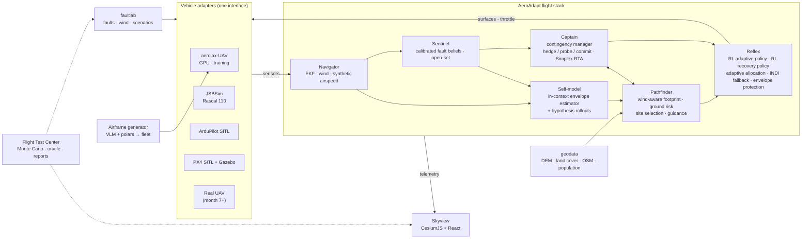

# AeroAdapt-UAV: Architecture, Simulation, Fleet, Benchmarks and Six-Month Roadmap

*Current plan. Draft for discussion, 13 Oct 2026.*

This document supersedes the C172-based plan in [02](02_aeroadapt_vision_architecture_roadmap.md). The philosophy from 02 still applies (oracle-normalised evaluation, "learned where it wins", the signature visuals, engineering practices), but this plan replaces it wherever the two differ. The literature context is in [01](01_sota_review_and_research_direction.md).

> **North star.** One AI pilot that can fly a fixed-wing UAV it has never seen before. It notices when that aircraft breaks, works out what broke, keeps it flying, and puts it down where nobody gets hurt. That happens in simulation in the first six months, and on a real aircraft after that.

---

## 0. What changed

| Aspect | Previous plan (C172) | Now (fixed-wing UAVs) |
|---|---|---|
| Vehicle | One general-aviation aircraft | **A family of 1–4 m fixed-wing UAVs** in six configurations: conventional, T-tail, V-tail, twin-boom pusher, glider, flying wing |
| Generalisation story | Held-out GA airframes | **"One brain, many airframes"**: a procedurally generated fleet of 10,000+ physically plausible UAVs. Tested on a *held-out configuration class* and on *independently authored* real UAV models. |
| Training simulator | aerojax with C172 tables | **aerojax-UAV**: coefficient-based 6-DoF model, electric propulsion, battery, servo dynamics, plus a procedural airframe generator (vortex-lattice method + 360° airfoil polars) |
| Evaluation simulators | JSBSim with GA models | JSBSim (Rascal 110), **ArduPilot SITL**, PX4 SITL with the Gazebo *Advanced Plane*, and published models (Skywalker X8, Aerosonde, Zagi) |
| Emergencies | Carb ice, pitot, engine, GA procedures | **UAV-specific**: motor/ESC failure, battery cell failure, servo jam/float/slow, mixer reversal, pitot blockage, GNSS loss or spoofing, link loss, wind exceeding the airspeed margin, CG shift or payload loss, propeller damage |
| Landing | Airports and fields; touchdown limits from GA certification rules | **Ditch-site selection under ground risk aligned with SORA** (the EU/JARUS drone risk-assessment method); into-wind belly landing; deep stall (stretch); decision to fly on vs terminate |
| Baselines | Generic GA autopilot | **Stock-autopilot equivalent** (ArduPlane/PX4-style PID + TECS + path following, with their failsafes), validated against *real ArduPilot SITL*; plus INDI, classical fault detection and isolation (FDI), end-to-end RL, and an oracle |
| Real-world grounding | Terrain data only | **ALFA real fixed-wing UAV fault logs** (to test diagnosis); a **hardware path after month 6** with a safety pilot |
| Role of RL | Possibly the inner loop | **Core**: an adaptive flight policy across the fleet, plus an upset-recovery policy. Learned models also do self-modelling, diagnosis and landing-site ranking. |

---

## 1. Why fixed-wing UAVs, and what to watch

**Why it's the right call**

- **RL is accessible.** Airframes can be randomised in physically meaningful ways: geometry, mass, aerodynamics, propulsion. Simulation is cheap and hardware is affordable.
- **Sim-to-real has precedent.** NTNU trained a deep-RL (soft actor-critic) attitude controller in simulation and flew it on a real fixed-wing UAV. Its performance was comparable to ArduPlane's PID attitude controller, with no further learning in flight. The authors found that **training with significant actuation delay and diversified simulated dynamics was crucial for the transfer** (Bøhn et al., *IEEE TNNLS* 2023). This plan builds both into the simulator from day one.
- **Real fault data exists.** ALFA contains real fixed-wing UAV flights with engine failures and control-surface failures, labelled with ground truth.
- **Emergency landing is a recognised UAV problem.**
  - NASA's Safe2Ditch (now archived) used the crippled vehicle's remaining control authority and battery to reach the safest ditch location, then checked the site with machine vision.
  - SORA (the drone operational risk-assessment framework) frames ground risk in terms of aircraft size, kinetic energy and population density.
- **The industry fit is direct.** This problem sits at the core of Anduril and Shield AI (autonomous fixed-wing aircraft), Helsing and Tekever (European fixed-wing UAVs), and Zipline and Wing (fixed-wing and hybrid delivery). NVIDIA and DeepMind are interested in the GPU-simulation and RL depth.

**What makes UAVs harder than the C172 plan (and more interesting)**

- **Low Reynolds number aerodynamics.** Stall is gentler, propeller wash matters, and aerodynamic models are less accurate.
- **Wind can approach, or exceed, cruise airspeed.** "Can I still get home?" becomes a real planning question.
- **Sensors are cheap.** Pitot blockage (water, insects) and vibration-induced IMU problems are common.
- **Actuators are imperfect.** Servo slop, rate limits and delay are significant. Configuration errors such as a reversed control surface are a classic cause of first-flight crashes.
- **Energy is a battery,** with voltage sag and possible cell failure, rather than fuel.
- **Most small UAVs belly-land.** Touchdown criteria are about impact energy and where the aircraft comes down, not landing-gear loads.

---

## 2. The fleet: aircraft models

### 2.1 Procedural airframe generator (the training fleet)

The aim is a fleet of **10,000+ physically plausible fixed-wing UAVs**. They span:

- **Size:** 1–4 m wingspan, roughly 0.8–15 kg.
- **Configuration:** conventional, T-tail, V-tail, twin-boom pusher and glider in training. The flying wing is held out entirely.

**Pipeline**

1. **Sample a geometry.** Wing span, aspect ratio, taper, sweep, dihedral, airfoil family, tail volume coefficients, control-surface sizes, fuselage length.
2. **Compute the aerodynamics.**
   - Linear stability and control derivatives from a vortex-lattice method (AeroSandbox's VLM, or AVL).
   - 360° post-stall section polars from AeroSandbox's airfoil functions, blended with the linear model (sigmoid blending in the style of Beard & McLain).
   - A component drag buildup.
   - *Post-stall modelling is approximate, and the documentation will say so.*
3. **Compute mass properties.** Component mass budget (structure, battery, motor, payload), then CG and the inertia tensor.
4. **Size the propulsion.** Motor, propeller and battery chosen from wing loading and power-to-weight rules; electric propeller and motor models; a battery model with voltage sag.
5. **Model the actuators.** Servo rate limits, deadband, backlash and delay, randomised per airframe.
6. **Filter for validity.** Keep only airframes that have positive static margin within limits, can be trimmed across the speed range, have adequate control power, and have realistic wing loading and stall speed.
7. **Export a mesh.** The same geometry is turned into a glTF model, so **every generated airframe can be rendered** in the viewer.

**Validating the generator.** Regenerate the Aerosonde and the Skywalker X8 from their published geometry and compare the derivatives with published values. This becomes a section of the "FDM validation report". It does not leak the X8 into training, because the whole flying-wing class is excluded from the training fleet.

### 2.2 Reference models (independent provenance, used for evaluation)

These models were *authored by other people*, so they test generalisation beyond the generator's own assumptions.

| Model | Configuration | Provenance | Runs in | Role |
|---|---|---|---|---|
| **Aerosonde** | Conventional | Beard & McLain, *Small Unmanned Aircraft* (parameter values via `mavsim_public`; its dynamics are a student template, see [04](04_m1_technical_spec.md) §0) | aerojax-UAV | **Development reference** and dynamics validation, so it is *seen* during development |
| **Rascal 110** (2.8 m span) | Conventional high-wing | The JSBSim model shipped with ArduPilot's SITL (software-in-the-loop) simulator | **JSBSim and ArduPilot SITL** | Held out; evaluated in an independent simulator *and* against a real autopilot stack |
| **Skywalker X8** (2.1 m) | Flying wing | NTNU wind-tunnel and CFD model (Gryte et al. 2018), refined with flight-test system identification (Reinhardt et al. 2022) | aerojax-UAV (published coefficients) | Held-out configuration class; also a candidate for a hardware twin |
| **Zagi** | Small flying wing | Beard & McLain | aerojax-UAV | Held-out configuration class |
| **PX4 Advanced Plane** | Conventional | PX4 Gazebo model; aerodynamics generated with AVL | **PX4 SITL with Gazebo** | Held out; evaluated with a second real autopilot stack |
| *Hardware twin* (after month 6) | Your aircraft | System identification from your own flight data | All of the above | The sim-to-real target |
| *ALFA Carbon Z T-28* | Conventional | Real flight logs; no public aerodynamic model | — (logs only) | Real-world test of the diagnoser |

---

## 3. Simulation environment

### 3.1 aerojax-UAV (training simulator, written in JAX)

- **Dynamics.**
  - 6-DoF rigid body with quaternion attitude.
  - Aerodynamics: Beard & McLain-style coefficients with stall blending, plus wind-relative velocity and rotation-rate damping terms.
  - Propulsion: electric motor, ESC and propeller (thrust and torque as functions of advance ratio), with a battery model (state of charge, internal resistance, voltage sag).
- **Actuators.** First-order servo dynamics with rate limits, deadband, backlash and **randomised delay of 10–60 ms**, following the NTNU finding above.
- **Sensors.**
  - IMU with noise, bias random walk and vibration.
  - Barometer.
  - Pitot-static airspeed with noise and blockage dynamics.
  - GNSS with latency and dropout.
  - Magnetometer.
  - Battery voltage and current.
  - Sample rates are chosen to match Pixhawk-class hardware.
- **Atmosphere.**
  - Steady wind with a boundary-layer profile.
  - Dryden turbulence.
  - Discrete gusts and wind shear near the ground.
  - Thermals and sink.
  - Optional terrain-induced turbulence ("rotor").
- **Ground contact.** A belly-landing impact is a terminal event. It records impact velocity, attitude, kinetic energy and location. A simple sliding model provides visuals only.
- **Performance.**
  - Everything is `jit`-compiled and `vmap`-batched across airframes and faults.
  - **Target: at least 1M environment steps per second on one rented GPU.**
  - The development laptop runs the same code on CPU.

### 3.2 faultlab: the fault and environment library (~30 faults at month 6)

The "Hardware-emulable?" column records whether each fault can later be reproduced safely in real flight. That is planning for sim-to-real from day one.

| Category | Faults | Hardware-emulable? |
|---|---|---|
| Air data | Total or partial pitot blockage (sudden or gradual), water in the line, airspeed bias/drift/stuck | ✓ in the input layer of the companion computer |
| Inertial / navigation | IMU bias, scale error, vibration saturation; magnetometer interference; barometer drift | ✓ (PX4 failure injection supports *off* and *stuck* faults for gyro, accelerometer, magnetometer, barometer and GPS on real hardware) |
| GNSS | Dropout or jamming; slow drift; **spoofing (gradual walk-off)** | ✓ in the input layer |
| Actuators | Servo stuck at an offset, hard-over, floating, slow (rate limit), reduced throw, backlash; **reversed surface (mixer error)** | ◐ "Virtual jam": the stack limits its own commands, with the safety pilot able to override |
| Propulsion | Motor cut (ESC desync), partial thrust loss, propeller damage (thrust loss plus vibration), motor thermal derate | ✓ motor cut and throttle limit |
| Energy | Battery cell failure, abnormal voltage sag, capacity loss | ◐ via a virtual battery model |
| Airframe | CG shift (payload shift), payload drop, wing damage (lift asymmetry), control horn failure | ✗ sim only |
| Environment | Wind above 80% of cruise speed, gust fronts, wind shear on approach, thermals and sink, terrain rotor | Naturally occurring |
| Command & control (C2) link | Loss of the RC or telemetry link (affects contingency logic) | ✓ |

**Deliberately confounded pairs.** These pairs look alike over short horizons. They are the "Adaptation under Ambiguity" test set, now made concrete for UAVs:

| Pair | Why it's ambiguous |
|---|---|
| Pitot blockage ↔ real airspeed loss (gust or approaching stall) | Both show falling indicated airspeed |
| **Slow GNSS spoofing ↔ change in wind** | Both appear as ground-track drift. Telling them apart needs an airspeed and heading dead-reckoning cross-check, or a probe turn. |
| Battery sag ↔ propeller damage | Both reduce climb performance |
| CG shift ↔ elevator servo offset | Both change pitch trim |
| Floating surface ↔ turbulence | Both produce irregular attitude disturbances |

### 3.3 Evaluation simulators (independent of training)

- **JSBSim** runs the Rascal 110 with its own aerodynamics, integrator and propulsion.
- **ArduPilot SITL with JSBSim (Rascal)**:
  - (a) The AeroAdapt stack flies a real autopilot's software environment over MAVLink.
  - (b) *Real* ArduPlane is used as the stock baseline on a subset of scenarios. This checks that our in-house "stock-equivalent" baseline really is equivalent.
- **PX4 SITL with Gazebo Advanced Plane** (AVL-based lift and drag). The PX4 JSBSim bridge is community-maintained and has reported reliability problems with the Rascal, so Gazebo is the preferred PX4 route.

### 3.4 Dynamics validation report (FDM = flight dynamics model; a credibility artefact)

- aerojax-UAV vs an independent NumPy reference implementation (N-version parity), plus physical invariants, B&M transfer-function cross-checks, and a JSBSim power-off glide cross-check (see [04](04_m1_technical_spec.md) §12). `mavsim_public` cannot serve as the oracle because its force models are placeholders.
- aerojax-UAV compared with JSBSim on the Rascal: trim, phugoid and short period, glide ratio.
- The generator's output compared with published Aerosonde and X8 derivatives.
- Throughput benchmarks on CPU and GPU.

---

## 4. Architecture

### 4.1 System diagram

**One `Vehicle` interface.** Sensors come in and actuator commands go out, with MAVLink-like semantics and explicit timestamps. All five adapters implement it, so the same stack flies everything.

### 4.2 The learning core: meaningful RL and learned dynamics

| # | Learned component | Learns | Training | Why it should earn its place | A/B against |
|---|---|---|---|---|---|
| **L1** | **Adaptive flight policy** (RL) | Attitude, airspeed and flight-path tracking on *any* airframe in the fleet, under faults and wind | PPO in aerojax-UAV across fleet × faults × wind. A **privileged teacher** (sees true airframe and fault parameters) is distilled into a **history-only GRU student** (the RMA/RAPTOR pattern). Delay, noise and latency are randomised. Runs at 50–100 Hz and has fewer than 50k parameters, small enough for embedded use. | Zero-shot adaptation across configurations and faults, without per-airframe tuning | Stock PID+TECS (tuned per airframe, which gives the baseline an *advantage*); INDI with adaptive allocation; L1 adaptive control |
| **L2** | **Upset-recovery policy** (RL) | Recovering from unusual attitudes after a fault (hard-over roll, stall, spiral dive, inverted) with degraded actuators, losing as little height as possible | PPO with a curriculum over upset initial conditions × actuator faults; explicit hand-back to L1 | Aggressive nonlinear recovery is where RL clearly beats scripted logic | Scripted recovery (unload, roll wings-level, pull up) |
| **L3** | **Self-model** (learned dynamics) | The *current* aircraft's envelope: glide ratio, best-glide and stall speeds, roll authority, climb capability, all with uncertainty | An in-context estimator over flight history, trained on fleet rollouts (amortised system identification). Hypothesis-conditioned physics rollouts produce the "futures fan". A full neural residual world model comes later. | Faster and more robust than recursive least squares when excitation is poor or the aircraft is damaged | Recursive least squares / EKF parameter estimation |
| **L4** | **Sentinel diagnoser** | A posterior over ~30 fault hypotheses plus "unknown" | A transformer over 10–30 s of telemetry, trained as **amortised simulation-based inference** on millions of fault episodes. Temperature-scaled, with **conformal prediction sets** and an **open-set test** that stays valid whenever it is checked. | 30 faults and compound cases are hard to threshold by hand | Residuals + CUSUM; an interacting-multiple-model (IMM) bank |
| **L5** | **Landability network** (month 7+) | P(safe landing at site s \| state, belief) | Supervised on oracle outcomes | Ranks hundreds of sites in microseconds | Direct footprint evaluation |

**Action-space design for cross-configuration transfer.**

- L1 outputs *virtual commands*: roll, pitch and yaw moment demands plus thrust.
- An **adaptive control-allocation layer** maps these to surfaces. It runs weighted least-squares allocation with *online effectiveness estimation*, so a jammed aileron is re-allocated to rudder and the other aileron, and a reversed surface is detected and corrected.
- This mirrors how real autopilots use per-airframe mixers, so it transfers cleanly to hardware. It also makes actuator faults *explicit and inspectable*, rather than buried inside a policy.
- An ablation tests a raw-surface policy that is given an embodiment descriptor as input.

### 4.3 Classical and safety backbone

These components are both the baselines and the fallbacks.

- **Control.**
  - Stock-equivalent: PID attitude control, TECS energy control, and L1/NPFG path following, with ArduPlane/PX4-style failsafes.
  - INDI with weighted least-squares allocation.
  - Envelope protection (angle of attack, bank, load factor, airspeed).
  - A control-barrier-function filter.
- **Estimation and fault detection.**
  - EKF with wind estimation.
  - Synthetic airspeed from the wind triangle, cross-checked against a model-based estimate.
  - Residual generators, CUSUM and an IMM bank.
- **Guidance.**
  - Wind-aware glide footprint built from trochoidal (Dubins-in-wind) paths, batched in JAX.
  - TECS-based glide energy management and a classical flare.
  - Trajectory optimisation (successive convexification, or NMPC with acados) after month 6.
- **Assurance (Simplex architecture).** Monitors on the recoverability margin, envelope, diagnosis confidence and model residuals switch control from the learned controllers to the INDI/stock fallback. On real hardware there are two further fallback layers: **the autopilot's native controllers**, and **the RC safety pilot**.

### 4.4 Contingency management (Captain)

- **Modes:** NORMAL → ANOMALY → DIAGNOSE (hedge / probe / commit) → STABILISE → ASSESS.
- **After ASSESS, choose one of:**
  - continue the mission;
  - return home (if the wind and energy budget allow);
  - divert to a rally point;
  - ditch at the best-ranked site;
  - terminate (parachute if fitted, otherwise a controlled descent into the lowest-risk area).
- **Probe library at month 6.** Probes are actions taken deliberately to tell competing hypotheses apart:
  - a pitch doublet (for airspeed hypotheses);
  - a heading-change probe (spoofing vs wind);
  - a throttle step (battery vs propeller);
  - a gentle surface exercise (jammed vs floating actuator).

  Each probe is allowed only if a recoverability-margin check passes.
- **Decision ledger.** Every decision is logged with its inputs, the alternatives considered and their scores. This feeds both the dashboard and the operator alerts.

### 4.5 Hardware-ready design choices, from day one

- **Rates:** inner loop 50–100 Hz; Sentinel and Self-model 10–20 Hz; Captain and Pathfinder about 1 Hz.
- **Frozen artefacts:** all learned components are exported to ONNX. Latency budgets are measured on a laptop now and on a Raspberry Pi 5 / Jetson Orin Nano class companion computer later. Weights are frozen in flight, consistent with the assurance discussion in 01.
- **Log replay:** an importer for ArduPilot DataFlash and PX4 ULog files allows any real flight log (including ALFA) to be **replayed through the stack**.
- **Two integration routes, both kept open:**

  | Route | How AeroAdapt takes control | Built-in fallback |
  |---|---|---|
  | **ArduPilot** (recommended for fixed-wing) | Lua scripting with servo overrides that time out back to the autopilot | Timeout returns control to the autopilot |
  | **PX4** | A ROS 2 custom mode built with the PX4 ROS 2 control interface library | The library falls back to the native mode if the custom mode fails |

  *Caveat:* PX4's fixed-wing ROS 2 offboard path is documented and tested less thoroughly. Bench-test it before relying on it.

---

## 5. AeroAdapt-Bench (UAV)

Existing benchmarks don't cover this combination:

- NeuralPlane (NeurIPS 2024) offers GPU-parallel fixed-wing RL, but no faults or emergency landing.
- jsbgym provides JSBSim RL environments.
- AdaptiveQuadBench covers fault adaptation, but for multirotors only.

None of them combines **fixed-wing UAV fault adaptation, held-out airframes, and emergency landing scored on ground risk**.

### 5.1 Scenario space

Each scenario samples:

- **Airframe:** fleet or reference model.
- **Mission phase:** climb, cruise, loiter, approach.
- **Altitude:** 60–400 m AGL.
- **Fault:** type, severity and onset time, singly or compounded.
- **Wind and turbulence.**
- **Geography:** terrain, land cover, population.
- **Home and rally-point geometry.**

Targets: **at least 5,000 scenarios per method by month 6**, and more than 10,000 afterwards.

### 5.2 Generalisation splits

| Split | Held out |
|---|---|
| G1 | Sanity check: in-distribution fleet airframes |
| G2 | Unseen fleet airframes, including extrapolated size and mass |
| **G3** | **The whole flying-wing configuration class** (X8, Zagi, and procedural flying wings). Leave-one-configuration-out rotation is used as a robustness check. |
| **G4** | **Independently authored models in independent simulators**: Rascal (JSBSim and ArduPilot SITL), PX4 Advanced Plane (Gazebo) |
| G5 | Unseen fault classes |
| G6 | Compound faults (training sees single faults only) |
| G7 | Unseen environments: wind above 80% of cruise, microbursts, terrain rotor |
| G8 | Unseen geography |
| **G9** | **ALFA real flight logs** (diagnosis only) |
| G10 | A blind red-team set, designed by someone else after the models are frozen (month 7+) |

### 5.3 Metrics

**Mission level**

- **Oracle-normalised safe-landing rate.**
  - *Oracle:* a privileged planner that knows the true fault, the true dynamics and the perfect state.
  - *Landable:* if the oracle can land, the scenario counts as landable.
  - The rate is the share of landable scenarios that AeroAdapt lands safely.
- **Ground-risk score.** A casualty proxy aligned with SORA: impact kinetic energy × lethal area × population density at the impact point.
- **Fraction of ditchings inside a safe area.**
- **Impact kinetic energy distribution,** reported against the SORA energy bands.

**Control**

- Tracking error.
- Envelope exceedances (stalls).
- **Altitude lost during recovery.**
- Time to stabilise.

**Diagnosis**

- Detection delay.
- False alarms per flight hour.
- Accuracy.
- **Confident-wrong rate.**
- Calibration (ECE and reliability plots).
- Conformal coverage and set size.

**Engineering**

- Inference latency (laptop now, ARM companion computer later).
- Real-time factor.

### 5.4 Baselines

| Baseline | What it is |
|---|---|
| **B1 Stock** | ArduPlane/PX4-equivalent: PID + TECS + L1/NPFG, plus stock failsafes (airspeed-less mode, glide to home or rally point, return-to-launch on link loss). Tuned per airframe. **Validated against real ArduPilot SITL on a subset.** |
| **B2 Classical expert** | INDI + adaptive allocation + EKF-based fault detection and isolation (FDI), using residuals and an IMM bank + footprint-based, ground-risk-aware site selection. This is AeroAdapt with every learned part replaced by its classical counterpart. |
| **B3 End-to-end RL** | A single recurrent PPO policy mapping sensors to surfaces for the whole emergency, trained on the same distribution. It is expected to struggle with long-horizon site selection, and *showing* that is the point. |
| **B4 Ablations** | Remove one AeroAdapt component at a time: Sentinel, probes, Self-model, RTA, the recovery policy, adaptive allocation. |
| **B5 Oracle** | Upper bound. |

**Reporting.** At least 5 training seeds at month 6 (10 later); Wilson 95% confidence intervals; paired comparisons on identical scenarios; pre-registered splits; a failure gallery.

---

## 6. Flagship demonstrations (UAV versions)

### 6.1 "Flight 0": the hero scenario

A 2.5 m survey UAV flies a mission at about 120 m above ground, over real 3D terrain with fields, a town, roads and power lines.

| Beat | Event (injected; unknown to the AI) | What AeroAdapt does | What the viewer sees |
|---|---|---|---|
| 0:00 | Mission cruise in gusty wind | Flies normally | Chase camera; calm dashboard |
| 0:15 | **Partial pitot blockage, drifting slowly.** It is chosen to slip past simple consistency checks. | Notices the disagreement and holds a safe pitch and power setting (the hedge). Runs a pitch-doublet probe. Cross-checks the wind triangle against the model. Commits to "blockage, 93%" and switches to synthetic airspeed. | **Truth overlay** (indicated airspeed in red, believed airspeed in cyan); hypothesis bars; **futures fan** collapsing to one trajectory; **ghost stock baseline** chasing the false airspeed into a stall or overspeed |
| 0:50 | **Motor cut (ESC desync).** Home lies 900 m *upwind* in an 11 m/s wind. | Tries an ESC re-arm and gets no thrust. Settles at best glide. The wind-aware footprint shows **home is unreachable**. Ranks ditch sites on land cover, roads, buildings, power lines and population. | **Reachability dome** shrinking; sites "go dark" as they fall out of reach; population heat map; operator alert: "Motor failure, home unreachable, ditching in Field B" |
| 1:30 | **Left aileron jams at +6°.** | Adaptive allocation shifts roll control to the rudder and the other aileron. The self-model downgrades roll authority, so Pathfinder widens its turns. A gust-induced roll upset is caught by the **RL recovery policy**. | Surfaces animated; envelope panel showing "max bank 25° (was 45°)"; the planned path ribbon re-routes |
| 2:05 | Into-wind approach and flare | Energy management, then a belly landing | Touchdown card: impact energy, attitude, distance from aim point, **people at risk: 0** |
| 2:20 | Montage | — | **"One brain, many airframes"**: the same frozen policy flying held-out aircraft (X8 flying wing, Rascal in JSBSim, PX4 Advanced Plane) → headline results from the bench |

### 6.2 New signature visuals

These are in addition to 02's truth overlay, futures fan, reachability dome, ghost, risk map and ledger.

- **"10,000 aircraft, one GPU".** An instanced render of the procedural fleet flying in parallel during training. It makes GPU-scale simulation tangible.
- **Airframe morphing.** The viewer morphs between configurations while the *same policy* keeps flying.
- **Allocation view.** The adaptive allocator's effectiveness estimates for each surface, updating live as a surface jams.

### 6.3 Chaos Console, upgraded

**"Generate an aircraft nobody has ever flown, break it, and watch it land."** The viewer:

1. picks or randomises an airframe, its location and the wind;
2. stacks faults, or presses **BREAK SOMETHING** for a hidden "mystery" fault;
3. watches the stack respond;
4. sees the diagnosis revealed next to the ground truth at the end.

At month 6 this is curated interactive replays. A live backend comes after month 6.

---

## 7. Six-month roadmap (26 weeks, ~30 h/week)

**Principles.**

- Build a vertical slice first.
- Build classical components before learned ones; the classical versions become the baselines and fallbacks.
- **Grow the visualisation every milestone**, rather than leaving it to the end.
- Each milestone ends with a public demo or post.
- Every learned component ships with its A/B test.

### 7.1 Module depth at month 6 versus later

| Module | Month-6 depth (must ship) | Months 7–12 |
|---|---|---|
| aerojax-UAV + generator + validation report | Full | — |
| faultlab | ~30 faults, confounded pairs | Richer spoofing and icing |
| **Reflex L1 RL policy + adaptive allocation** | **Full (the core)** | Flight tests |
| Reflex L2 recovery policy | RL (fallback: scripted recovery) | — |
| Self-model L3 | In-context envelope estimator + physics hypothesis rollouts | Neural residual world model + MPC |
| Navigator | EKF + wind + synthetic airspeed | GNSS-denied navigation |
| **Sentinel L4** | **Classical + learned, calibrated, conformal, open-set; ALFA check** | — |
| Captain | Contingency state machine, hedge/commit, 2–4 probes, Simplex RTA | Richer probes; parachute decision |
| Pathfinder | Wind-aware footprint + ground-risk scoring + guidance + glide energy management + flare | SCvx, landability net (L5), deep-stall landing |
| Bench | ≥5k scenarios × methods, splits G1–G9, oracle-lite | 10k+, blind red team, larger SITL baseline subset |
| Skyview | CesiumJS dashboard, signature visuals, replay-based Chaos Console, Flight Test Center | Live backend; cinematic Unreal Engine 5 + Cesium video |
| Hardware path | Hardware-ready interfaces + **ArduPilot SITL smoke test** | HITL → real flights |

### 7.2 Milestones

| Milestone | Weeks | Build | Public demo / post | Done when | Cut if behind |
|---|---|---|---|---|---|
| **M1 · Vertical slice** | 1–4 | Repo, CI, uv/Docker, Hydra. aerojax-UAV v0 (6-DoF, Beard & McLain aero, electric propulsion, servo delay, sensors, Dryden) on the **Aerosonde**, validated by N-version parity, physical invariants and a JSBSim cross-check. `Vehicle` interface. Stock-equivalent autopilot (PID, TECS, L1). faultlab v0 (motor cut, pitot blockage, servo jam). Classical "glide to nearest pre-surveyed safe zone". Skyview v0 (CesiumJS, UAV model, head-up display, replay recorder). | "A UAV flying a mission in your browser. Cut the motor and watch the stock logic cope (or not)." | Definition of Done in [04](04_m1_technical_spec.md) §1 | — |
| **M2 · The fleet** | 5–8 | **Procedural airframe generator** (geometry → VLM + polars + blending → inertia → propulsion sizing → glTF), with validity filters and validation against Aerosonde/X8. faultlab v1 (~30 faults + wind/turbulence/shear + confounded pairs). GPU throughput benchmark. **JSBSim Rascal adapter.** Scenario DSL + Monte Carlo harness v0. First stock-baseline numbers. | **"10,000 aircraft, one GPU"** + blog post on building a GPU flight simulator in JAX | ≥1M steps/s on one GPU; baseline numbers on 1k scenarios | Drop the glider and V-tail classes from the generator |
| **M3 · One brain, many airframes** | 9–13 | **L1 RL adaptive policy** (PPO, privileged teacher → GRU student, randomised delay) with **adaptive allocation**. **L2 RL recovery policy.** INDI + allocation baseline. A/B on splits G2, G3 (flying wing) and G4 (Rascal in JSBSim). | **Same frozen policy flies six airframes it never trained on**, including recovery from a hard-over | A/B report with confidence intervals on G2–G4 | L2 → scripted recovery |
| **M4 · It knows what broke** | 14–17 | Navigator (EKF, wind, synthetic airspeed). Classical FDI (residuals, CUSUM, IMM). **L4 Sentinel** (transformer, simulation-based inference, calibration, conformal sets, open-set). **ALFA evaluation.** **L3 self-model** (envelope estimator) + hypothesis rollouts (futures fan). | The ambiguous pitot scene: truth overlay, hypotheses, futures fan, ghost baseline | Diagnosis metrics on G5, G6 and G9; calibration plots | Open-set test → simple residual threshold |
| **M5 · It lands** | 18–22 | **Captain** (contingency state machine, hedge / probe / commit with 2–4 probes, Simplex RTA). **Pathfinder** (geodata pipeline: DEM, land cover, OSM roads/buildings/power lines, population; batched wind-aware footprints; ground-risk scoring; site selection; glide guidance; flare). Oracle-lite (privileged Pathfinder with an exhaustive site search). | Motor failure with home upwind and unreachable → ditch choice → belly landing | Oracle-normalised landing rate and ground-risk score on 1k scenarios | Probes → hedge-only; drop power-line data |
| **M6 · Proof & launch** | 23–26 | Flight 0 integrated end to end. Skyview v2 (all signature visuals, Chaos Console replays, airframe picker). **Evaluation campaign** (≥5k scenarios × B1–B5 × G1–G9). Flight Test Center site with drill-down to every replay. **ArduPilot SITL smoke test** (the stack flies ArduPlane SITL over MAVLink; real ArduPlane as the B1 check on a subset). Hero video (screen capture). Technical write-up. | **Launch v1**: repo, web demo, video, report | Every headline number reproducible with one command | Unreal Engine 5 video; natural-language operator-alert narrator |

**Honest note on schedule.** This is ambitious for 26 solo weeks. The *Cut if behind* column is the plan, not an afterthought. The non-negotiables are the stock and classical baselines, the evaluation harness, the held-out splits, the L1 policy, the Sentinel and the truth-overlay demo. Everything else can be scaled down without breaking the end-to-end story.

### 7.3 Months 7–12: the sim-to-real track (outline)

1. **Integration (M7–M8).**
   - The stack runs on a companion computer (Raspberry Pi 5 or Jetson Orin Nano) against ArduPilot SITL, then HITL (hardware-in-the-loop) on a real flight controller, with latency budgets verified.
   - **Choose and build the airframe.** A 1.6–2.0 m foam pusher trainer with ailerons, elevator, rudder and flaps is recommended over the X8: control redundancy allows real actuator-fault recovery, and a pusher propeller survives belly landings.
   - **System identification flights** (ArduPilot ships a Lua doublet example). This produces your *hardware twin*, which is added to the evaluation set.
2. **First AeroAdapt flights (M9–M10), always with an RC safety pilot.**
   - (a) AeroAdapt as outer loop only, sending setpoints to ArduPlane.
   - (b) The L1 RL attitude policy flying the surfaces directly, using Lua servo overrides that time out back to ArduPlane. This mirrors the NTNU precedent.
3. **Fault-emulation flights (M11–M12).**
   - Motor cut → autonomous glide and ditch into a designated zone at the field.
   - Virtual servo jam.
   - Sensor faults injected in the companion computer's input layer, plus PX4/ArduPilot hardware failure injection where it is supported.

   **A real UAV recovering from an injected failure and landing itself is the strongest single career artefact in the whole plan.**
4. **Rough budget.** About £800–1,600 for the airframe, H7-class flight controller, GNSS, digital airspeed sensor, telemetry radio, RC transmitter and receiver (if you don't own one), companion computer and batteries.
5. **Regulation.** Check your national rules before flying (the UK CAA, if you're UK-based): registration and pilot competency, visual line of sight, height limits, and a pilot able to take over at all times. Fly at a model-flying club site with an experienced safety pilot.

---

## 8. Differentiators and career mapping (UAV edition)

**Differentiators.**

- **"One brain, many airframes"**, proven on a held-out configuration class and on independently authored models running in other people's simulators and autopilots.
- **Real autopilot stacks in the loop** (ArduPilot and PX4 SITL), with real ArduPlane as a baseline.
- **Real UAV fault logs** (ALFA) used for diagnosis.
- **SORA-aligned ground-risk metrics**: the language regulators and UAV companies already use.
- **A credible, staged sim-to-real path**, built into the architecture from day one.

**Where each target company sees its priorities.**

| Company | Where AeroAdapt-UAV hits their priorities |
|---|---|
| **Anduril / Shield AI** | Autonomy for uncrewed fixed-wing aircraft under degraded conditions; GNSS spoofing vs wind ambiguity; contingency management; PX4/ArduPilot integration |
| **Helsing / Tekever / Quantum Systems** (UK/EU) | Fixed-wing UAV resilience; held-out-airframe generalisation; credible sim-to-real |
| **Zipline / Wing** | Emergency landing with ground risk; battery and wind energy management; safety architecture |
| **NVIDIA** | GPU simulation at fleet scale; massively parallel RL; visual polish |
| **Google DeepMind** | RL with privileged distillation; learned dynamics and amortised inference; calibration; rigorous held-out evaluation in JAX |
| **SpaceX** | Guidance, navigation and control fundamentals; trajectory optimisation (month 7+); test discipline |

---

## 9. UAV-specific risks

| Risk | Mitigation |
|---|---|
| Procedural aerodynamics are unrealistic (vortex-lattice limits, post-stall guesswork) | Validate against published Aerosonde/X8 data; evaluate on independently authored models (G4); state the limits in the report |
| RL policy fails to transfer to the held-out flying-wing class | That is a *reportable result*. The allocation layer and the INDI fallback keep the system safe, and leave-one-configuration-out shows where transfer works. |
| Sim-to-sim gap to JSBSim or SITL | Randomise delay, noise and latency (the NTNU lesson); report the gap openly |
| ArduPilot/PX4 integration friction | Smoke-test SITL in M6; keep both routes open; bench-test fixed-wing offboard control on PX4 before relying on it |
| Ground-risk data quality (population and building data in rural areas) | Use a coarse population grid plus OSM buildings; treat the score as a relative ranking, not an absolute casualty estimate |
| Schedule (solo, 26 weeks) | Explicit month-6 depth table and cut lines; the visualisation grows every milestone |
| Hardware safety and regulation | Hardware only after month 6, VLOS with a safety pilot, at a club field, with software-emulated faults first |

---

## 10. Decisions needed

*Decided 14 Oct 2026:* **ArduPilot**, **~30 h/week**, **UK site**. The M1 spec is [04](04_m1_technical_spec.md).

1. **Weekly hours.** The roadmap assumes about 30 h/week.
2. **Hero location.** Google's photorealistic 3D tiles are strongest over towns and cities; rural UK coverage may be flatter. Choose between a UK site near a town with good tile coverage, or the Bay Area.
3. **Autopilot for the hardware path.** ArduPilot is recommended: mature fixed-wing support, a JSBSim-based SITL, and Lua overrides that time out back to the autopilot (a natural safety fallback). PX4 is the alternative if you particularly want ROS 2 integration.
4. **Hardware airframe direction** (decide by month 6). A conventional pusher trainer (recommended) or the Skywalker X8, which has a published model but is a flying wing with less control redundancy.
5. **Target-employer ranking.** This decides what gets emphasis in months 7–12.

---

## Sources

**New in this document**

- Bøhn, Coates, Reinhardt, Johansen: *Data-Efficient Deep RL for Attitude Control of Fixed-Wing UAVs: Field Experiments*, IEEE TNNLS 2023. [arXiv:2111.04153](https://arxiv.org/abs/2111.04153)
- Skywalker X8 models:
  - Gryte et al., wind tunnel + CFD, ICUAS 2018: [NTNU Open](https://ntnuopen.ntnu.no/ntnu-xmlui/handle/11250/2592296)
  - Reinhardt, Gryte, Johansen, flight-test system identification, ICUAS 2022: [NTNU Open](https://hdl.handle.net/11250/3052344)
- Beard & McLain companion code (Aerosonde parameters only; GPL-3.0 student template): [byu-magicc/mavsim_public](https://github.com/byu-magicc/mavsim_public)
- AeroSandbox:
  - [documentation](https://aerosandbox.readthedocs.io/)
  - [vortex lattice method](https://aerosandbox.readthedocs.io/en/master/autoapi/aerosandbox/aerodynamics/aero_3D/vortex_lattice_method/index.html)
  - [360° airfoil polar functions](https://aerosandbox.readthedocs.io/en/master/autoapi/aerosandbox/aerodynamics/aero_2D/airfoil_polar_functions/index.html)
- PX4:
  - [Advanced Lift Drag (AVL) automation tool](https://docs.px4.io/main/en/sim_gazebo_gz/tools_avl_automation.html)
  - [JSBSim simulation](https://docs.px4.io/main/en/sim_jsbsim) and [forum report on Rascal SITL issues](https://discuss.px4.io/t/state-of-jsbsim-sitl-for-fixed-wing-rascal-model/43654)
  - [Failure injection](https://docs.px4.io/main/en/debug/failure_injection.html)
  - [Offboard mode](https://docs.px4.io/main/zh/flight_modes/offboard.html) and [ROS 2 control interface](https://docs.px4.io/v1.15/en/ros2/px4_ros2_control_interface)
  - [Forum: fixed-wing ROS 2 offboard maturity](https://discuss.px4.io/t/achieving-fw-offboard-control-via-ros2/23523)
- ArduPilot:
  - [SITL with JSBSim (Rascal 110 default)](https://ardupilot.org/dev/docs/sitl-with-jsbsim.html)
  - [Lua scripts](https://ardupilot.org/dev/docs/common-lua-scripts.html)
  - [Custom fixed-wing controller via Lua servo overrides](https://discuss.ardupilot.org/t/custom-fixed-wing-controller-on-a-lift-cruise-quadplane/144326)
- NASA Safe2Ditch: [NASA](https://www.nasa.gov/safe2ditch), [NTRS steer-to-clear flight tests](https://ntrs.nasa.gov/api/citations/20200002724/downloads/20200002724.pdf)
- SORA ground risk:
  - [Traficom SORA guidance](https://traficom.fi/en/unmanned-aviation/sora-risk-assessment)
  - [Ground risk class explainer](https://dronetalks.online/blog/3-the-ground-risk-class-grc/)
  - [Certifying emergency landing for safe urban UAV](https://arxiv.org/abs/2104.14928)
- Deep-stall landing: [Mathisen, *Autonomous Aerial Recovery*, NTNU thesis](https://ntnuopen.ntnu.no/ntnu-xmlui/handle/11250/2645018)
- Fixed-wing RL environments: [NeuralPlane, NeurIPS 2024](https://proceedings.neurips.cc/paper_files/paper/2024/hash/af97b61e9fef8f55e32a2602af364d8c-Abstract.html), [jsbgym](https://pypi.org/project/jsbgym/)
- Real fixed-wing fault data: [ALFA](https://arxiv.org/abs/1907.06268)

**Carried over:** see [01](01_sota_review_and_research_direction.md) and [02](02_aeroadapt_vision_architecture_roadmap.md).
