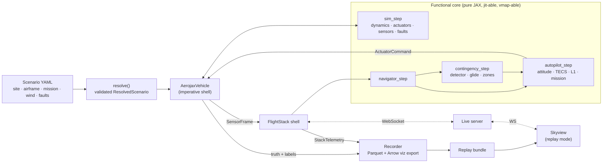

# M1 Technical Specification: Vertical Slice

*Status: draft for approval · 14 Oct 2026 · Parent plan: [03 — AeroAdapt-UAV](03_uav_architecture_and_six_month_roadmap.md)*

**Decisions already made**
- **Autopilot path: ArduPilot.** This affects conventions, the stock baseline and parameter naming.
- **About 30 hours per week.** M1 is 4 weeks, roughly 120 hours.
- **UK site.**

**Goal of M1.** A fixed-wing UAV flies a mission over real UK terrain in the browser. You can inject a motor cut, a pitot blockage or a servo jam, and watch two things side by side:
- the *stock* (ArduPlane-equivalent) logic, which does not handle the fault well;
- a *classical contingency* that glides to a pre-surveyed safe zone.

All of it runs on a simulator whose correctness is proven by a published validation report.

**Out of scope for M1** (later milestones):
- the procedural airframe fleet;
- RL and any other learned component;
- EKF, Sentinel and the Self-model;
- geodata-derived landing sites and the ground-risk model;
- terrain-aware ground (M1 assumes flat ground at the site elevation);
- ArduPilot SITL;
- GPU training.

---

## 0. Key finding that changes the plan

Doc 03 said M1 would be "validated against `mavsim_public`". **That is not possible.**

- The repository is the public *student template* for Beard & McLain's course, licensed GPL-3.0.
- Its `mav_dynamics_control.py` contains placeholders: `_forces_moments` returns zeros, and `_motor_thrust_torque` returns zero thrust and torque.
- It is still useful as the **source of the Aerosonde parameter values**. Those are numerical facts from the textbook; we cite them and do not vendor any code.

**Replacement validation strategy.** Three independent lines of evidence (§12):

1. **N-version check.** A deliberately simple NumPy float64 reference implementation, transcribed equation-by-equation from the book, must agree with the JAX simulator to machine precision.
2. **Physics checks.** Invariants (angular momentum, energy, free fall), analytic transfer-function approximations from B&M chapter 5, and integrator convergence order.
3. **Independent simulator.** The Aerosonde is re-expressed as a JSBSim model and compared in power-off glide. JSBSim has its own equations of motion, integrator and atmosphere.

Doc 03 has been corrected accordingly.

---

## 1. Deliverables and Definition of Done

M1 is **done** when all of the following hold.

| # | Criterion | Evidence |
|---|---|---|
| D1 | CI is green on `main`: lint, type checks, unit tests and the fast validation tier. The nightly full validation tier is also green. | GitHub Actions badges |
| D2 | A validation report is published containing the N-version parity results, physical invariants, transfer-function cross-checks, Dryden statistics, sensor and fault golden tests, and the autopilot acceptance criteria. | `docs/validation/m1_report.md` + figures |
| D3 | The stock autopilot meets every V11 criterion on the Aerosonde, in calm air and in light turbulence. | V11 test output + report section |
| D4 | Three faults (four variants) can be injected from scenario YAML. Ground-truth fault labels are present in every recording. | V10 tests; sample replay |
| D5 | The classical contingency meets V12. A 50-scenario motor-cut mini-campaign is reported as a table plus a map. | Campaign output + report section |
| D6 | **Skyview** plays any replay over the UK site on Google Photorealistic 3D Tiles, with a fallback in CI. Requirements: ≥50 Hz telemetry; 60 fps target and 30 fps floor on an M-series laptop; a head-up display showing **indicated vs true airspeed**; event log; timeline. | Screen recording; Playwright smoke test |
| D7 | Demo video, 60–90 s: **(a)** motor cut, stock vs classical contingency side by side or as a ghost aircraft; **(b)** pitot blockage with a blocked drain hole, where the stock speed/height controller (TECS) chases an airspeed reading that is wrong. (b) is the teaser for M4. | Video file + post |
| D8 | ADR-001 to ADR-006 are merged. | `docs/adr/` |

**Priority labels** used in the rest of this spec:

| Label | Meaning |
|---|---|
| **Must** | Needed for the Definition of Done |
| **Should** | Planned for M1; moves to M2 week 1 if the schedule slips |
| **Could** | Only if there is time left |

---

## 2. Repository layout

```
aero-adapt/
├── README.md
├── LICENSE                         # Apache-2.0 (proposed, see §2.2)
├── pyproject.toml / uv.lock        # single Python package `aeroadapt`, managed by uv
├── .python-version                 # 3.12
├── .pre-commit-config.yaml         # ruff, pyright, import-linter, end-of-file, large-file guard
├── .importlinter                   # privileged-information boundary contracts (ADR-006)
├── Makefile                        # make setup | test | validate | report | demo | web | bench
├── configs/
│   ├── airframes/aerosonde_bm.yaml
│   ├── sites/uk_dev_site.yaml
│   ├── scenarios/m1/*.yaml         # golden flights + mini-campaign template
│   └── run/                        # Hydra run compositions (vehicle × stack × logging)
├── src/aeroadapt/
│   ├── core/          # frames.py, quaternion.py, geodesy.py, units.py, types.py, timebase.py
│   ├── sim/aerojax/   # state.py, rigid_body.py, aero.py, propulsion.py, battery.py, actuators.py,
│   │                  # atmosphere.py, turbulence.py, sensors.py, ground.py, integrators.py,
│   │                  # model.py (sim_step), rollout.py (lax.scan / vmap)
│   ├── airframes/     # schema.py (pydantic), loader.py, derived.py, trim.py, linearise.py
│   ├── faultlab/      # schema.py, slots.py, sensor_faults.py, actuator_faults.py,
│   │                  # propulsion_faults.py, triggers.py, labels.py
│   ├── vehicle/       # protocol.py, aerojax_vehicle.py   (M2+: jsbsim_vehicle.py, ardupilot_sitl.py)
│   ├── stack/
│   │   ├── navigator/     # attitude_cf.py, posvel.py, airdata.py, wind.py, airspeed_health.py
│   │   ├── autopilot/     # attitude.py, yaw.py, tecs.py, l1.py, mission.py, modes.py, params.py
│   │   └── contingency/   # motor_fail_detector.py, glide.py, reachability.py, zone_select.py, approach.py
│   ├── scenarios/     # schema.py, resolve.py, runner.py, campaign.py
│   ├── telemetry/     # schema.py, recorder.py, replay.py, viz_export.py
│   ├── server/        # live.py (WebSocket), protocol.py
│   └── cli.py         # aeroadapt run | campaign | validate | report | serve | export-viz | bench
├── reference/bm_numpy/   # independent NumPy reference implementation (test-only, never imported by src/)
├── tests/
│   ├── unit/
│   ├── validation/       # V1–V15
│   └── regression/       # golden flights with metric tolerances
├── validation/report.py  # builds docs/validation/m1_report.md + figures
├── tools/                # make_gltf.py, tile_survey.md, bench.py, jsbsim/aerosonde_bm.xml
├── web/skyview/          # Vite + React + TypeScript + CesiumJS
├── docs/                 # 01–04, adr/, validation/
├── ardupilot/            # (M6+) Lua scripts, kept separate under GPL-3.0
└── .github/workflows/    # ci.yml (every push), nightly.yml (full validation + benchmarks)
```

### 2.1 Tooling

Pin exact versions in the lockfiles on day 1.

| Area | Choice |
|---|---|
| Python | 3.12; uv for environments and lockfile |
| Simulation / ML | JAX (CPU on the Mac); NumPy 2.x; SciPy |
| Config and schemas | pydantic v2 (scenario and airframe schemas, with JSON Schema exported for the web app); hydra-core (run composition) |
| Data and telemetry | pyarrow (Parquet / Arrow IPC); msgpack |
| Live server | websockets (or FastAPI + uvicorn) |
| Reports | matplotlib |
| Testing | pytest, hypothesis, pytest-benchmark; pymap3d (geodesy oracle, tests only); `jsbsim` from pip (cross-check, should-have) |
| Code quality | ruff, pyright (strict on `core/`, `sim/`, `stack/`), import-linter |
| Web | Node 22 LTS, pnpm, Vite, React, TypeScript, CesiumJS, apache-arrow, msgpackr, zustand; vitest + Playwright |

### 2.2 Licensing (ADR-006)

- **Proposed project licence:** Apache-2.0.
- **GPL material stays outside the package:**
  - `mavsim_public` is **not vendored**; only its parameter values are used, with citation.
  - ArduPilot-side Lua scripts (M6+) live in `ardupilot/` under GPL-3.0 with their own licence file.
  - ArduPilot SITL is used as an external process over MAVLink.
- *This is not legal advice. Re-check before any commercial use.*

---

## 3. Conventions (ADR-001)

Most simulator bugs are sign-convention bugs. Every item below has a test.

| Item | Convention |
|---|---|
| Units | SI internally. Angles in **radians** internally. Degrees appear only in YAML and UI fields with a `_deg` suffix. Field names carry units where ambiguous: `alt_agl_m`, `airspeed_mps`. |
| Time | `time_us`: integer microseconds since scenario start (MAVLink-style). Physics uses float seconds. |
| World frame | **NED** local tangent plane at the site origin. Flat-earth dynamics are valid within a 10 km radius; the curvature error at 5 km is about 2 m and is documented. |
| Geodetic | WGS84. The site origin is stored as an **ellipsoidal height** (`h_ellipsoid_m`). Conversion to and from lat/lon/height goes through exact ECEF, tested against pymap3d to ≤1 mm within 20 km. |
| Heights | The sim uses AGL above flat ground at the origin's ellipsoidal height. **UK gotcha:** the geoid sits roughly 50 m above the WGS84 ellipsoid in the UK. Google 3D Tiles use ellipsoidal heights, so mixing in MSL (above mean sea level) heights would bury or float the aircraft. **The site config stores the ground's ellipsoidal height**, sampled once from the tiles (§11). |
| Body frame | **FRD** (forward, right, down). |
| Attitude | Unit quaternion, **scalar-first** `[e0, e1, e2, e3]`, rotating body → NED (Beard & McLain convention). Euler angles are ZYX (ψ, θ, φ) for display and controllers only. Renormalise after every integrator step. |
| Wind | `wind_ned_mps` is the air-mass velocity (the direction the wind blows *towards*). UI and YAML use aviation "from" direction plus speed, converted at the boundary. |
| Actuator commands | Normalised channels named after **ArduPilot servo functions**, with *aircraft-response* sign semantics: `aileron` +1 = roll right; `elevator` +1 = nose up; `rudder` +1 = nose right; `throttle` ∈ [0, 1]. A per-airframe `ServoMap` converts these to physical deflections in **Beard & McLain sign conventions** (e.g. δe > 0 is trailing edge down, so C_m,δe < 0 and nose up needs δe < 0). `reversed` flags mirror ArduPilot's `SERVOn_REVERSED`. |
| Surfaces (M2+) | Elevon and V-tail mixing happen in the ServoMap, as ArduPilot does. M1 uses four channels. |
| Randomness | Explicit JAX PRNG keys only. Same seed ⇒ bitwise-identical replay on the same machine (V13). |

---

## 4. Architecture for M1



### ADR-002: functional core, imperative shell

- **Fast path is pure JAX.** Everything at ≥10 Hz is written as pure functions `f(params, state, inputs, key) -> (state, outputs)`: the simulator step, navigator, autopilot and contingency v0. No Python control flow on traced values; mode logic uses `lax.switch` / `jnp.where`.
  - In M1, these functions are **called host-side**, one step at a time, through thin shells.
  - In M2, the *same functions* run batched inside `lax.scan` / `vmap`, so baselines can be evaluated over thousands of scenarios on a GPU.
  - In M3, they serve as the base for residual RL on INDI.
- **Slow path may be plain Python.** Logic at ≤1 Hz (the future Captain and Pathfinder, geodata, I/O) can be ordinary Python.

### ADR-006: privileged-information boundary

- `aeroadapt.stack` must not import `aeroadapt.sim`, `aeroadapt.faultlab` or anything that exposes truth. This is enforced by an **import-linter contract** in CI.
- The stack receives a `Vehicle` view with no `truth()` method.
- Only the recorder, evaluator and (later) oracle receive the `PrivilegedVehicle` view.

---

## 5. Interfaces (normative field lists; implementation is free)

### 5.1 Messages

```python
TimeUs = int  # µs since scenario start

@dataclass(frozen=True)
class ImuSample:      time_us: TimeUs; gyro_rps: Vec3; accel_mps2: Vec3; fresh: bool   # body FRD; specific force
@dataclass(frozen=True)
class BaroSample:     time_us: TimeUs; pressure_pa: float; temperature_k: float; fresh: bool
@dataclass(frozen=True)
class AirspeedSample: time_us: TimeUs; diff_pressure_pa: float; temperature_k: float; fresh: bool  # raw; IAS derived by navigator
@dataclass(frozen=True)
class GnssSample:     time_us: TimeUs        # time of VALIDITY (latency already applied)
                      lat_deg: float; lon_deg: float; alt_ellipsoid_m: float
                      vel_ned_mps: Vec3; fix_type: int; num_sats: int; h_acc_m: float; v_acc_m: float; fresh: bool
@dataclass(frozen=True)
class MagSample:      time_us: TimeUs; field_body_gauss: Vec3; fresh: bool
@dataclass(frozen=True)
class BatterySample:  time_us: TimeUs; voltage_v: float; current_a: float; consumed_mah: float; fresh: bool
@dataclass(frozen=True)
class EscSample:      time_us: TimeUs; rpm: float; fresh: bool     # ArduPilot ESC telemetry (DShot/BLHeli-class)

@dataclass(frozen=True)
class SensorFrame:
    time_us: TimeUs
    imu: ImuSample; baro: BaroSample; airspeed: AirspeedSample; gnss: GnssSample
    mag: MagSample; battery: BatterySample; esc: EscSample

@dataclass(frozen=True)
class ActuatorCommand:
    time_us: TimeUs
    aileron: float; elevator: float; rudder: float   # [-1, 1], aircraft-response signs (ADR-001)
    throttle: float                                  # [0, 1]
```

### 5.2 Vehicle

```python
class Vehicle(Protocol):
    info: VehicleInfo            # control_rate_hz, sensor suite + rates, airframe id/hash, servo map
    def reset(self, scenario: ResolvedScenario, seed: int) -> SensorFrame: ...
    def step(self, cmd: ActuatorCommand) -> StepResult: ...   # advances exactly ONE control period
    def close(self) -> None: ...

class PrivilegedVehicle(Vehicle, Protocol):                    # recorder / evaluator / oracle only
    def truth(self) -> TruthState: ...
    def fault_labels(self) -> FaultLabels: ...                 # per-tick ground truth (Sentinel training data later)

@dataclass(frozen=True)
class StepResult:
    sensors: SensorFrame
    terminated: bool
    termination: Termination     # NONE | GROUND_CONTACT | OUT_OF_BOUNDS | NUMERICAL | TIME_LIMIT
    impact: ImpactRecord | None

@dataclass(frozen=True)
class TruthState:
    time_us: TimeUs
    pos_ned_m: Vec3; vel_ned_mps: Vec3; quat_bn: Vec4; omega_body_rps: Vec3
    airspeed_tas_mps: float; alpha_rad: float; beta_rad: float; wind_ned_mps: Vec3
    surface_actual_rad: Vec3; throttle_actual: float; prop_omega_rps: float
    battery_soc: float; forces_body_n: Vec3; moments_body_nm: Vec3
    model_validity_ok: bool      # False if |alpha|>30° or |beta|>20°: logged, not terminal

@dataclass(frozen=True)
class ImpactRecord:
    time_us: TimeUs; pos_ned_m: Vec3; lat_deg: float; lon_deg: float
    vel_ned_mps: Vec3; sink_rate_mps: float; groundspeed_mps: float
    roll_rad: float; pitch_rad: float; kinetic_energy_j: float
    heading_vs_wind_rad: float; zone_id: str | None
    touchdown_class: str         # "controlled" | "hard" | "crash" (provisional thresholds, §6.6)
```

### 5.3 Flight stack

```python
class FlightStack(Protocol):
    def reset(self, info: VehicleInfo, mission: Mission, site: Site, params: StackParams) -> None: ...
    def step(self, sensors: SensorFrame) -> tuple[ActuatorCommand, StackTelemetry]: ...

@dataclass(frozen=True)
class StackTelemetry:
    est: Estimate                # attitude, pos/vel NED, alt_agl, IAS, TAS, wind_ned, airspeed_healthy
    mode: Mode                   # AUTO | LOITER | RTL | GLIDE | APPROACH | FLARE | TERMINATED
    demands: Demands             # roll/pitch/yaw-rate demands, TECS alt/speed demands, L1 lateral accel
    contingency: ContingencyTelemetry  # detector states, reachability table, selected zone, reasons
    events: tuple[Event, ...]    # mode changes, detections, zone selections (→ decision ledger later)
```

### 5.4 JAX core signatures

```python
def sim_step(p: AirframeParams, env: EnvParams, s: SimState, u: CmdArray,
             f: FaultState, key: PRNGKey) -> tuple[SimState, SensorArrays, StepInfo]: ...
def rollout(p, env, s0, policy, f, key, n_steps) -> Trajectory          # lax.scan
batched_rollout = jax.vmap(rollout, in_axes=(0, 0, 0, None, 0, 0, None))  # used for benchmarks in M1

def navigator_step(np_: NavParams, ns: NavState, z: SensorArrays) -> tuple[NavState, EstimateArr]: ...
def autopilot_step(ap: APParams, as_: APState, est: EstimateArr, mission: MissionArr,
                   cmode: ContingencyOut) -> tuple[APState, CmdArray, DemandsArr]: ...
def contingency_step(cp: CParams, cs: CState, est: EstimateArr, zones: ZonesArr,
                     esc: EscArr) -> tuple[CState, ContingencyOut]: ...
```

`ZonesArr` is padded to a fixed maximum of 16 zones with a validity mask, so the call stays jit-able.

---

## 6. aerojax-UAV v0: model specification

### 6.1 State

| Group | Contents |
|---|---|
| Rigid body | `pos_ned` (3), body velocity `u, v, w` (3), quaternion (4), body rates `p, q, r` (3) |
| Actuators | Actual deflections δa, δe, δr; actual throttle; delay ring buffers at physics rate |
| Energy | Battery state of charge; last current (resolves the motor–battery algebraic loop with a one-step lag) |
| Atmosphere | Dryden filter states (u, v, w gust channels) |
| Sensors | Gyro and accelerometer bias random walks; barometer drift; GNSS Gauss–Markov errors and latency buffer; pitot internal state (trapped pressure, drain decay) |

### 6.2 Equations

- **6-DoF kinematics and dynamics:** Beard & McLain chapter 3, quaternion form. The quaternion is renormalised after each step.
- **Forces and moments:** chapter 4.
  - Gravity.
  - Lift and drag: nonlinear C_L(α) with sigmoid stall blending (M, α0), and the B&M drag model C_D(α) = C_D,p + (C_L0 + C_Lα·α)² / (π e AR). Both are rotated from stability axes to body axes.
  - Lateral: linear in β, p, r, δa and δr.
  - Air-relative velocity: `v_air = v_body − R_bn·wind_ned − gust_body`, which gives V_a, α and β.
- **Propulsion:** the B&M propeller and motor model.
  - Propeller speed Ω is the positive root of the quadratic in Ω derived from the motor model (K_V, K_Q, R, i0) and the C_Q(J) polynomial.
  - Thrust and torque follow from C_T(J) and C_Q(J), with advance ratio J = 2πV_a / (ΩD).
  - Input voltage: `V_in = throttle_actual · V_batt` (§6.4).
  - **Motor-cut fault:** the motor model is *not* evaluated at V_in = 0 (it is outside its validity). The fault branch applies a windmilling drag instead: `D_wm = ½ρV_a²·A_disc·C_wm`, with torque = 0 and rpm decaying with τ = 0.3 s. **C_wm defaults to 0.02 and is flagged for calibration.** For a folding propeller, C_wm = 0.
- **Integrator:** fixed-step RK4. **Physics runs at 200 Hz (dt = 5 ms); control runs at 100 Hz (2 physics substeps).** The default dt is confirmed by V6.

### 6.3 Actuators

For each surface channel, the pipeline is:

> command → ServoMap (trim, max deflection, reversal) → **transport delay** (ring buffer) → **rate limit** → **first-order lag τ** → deadband → actual deflection

| Parameter | M1 default (randomised from M2) |
|---|---|
| Max deflection | ±25° (aileron, elevator, rudder) |
| Rate limit | 300 °/s |
| Lag τ | 20 ms |
| Transport delay | **20 ms** (randomised 10–60 ms from M2, following the NTNU sim-to-real lesson) |
| Deadband | 0.2° |
| Throttle / ESC | τ = 50 ms; delay 10 ms |

### 6.4 Battery (v0)

- **Pack voltage:** `V_batt = n_cells · OCV(SOC) − I · R_int`, where OCV is a piecewise-linear Li-ion curve and I is the previous step's current (one-step lag).
- **State of charge:** SOC is integrated from current.
- **Validation mode:** `ideal_battery: true` makes V_batt = V_max, which is exactly B&M behaviour. This mode is used for N-version parity.

### 6.5 Atmosphere

- **ISA troposphere** (temperature, pressure, density as functions of altitude). The site sets the temperature and pressure offsets.
- **Steady wind:** a NED vector, with an optional power-law boundary-layer profile below 50 m AGL. Disabled in M1 tests.
- **Dryden turbulence** using the MIL-HDBK-1797 *low-altitude* model, appropriate below about 300 m AGL:

  | Quantity | Formula |
  |---|---|
  | Vertical intensity | σ_w = 0.1·W20 |
  | Horizontal intensity | σ_u = σ_v = σ_w / (0.177 + 0.000823 h)^0.4 |
  | Vertical length scale | L_w = h |
  | Horizontal length scale | L_u = L_v = h / (0.177 + 0.000823 h)^1.2 |

  - h is in feet and clamped to ≥10 ft.
  - Intensity presets set W20 to 15 kt (light), 30 kt (moderate) or 45 kt (severe).
  - The shaping filters are discretised exactly and driven at the current airspeed (frozen-turbulence assumption).
  - Beard & McLain's low-altitude table is used as a secondary sanity check (V8).

### 6.6 Ground and termination (M1)

- **Ground:** flat, at AGL = 0.
- **Ground contact:** fires when the CG height AGL is ≤ `contact_height_m` (0.15 m by default). It produces an `ImpactRecord` and freezes the state.
- **Touchdown classes** (provisional; replaced in M5 by kinetic-energy and ground-risk metrics aligned with SORA, the EU/JARUS drone risk-assessment method):

  | Class | Sink rate | Roll | Pitch |
  |---|---|---|---|
  | Controlled | ≤ 1.5 m/s | \|φ\| ≤ 10° | −5° ≤ θ ≤ 15° |
  | Hard | ≤ 3 m/s | \|φ\| ≤ 25° | — |
  | Crash | anything else | | |

- **Other terminations:**
  - Out of bounds: more than 8 km from the origin.
  - Numerical: a NaN or Inf guard.
  - Time limit.

### 6.7 Sensors (M1 defaults)

These are initial values, to be re-fitted to Pixhawk-class datasheets and real logs in M2.

| Sensor | Rate | Model | Default |
|---|---|---|---|
| Gyro | 100 Hz | ω + b_g + n | n: 0.005 rad/s (1σ per sample); bias random walk 1e-4 rad/s/√s |
| Accelerometer | 100 Hz | specific force + b_a + n | n: 0.05 m/s²; bias random walk 1e-3 m/s²/√s |
| Barometer | 20 Hz | ISA pressure at true altitude + drift + n | n: 3 Pa (≈0.25 m); drift 0.5 Pa/min random walk |
| Airspeed (pitot) | 20 Hz | Δp = ½ρu_r² (axial component) + n; pitot fault model (§8) | n: 1.5 Pa |
| GNSS | 5 Hz | position + Gauss–Markov error; velocity + n; **latency 120 ms** | horizontal 1σ 1.0 m (τ = 300 s); vertical 1σ 2.0 m; velocity 0.1 m/s |
| Magnetometer | 50 Hz | Earth field at the site, from **WMM2025**, rotated to body + n | n: 0.005 gauss |
| Battery | 10 Hz | V, I, consumed mAh | 0.05 V, 0.2 A |
| ESC telemetry | 10 Hz | rpm = Ω·60/2π + n | 1% |

Multi-rate behaviour: each sample carries its own `fresh` flag, and stale samples repeat the last value.

### 6.8 Performance targets (provisional; recorded, not gated, in M1)

- **Host-stepped closed loop** (simulator + stack, one scenario): real-time factor **≥ 20× per core**. This means a 50-scenario campaign of 10-minute flights finishes in under 30 minutes on the laptop.
- **Batched open-loop JAX on the laptop CPU** (1 / 64 / 1,024 environments): throughput recorded. The ≥1M steps/s GPU target belongs to M2.
- **JIT compile time:** recorded, so that recompilation regressions show up.

---

## 7. Airframe definition: `aerosonde_bm.yaml`

The pydantic schema has these sections:
- `provenance`: source, citation, repository commit, notes;
- `mass_inertia`;
- `geometry`;
- `aero.longitudinal`, `aero.lateral`, `aero.stall`;
- `propulsion` (prop, motor, battery);
- `actuators` (per channel);
- `sensors`;
- `servo_map`;
- `derived`, which is computed and never authored.

**Values from the textbook model** (via `mavsim_public` `aerosonde_parameters.py`, cited):

| Group | Values |
|---|---|
| Mass and inertia | m = 11 kg; J_x = 0.8244, J_y = 1.135, J_z = 1.759, J_xz = 0.1204 kg·m² |
| Geometry | S = 0.55 m²; b = 2.8956 m; c = 0.18994 m; e = 0.9 |
| Lift | C_L0 = 0.23, C_Lα = 5.61 |
| Pitching moment | C_mα = −2.74, C_mq = −38.21, C_mδe = −0.99 |
| Stall blending | M = 50, α0 = 0.47 rad |
| Propeller | D = 0.508 m; C_T and C_Q quadratic fits |
| Motor | K_V = 145 rpm/V; R = 0.042 Ω; i0 = 1.5 A |
| Battery | 12 cells at 3.7 V, so V_max = 44.4 V |

The remaining aerodynamic coefficients are taken verbatim from the cited file.

**Additions that are ours** (not in the textbook): actuator dynamics and limits, battery capacity and internal resistance, the sensor suite and noise, the ServoMap, and the windmilling coefficient.

**Derived quantities** (computed and checked in tests):
- aspect ratio ≈ 15.2;
- (L/D)max ≈ 15.8;
- best-glide speed at sea level ≈ 15 m/s;
- trim at the 25 m/s reference airspeed.

**Known limitations, stated up front:**
- This is a *textbook* model. α0 = 0.47 rad (27°) gives an unrealistically late stall.
- The drag polar is idealised.
- The mavsim documentation itself mentions alternative Aerosonde coefficients (different mass and cruise speed) in its MATLAB project files.

The Aerosonde in M1 exists to prove the plumbing and the methodology. Realistic small-UAV aerodynamics arrive with the generator and the reference models in M2–M3.

---

## 8. faultlab v0

### 8.1 Design (ADR-003): fixed-shape fault slots

- Faults must be `jit`/`vmap`-compatible, so the next milestone can batch thousands of scenarios with *different* faults. Each fault type therefore owns a **fixed-shape slot** in a `FaultState` pytree, for example `active`, `variant`, `onset_t`, `ramp_s` and parameters.
- An inactive slot is an identity transform implemented with masks, with no Python branching.
- Triggers are resolved to onset times at `reset()`. M1 supports only `at_time_s`; condition-based triggers arrive in M2.
- **Injection points:**

  | Fault kind | Applied in |
  |---|---|
  | Sensor | The sensor model's *output* |
  | Actuator | The actuator pipeline (after the delay, before the lag) |
  | Propulsion | The propulsion model |
  | Aerodynamic (M2) | The aero model |
  | Environment | The atmosphere |

- **Labels:** every physics step emits a `FaultLabels` record (active faults, onset time, variant and severity). This makes every recording usable as Sentinel training data later.

### 8.2 M1 faults

| Fault | Variants and model | Golden-test expectation |
|---|---|---|
| **`pitot_blockage`** | **`drain_open`**: the total-pressure port is blocked and the drain is clear, so measured Δp decays to 0 with τ = 3 s (IAS reads near zero). **`drain_blocked`**: total pressure p_t is trapped at its onset value, so Δp_meas = p_t,trapped − p_static(h). This is the classic "airspeed behaves like an altimeter" failure: indicated speed *rises* in a climb and *falls* in a descent. Optional `ramp_s` blends from healthy to blocked. | Drain open: decay τ within ±5%. Drain blocked: the sign and magnitude of the IAS change during a 50 m climb match the analytic ISA pressure difference within 1%. |
| **`servo_jam`** | The target channel's actual deflection is held at `jam_position_deg` (default: the deflection at onset) whatever the command. Rate limit and lag still apply to the transition into the jam. | Holds within the deadband for any command sequence. |
| **`motor_cut`** | Models an ESC desync or cut: thrust follows the windmill model from §6.2, torque is 0, rpm decays with τ = 0.3 s, and battery current drops to the avionics baseline (1 A). | Thrust ≤ 0 within one physics step; ESC rpm below 5% of its pre-fault value within 1.5 s. |

---

## 9. Flight stack v0

### 9.1 Navigator v0: a deliberately "DCM-class" estimator

The stack never sees truth. Its estimator is realistic enough that faults propagate the way they would on real hardware.

- **Attitude:** a Mahony-style complementary filter.
  - It integrates the gyro and corrects with the accelerometer's gravity reference, after **centripetal compensation** (ω × v, using TAS, or GNSS velocity if airspeed is unhealthy).
  - Yaw is corrected from the magnetometer, and from GNSS course when groundspeed exceeds 5 m/s, as ArduPilot's DCM does.
  - Gains are configurable.
- **Position, velocity and altitude:** complementary filters.
  - Horizontal: GNSS (with its latency) plus accelerometer propagation in NED.
  - Altitude: barometer, blended slowly with GNSS altitude.
  - Height AGL = estimated altitude − site ground height.
- **Air data:**
  - IAS = √(2Δp/ρ0).
  - TAS = IAS·√(ρ0/ρ), with ρ taken from baro-derived ISA.
- **Wind:** `w = v_ground − TAS·(x_body in NED)`, ignoring sideslip, low-pass filtered with τ = 10 s. This is a simplified version of ArduPilot's DCM wind estimate.
- **Airspeed health (stock-equivalent):** flag the sensor unhealthy when |TAS − |v_g − w|| exceeds 5 m/s for more than 5 s. When unhealthy, TECS uses a synthetic airspeed |v_g − w|.
  - This *approximates* ArduPlane's airspeed failure handling, which uses the `ARSPD_OPTIONS` mismatch checks.
  - It can be toggled, and it will be checked against real ArduPlane SITL in M6.
- **Oracle mode:** `estimator: truth` is available for debugging and for the future oracle only. It is unavailable to the stack in evaluation runs; the runner enforces this.

### 9.2 Stock autopilot v0: ArduPlane-equivalent structure

Parameter names mirror ArduPlane where an equivalent exists, so that M6 can import ArduPlane SITL tunings.

| Loop | Design | Main parameters (ArduPlane analogue) |
|---|---|---|
| **Lateral guidance** | L1 nonlinear guidance (Park, Deyst & How, 2004; ArduPilot `AP_L1_Control`). L1 = (1/π)·damping·period·groundspeed; a_lat = 2V²/L1·sin η; roll demand = atan(a_lat/g), clipped. Waypoint switching at the acceptance radius or the bisector. Loiter capture. | `NAVL1_PERIOD`, `NAVL1_DAMPING`, `WP_RADIUS`, `LIM_ROLL_CD` |
| **Energy** | TECS (Lambregts; ArduPilot `AP_TECS`): specific energy-rate error → throttle (with feed-forward); energy-balance rate error → pitch demand. Includes speed weighting, **underspeed protection**, climb and sink limits, and an airspeed-less mode using synthetic airspeed. | `TECS_TIME_CONST`, `TECS_SPDWEIGHT`, `TECS_CLMB_MAX`, `TECS_SINK_MIN/MAX` |
| **Roll** | Angle error → rate demand (time constant), then rate PID + feed-forward → aileron, with an ArduPilot-style **speed scaler** (cruise/airspeed, clipped) | `RLL2SRV_TCONST`, roll rate-loop gains |
| **Pitch** | Same structure plus turn compensation (pitch-up in a bank) | `PTCH2SRV_TCONST`, pitch rate-loop gains |
| **Yaw** | Yaw damper (washed-out r) plus lateral-acceleration coordination → rudder | Yaw damper gain |
| **Mission / modes** | AUTO (waypoint list, AGL altitudes), LOITER, RTL (loiter at home), TERMINATED | — |
| **Stock failsafes** | Low battery → RTL. **No motor-failure detection** (true to stock ArduPlane without custom logic): after a motor cut, TECS underspeed protection trades height for speed and the aircraft glides *along its mission path* until it hits the ground. Airspeed fault: the health check above. | — |

**Tuning procedure.**
1. Linearise at trim with `jax.jacfwd`.
2. Design initial gains by successive loop closure, following Beard & McLain chapter 6.
3. Run an automated step-response refinement against the V11 criteria using scipy.
4. Freeze the gains in the airframe config and record them in the report.

### 9.3 Classical contingency v0 (the seed of baseline B2)

1. **Motor-failure detector.**
   - *Primary:* ESC telemetry. Fires when rpm < 20% of the rpm expected for the current throttle and airspeed (from the motor-model lookup) for more than 0.5 s, while throttle > 0.3.
   - *Secondary:* energy-rate residual. Fires when the measured specific energy rate stays more than 1.0 m/s below the rate expected at the current throttle for more than 2 s. This covers airframes without ESC telemetry.
2. **On detection → GLIDE mode.**
   - Throttle 0.
   - TECS switches to gliding (pitch controls speed only), with target speed = V_bg + 0.5·headwind component, clipped (speed-to-fly rule of thumb). V_bg is derived from the airframe polar.
3. **Reachability, for each pre-surveyed safe zone *z*:**
   - Required height: `h_req = d_z / ((L/D)max · V_g(bearing)/V_a) + h_pattern + h_margin`, where V_g comes from the wind triangle for the heading that tracks the bearing.
   - Defaults: h_pattern = 30 m, h_margin = 10 m.
   - The zone is *reachable* if h_AGL ≥ h_req.
4. **Zone selection:** maximise `quality_z × margin_z` over reachable zones.
   - If none is reachable: turn into wind and land straight ahead (the standard "engine failure after take-off" technique).
   - The reason for each choice is logged as an event.
5. **Descent and approach.**
   - L1 to the zone. Loiter-descend over it while there is excess height.
   - Leave the loiter on the downwind side at h_final.
   - Final approach into wind, of length L_final = h_final · (L/D)_eff,into-wind.
   - Approach at 1.3·V_stall,est.
   - **Flare** at 3 m AGL: pitch to arrest sink while IAS ≥ 1.1·V_stall,est.

A geometric "reachability table" (zone, distance, h_req, margin, reachable) is published in `StackTelemetry`. The viewer colours zones with it, which is the seed of M5's reachability dome.

---

## 10. Scenarios, runner, recording

### 10.1 Scenario YAML

```yaml
schema_version: 1
id: m1-motorcut-001
site: uk_dev_site                 # → configs/sites/uk_dev_site.yaml
airframe: aerosonde_bm            # → configs/airframes/aerosonde_bm.yaml
seed: 1234
duration_s: 600
initial: {pos_ne_m: [0, 0], alt_agl_m: 120, heading_deg: 270, airspeed_mps: 25}
mission:
  type: waypoints
  alt_agl_m: 120
  waypoints_ne_m: [[800, 0], [800, 800], [0, 800], [0, 0]]
  on_complete: loop
environment:
  wind: {from_deg: 250, speed_mps: 6}
  turbulence: {model: dryden_low_alt, intensity: light}
faults:
  - {type: motor_cut, trigger: {at_time_s: 90}}
  - {type: pitot_blockage, variant: drain_blocked, trigger: {at_time_s: 200}, ramp_s: 5}
stack: {autopilot: stock, contingency: classical_v0, estimator: navigator}
```

```yaml
# configs/sites/uk_dev_site.yaml
id: uk_dev_site
name: "<chosen after tile survey>"
origin: {lat_deg: 0.0, lon_deg: 0.0, h_ellipsoid_m: 0.0}   # ground at origin, WGS84 ELLIPSOIDAL
ground_model: flat                                           # M5: dem
isa: {temp_offset_k: 0.0, qnh_hpa: 1013.25}
magnetic: {model: WMM2025, declination_deg: 0.0, inclination_deg: 0.0, field_gauss: 0.0}  # computed once
safe_zones:                                                  # max 16 (padded for jit)
  - {id: A, polygon_ne_m: [[...]], surface: grass, quality: 0.9, approach_from_deg: [250, 70]}
```

### 10.2 Runner and CLI

| Command | What it does |
|---|---|
| `aeroadapt run <scenario>` | One run → replay bundle |
| `aeroadapt campaign <template> --n 50 --vary fault.onset,initial.pos,wind` | Seeded variations, run in parallel processes → summary Parquet + map |
| `aeroadapt validate [--tier fast\|full]` | Runs V1–V15 |
| `aeroadapt report` | Builds `docs/validation/m1_report.md` |
| `aeroadapt serve` | Live WebSocket server |
| `aeroadapt export-viz <bundle>` | Exports the browser format |

### 10.3 Recording (ADR-005)

A **replay bundle** (a directory or `.zip`) contains:

| File | Contents |
|---|---|
| `manifest.json` | `schema_version`, fully resolved scenario, airframe hash, git commit, seed, rates, units, stack config |
| `frames.parquet` | One row per control tick: `time_us`, `truth.*`, `est.*`, `sensors.*`, `cmd.*`, `actual.*`, `mode`, `demands.*`, `labels.*` |
| `events.jsonl` | `time_us`, `type`, `payload` (fault onsets, detections, mode changes, zone selections, impact) |
| `viz.arrow` | Arrow IPC subset for the browser: 50 Hz, float32, about 25 columns; served with HTTP brotli/gzip |

Columnar Arrow means the browser reads typed arrays directly, with no JSON parsing. *Verify at setup* whether the Arrow JS build in use reads compressed IPC buffers; the default is uncompressed IPC with compression at the transport layer.

### 10.4 Live protocol (should-have)

WebSocket + msgpack, versioned.

| Direction | Messages |
|---|---|
| Server → client | `hello` (manifest), `frame` (viz subset at 50 Hz), `event` |
| Client → server | `cmd` with `inject_fault{spec}`, `set_speed{x}`, `pause`, `resume`, `reset{scenario_id}` |

The server runs the simulator and stack at a selectable 1×–4× real time and records a bundle for every live session.

---

## 11. Skyview v0 (web)

- **Stack:** Vite + React + TypeScript; CesiumJS used directly behind a thin React wrapper; zustand for state.
- **Imagery:** Google Photorealistic 3D Tiles via `createGooglePhotorealistic3DTileset`.
  - The key is a Map Tiles API key held in `VITE_GOOGLE_MAPS_API_KEY`, **restricted to HTTP referrers** so it is never an unrestricted key.
  - The required attribution is shown.
  - **Fallback** (CI, or no key): WGS84 ellipsoid or Cesium World Terrain plus imagery.
- **Aircraft model:** a glTF generated by `tools/make_gltf.py` (trimesh) from the airframe geometry, so the model matches the simulation. *Could:* separate nodes for the control surfaces, animated from `actual.*`.
- **Views:** chase (smoothed), orbit, top-down and free cameras.
- **Overlays:**
  - 60 s trail, coloured by mode;
  - mission path;
  - safe zones clamped to the ground and coloured by the live **reachability table** (green reachable, grey not, gold selected);
  - wind arrow.
- **Head-up display (SVG):**
  - attitude;
  - **airspeed tape showing indicated (sensor) and true (truth) together**: the first appearance of the "truth overlay";
  - AGL altitude tape, vertical speed, heading, throttle;
  - mode;
  - active faults with onset time;
  - touchdown card when the flight ends.
- **Panels:** event log; timeline scrubber; playback speed 0.25×–8×; layer toggles.
  - *Should:* fault-injection panel (live mode).
  - *Should:* **ghost** aircraft. Load two bundles of the same scenario seed and render the second translucent.
- **Data path:**
  - Replays come from `fetch(viz.arrow)`. Live data comes over a WebSocket.
  - Rendering interpolates between 50 Hz samples at display rate: linear for position, slerp for the quaternion.
  - Height: `h_ell = origin.h_ellipsoid_m + alt_agl_m`.
- **Frames:** NED/FRD → ENU → Cesium `Transforms.headingPitchRollQuaternion` is one tested function. A **visual calibration checklist** (heading 0/90/180/270°, pitch ±30°, roll ±45°, compared against the HUD) runs once and again whenever the model changes. Model forward-axis alignment is the usual gotcha.
- **Performance budgets:**

  | Item | Budget |
  |---|---|
  | Frame rate | 60 fps target, 30 fps floor (M-series laptop, 120 m AGL, tiles on) |
  | Loading a 10-minute replay | ≤ 2 s |
  | Tab memory | ≤ 1.5 GB |
- **Tests:**
  - vitest: frame conversions, interpolation, Arrow loader.
  - Playwright smoke test (tiles disabled): loads a replay, plays 5 s, checks that the HUD airspeed changes and that the console has no errors.

### 11.1 UK site selection (week 1, about 2 hours)

1. **Shortlist** the following candidates, or substitute your own:

   | Candidate | Character | Caveat |
   |---|---|---|
   | South Downs near Brighton/Lewes | Chalk ridges, fields, town edge, coastline. Dramatic, and the town has strong tile coverage. | — |
   | Cambridge fringe | Flat farmland, villages, A14/M11, power lines; excellent coverage | Airfields nearby, so check the airspace |
   | Bath/Bristol fringe | Valleys, Avon Gorge | — |
   | Peak District edge near Sheffield | Moorland, reservoirs | Rural 3D coverage uncertain |

2. **Tile survey.** For each candidate, screenshot at 120 m AGL from four headings. Score:
   - 3D tile fidelity;
   - variety of landing options;
   - ground-risk interest (town edge, roads, power lines);
   - visual drama.
3. **Airspace realism.** Using the CAA's current official drone airspace guidance, check that the site is outside aerodrome flight restriction zones and restricted areas, so that the demo depicts a flight that *could* legally happen.
4. **Strong recommendation.** If you know which model-flying club field you would use for the real flights in months 9–12, pick a site **around that field**. The simulated site then becomes the digital twin of the real test site, which makes a compelling narrative.
5. **Record the ground height.** Sample the 3D tiles at the origin with `sampleHeightMostDetailed` and store the result as `h_ellipsoid_m`.

**UK open data to use later (M5):**
- Environment Agency LIDAR composite DTM/DSM (England, Open Government Licence; Scotland and Wales have their own equivalents);
- OS OpenData (Open Roads, Open Zoomstack, Terrain 50);
- OSM for power lines and land use;
- ONS census or GHSL for population.

---

## 12. Validation and test plan

**Tiers:**
- **fast** runs on every push, in under 10 minutes on CI.
- **full** runs nightly and before tagging M1.

| ID | What | Method | Pass criterion | Tier | Priority |
|---|---|---|---|---|---|
| V1 | Frames and geodesy | Round-trips (Euler ↔ quaternion, NED ↔ ENU ↔ body); geodetic vs pymap3d; hypothesis property tests | ≤1e-12 round-trip; ≤1 mm within 20 km | fast | Must |
| V2 | Rigid-body invariants | Torque-free spin (aero and gravity off); gravity-only free fall; quaternion norm | \|H\| and rotational KE relative drift ≤1e-9 over 100 s (f64); free fall exact to 1e-9 m; quaternion norm error ≤1e-12 | fast | Must |
| V3 | **N-version parity** | `reference/bm_numpy` (scalar, unoptimised, book equation numbers in comments) vs `aerojax` | Forces and moments over 10,000 random (state, wind, control) tuples: relative error ≤1e-10. Propulsion Ω, T, Q: ≤1e-10. Open-loop trajectories over 60 s from 20 random inputs: ≤1e-8 (f64, ideal battery). | fast (1k tuples) / full | Must |
| V4 | Trim | Solve trims: level flight at 25 m/s, 5° climb, coordinated turn R = 250 m | Residual ‖ẋ‖ ≤1e-8. Matches the reference implementation's trims within 1e-6. Inputs within limits. | fast | Must |
| V5 | Transfer-function cross-check | Linearise with `jacfwd`; compare poles to B&M chapter 5 approximations: roll subsidence vs −a_φ1, short-period ω_n vs the B&M approximation, phugoid ω ≈ √2·g/V_a | Within 10% / 15% / 20% (these are approximations by construction) | fast | Should |
| V6 | Integrator convergence | RK4 at dt = 10 / 5 / 2.5 ms vs a 0.5 ms reference over a 30 s doublet | Log-log error slope 4 ± 0.5. Chosen dt gives pitch error ≤1e-3 rad. | full | Must |
| V7 | Precision | f32 vs f64 closed-loop 60 s flight | Report position and attitude divergence (expected ≤1 m and ≤0.5°). This fixes the training precision for M2. | full | Must |
| V8 | Dryden statistics | 20 seeds × 10 min at 50 m and 120 m AGL | σ within ±5%; empirical PSD within ±1.5 dB of analytic over the significant band; consistent with the B&M low-altitude table | full | Must |
| V9 | Sensors | Noise statistics; GNSS latency; pitot physics | Std within ±5%; GNSS `time_us` = t − latency exactly; drain-blocked IAS change within 1% of analytic | fast | Must |
| V10 | Faults | Golden tests from §8.2; label emission | As in §8.2; labels at exact onset tick | fast | Must |
| V11 | **Autopilot acceptance** (Aerosonde, 25 m/s) | Step and tracking tests in calm air and light Dryden | **Roll** 0→30°: 10–90% rise ≤1.0 s, overshoot ≤10%, steady-state error ≤1°. **Pitch** 0→5°: rise ≤0.8 s, overshoot ≤15%. **Altitude** +20 m: within ±2 m by 20 s, overshoot ≤3 m, airspeed deviation ≤2 m/s. **Airspeed** +5 m/s: within ±0.5 m/s by 15 s, altitude deviation ≤3 m. **L1** cross-track RMS ≤2 m calm, ≤5 m light turbulence; loiter radius RMS error ≤5 m. **Coordination**: \|β\| ≤3° in a 30° banked turn. **Light turbulence**: no limit cycles; servo saturation <5% of time. | fast (calm) / full | Must |
| V12 | **Contingency** | 100 motor-cut cases; 10 h of no-fault flight in light turbulence; 50-scenario mini-campaign | Detection latency ≤1.0 s (ESC) and ≤4 s (energy residual). **Zero false alarms** in 10 h. In the mini-campaign, ≥80% of cases judged reachable at detection end with a controlled or hard touchdown inside the selected zone. All failures are listed with cause. | full | Must |
| V13 | Determinism | Same seed twice; then across machines | Bitwise-identical bundle on the same machine; metrics within tolerance across machines | fast | Must |
| V14 | **JSBSim cross-check** | `tools/jsbsim/aerosonde_bm.xml` reproduces the B&M aero (density matched; β = 0). Compare power-off glide trim and elevator-doublet response. | Trim α within 0.1°, γ within 0.05°; pitch-response RMS difference ≤0.3° over 10 s | full | Should (else M2 week 1, which already builds the JSBSim adapter) |
| V15 | Throughput and real-time factor | `aeroadapt bench` | Recorded, not gated; real-time factor ≥20× per core is the target | full | Must (recording) |
| W1 | Web | vitest + Playwright smoke (§11) | Green | fast | Must |

**Honesty note on V3.** In a solo project, N-version independence is limited, because one person writes both implementations. To compensate:
- The reference implementation is written *first*, straight from the book.
- V2, V5, V8 and V14 supply checks that are genuinely independent of that author.

**Validation report contents** (`aeroadapt report`):
- provenance;
- parity tables;
- invariant plots;
- trim table;
- doublet overlays (aerojax / reference / JSBSim);
- modal table vs B&M approximations;
- convergence plot;
- f32 vs f64 comparison;
- Dryden PSD;
- autopilot step responses;
- detector latency histogram;
- mini-campaign map and table;
- throughput.

---

## 13. CI and developer workflow

- **`ci.yml`** (every push): ruff, pyright, import-linter, pytest (unit + validation fast tier + regression golden flights), web typecheck, vitest, build, Playwright smoke test. Python and pnpm caches.
- **`nightly.yml`:** full validation tier + benchmarks. Also regenerates the validation report as a CI artefact.
- **Golden flights:** 4 canonical scenarios:
  1. nominal mission;
  2. motor cut + classical contingency;
  3. pitot drain-blocked with the stock stack;
  4. servo jam.

  Their metrics are stored and gated with tolerances. A change that worsens them must update the goldens explicitly, with a justification.
- **Pre-commit hooks** mirror CI. `make demo` regenerates the D7 replays from seeds.

---

## 14. Four-week work plan (about 30 h/week)

| Week | Work (hours) | Exit criterion |
|---|---|---|
| **1 · Foundations and core dynamics** | Repo, uv, CI skeleton, import-linter, Makefile (4) · ADR-001 to 004 (4) · `core/` frames, quaternion, geodesy + V1 (5) · **Cesium spike**: a static aircraft at a candidate site with correct height and heading, plus the tile survey (3) · `reference/bm_numpy` (6) · aerojax rigid body, gravity, aero, propulsion (ideal battery), RK4 (6) · V2 and V3 (2) | **aerojax ≡ reference (V3)**; invariants green; UK dev site chosen |
| **2 · Complete simulator** | Actuators and battery v0 (4) · ISA, wind, Dryden + V8 (5) · Sensors + V9 (6) · faultlab slots + 3 faults + labels + V10 (6) · Trim + `jacfwd` linearisation + V4/V5 (5) · Batched rollout + benchmark (V15) (2) · Airframe YAML + derived quantities (2) | Full simulator with faults; V1–V10 green |
| **3 · Flight stack** | `Vehicle` protocol + `AerojaxVehicle` + privileged boundary (3) · Navigator v0 + tests (6) · Stock autopilot: attitude, yaw, TECS, L1, mission/modes (10) · Tuning + V11 (4) · Classical contingency v0 (7) | Stock flies the mission within V11; contingency lands in-zone on hand-made cases |
| **4 · Scenarios, Skyview, proof** | Scenario schema, runner, recorder, campaign + mini-campaign (5) · **Skyview v0** (14) · V6, V7, V12, V13 + validation report (4) · *Should:* live server + fault panel (3) / ghost aircraft (1) / V14 JSBSim (3) · Demo video + write-up (3) | **Definition of Done (§1)** |

**If behind**, slip in this order:
1. V14 → M2 week 1.
2. Live server → M2.
3. Ghost aircraft → M2.
4. V5 → M2.

Never cut V3, V11, V12, the recorder or the replay viewer.

---

## 15. M1 risks

| Risk | Mitigation |
|---|---|
| Sign-convention bugs | ADR-001; V1–V4; visual calibration checklist; reference implementation written first |
| JAX pitfalls (recompilation, Python control flow under `jit`) | Functional-core design; fixed-shape slots; a test that fails on unexpected recompiles; benchmark from week 2 |
| Cesium height and axis gotchas (ellipsoid vs geoid, model forward axis) | Week-1 spike; one tested conversion function; ground height sampled and stored in the site config |
| Autopilot tuning becomes a time sink | Initial design from the linearised model; acceptance criteria fixed up front (V11); automated refinement |
| Textbook Aerosonde realism (late stall, ideal polar) | Accepted and documented for M1; realistic models arrive in M2–M3 |
| Scope creep into M2 | Must/Should/Could labels; anything not listed is out of scope |

---

## 16. Open questions (non-blocking)

1. **Licence:** is Apache-2.0 acceptable?
2. **Visibility:** public repo from day 1 (build in public), or private until the M1 demo?
3. **Club field:** do you already know which club field you would fly from? It would decide the site (§11.1).
4. **3D tiles access:** a Google Maps Platform account (billing account required; development usage is likely within free allowances) or a Cesium ion account?

---

## Sources

- `mavsim_public`: [repository (GPL-3.0)](https://github.com/byu-magicc/mavsim_public), [Aerosonde parameters](https://raw.githubusercontent.com/byu-magicc/mavsim_public/main/mavsim_python/parameters/aerosonde_parameters.py), [simulation parameters](https://raw.githubusercontent.com/byu-magicc/mavsim_public/main/mavsim_python/parameters/simulation_parameters.py), [template dynamics file with placeholder force models](https://raw.githubusercontent.com/byu-magicc/mavsim_public/main/mavsim_python/models/mav_dynamics_control.py)
- Beard & McLain, *Small Unmanned Aircraft: Theory and Practice*, Princeton University Press, 2012
- Bøhn et al., sim-to-real lessons for fixed-wing RL (actuation delay, diversified dynamics): [arXiv:2111.04153](https://arxiv.org/abs/2111.04153)
- ArduPilot SITL with JSBSim: [docs](https://ardupilot.org/dev/docs/sitl-with-jsbsim.html)
- Google Map Tiles API usage and billing: [docs](https://developers.google.com/maps/documentation/tile/usage_limits?hl=en)

---

## 17. Implementation log (living section)

### Week 1 (14 Oct 2026)

**Results**

| Check | Result |
|---|---|
| V3 pointwise parity (10,000 random tuples) | Max relative error 3.6e-13 (forces), 1.3e-14 (moments). Spec tolerance: 1e-10. |
| V3 trajectory parity (20 × 60 s) | Max absolute position error 2.3e-11 m. Spec tolerance: 1e-8. |
| V2 torque-free motion (100 s) | Inertial angular momentum and rotational kinetic energy conserved to ≤1e-9 relative |
| V2 free fall | Matches ½gt² to 1e-9 m |
| Level-trim sanity check (formally V4 in week 2) | At 25 m/s: α 2.85°, δe −7.1°, throttle 0.77, aileron 0.36° (cancels the propeller torque). C_L 0.509 vs the 0.495 required; the elevator's lift term accounts for the difference. |
| Viewer frames | 48 golden cases from Python plus 3 semantic tests pass in TypeScript. Visual calibration checked in the browser: heading 0°/90°, pitch +30°, roll +45°. |

**Deviations from this spec**

1. **pyright:** standard mode everywhere, with strict mode enabled per file (currently `core/geodesy.py`). JAX's own type stubs contain unknown types, so strict mode on JAX modules would need blanket suppressions. Recorded in ADR-002.
2. **npm instead of pnpm:** pnpm isn't installed on the development machine, and installing it would change the global Node setup. npm with a lockfile gives the same reproducibility.
3. **vite-plugin-static-copy removed:** its dependency chain pulled in an advisory for `braces` (three high-severity findings in `npm audit`). It is replaced by a ~30-line in-repo Vite plugin; the audit now reports 0 vulnerabilities.
4. **V2 translational check:** the extra "NED velocity constant" invariant uses a relative tolerance (≤1e-9), like the other invariants. The absolute drift was 4e-9 m/s on a 20 m/s body, which is RK4 truncation, not a defect.
5. **ruff:** `docs/` is excluded, because ruff 0.17 reformats Python blocks inside Markdown.
6. **UK dev site: `cambridge_west`** (Coton fields, 52.2075 N 0.0747 E, ground 63.9 m ellipsoidal), chosen after the tile survey.
   - **Lesson:** a site's ground height must come from the *rendered* 3D-tiles surface over open ground. Cesium World Terrain is deterministic but coarse: it sat ~5 m above the tiles in Coton village.
   - **Lesson:** M1's flat-ground model constrains safe zones to the flat area east of Coton (the ground rises 20–50 m towards Madingley).
   - A site schema (`aeroadapt.scenarios.site`) and the WMM2025 magnetic field (`tools/site_magnetic.py`) were added ahead of week 4.
   - The viewer's site list duplicates the config's origin and height until week 4, when the viewer loads site configs directly.
7. **Viewer ground-height bug fixed:** `sampleHeightMostDetailed` was hitting our own up-scaled calibration model. Heights are now taken from the terrain model and the 3D tiles (with the aircraft excluded), or from the site config.
8. **Environment hazard:** the repository lives under an iCloud-synced `~/Desktop`. iCloud created " 2" conflict copies inside `.venv` and `dist` and flagged `.venv` files hidden, which Python 3.12+ skips in `.pth` handling. That broke the editable install; `.venv` was rebuilt. Moving the repository out of iCloud-synced folders is recommended.

### Week 2 (14 Oct 2026)

**Delivered**

- **Actuator pipeline** (`sim/aerojax/actuators.py`): ServoMap → transport delay (ring buffer) → servo-jam slot → first-order lag with deadband, clipped by the rate limit.
- **Battery v0**: LiPo OCV curve, internal resistance, coulomb counting.
- **Atmosphere**: ISA (with ΔT and QNH), steady wind with an optional boundary-layer profile, and MIL-HDBK-1797 low-altitude Dryden turbulence with stationary initialisation.
- **Sensors** (multi-rate, sample-and-hold): IMU with bias random walks; barometer drift; pitot (drain-open and drain-blocked blockage); GNSS with Gauss–Markov error and 120 ms latency; magnetometer (site WMM field); battery; ESC rpm.
- **faultlab**: fixed-shape fault slots, YAML specs, ground-truth labels (ADR-003). The stack's import contract now also forbids `faultlab`.
- **`sim_step`**: one pure, jit/vmap-able step per control period: 2 × 5 ms physics, then termination and freezing, then sensors.
- **Trim and linearisation** (`sim/aerojax/trim.py`).
- **Benchmark tool** (`tools/bench.py`).

**Results**

*Trim (V4)*

| Case | Residual | Matches reference trim | Result |
|---|---|---|---|
| Level | ~1e-15 | to 1e-6 | α 2.85°, δe −7.10°, δt 0.774 |
| 5° climb | ~1e-15 | to 1e-6 | θ = α + γ |
| 250 m turn | ~1e-15 | to 1e-6 | φ 14.5° (analytic 14.3°) |
| Over Cambridge (50.4 V battery, ρ 1.209) | — | — | δt 0.682; elevator command +0.31 (nose up), confirming the ServoMap signs |

*Linear modes (V5), at 25 m/s*

| Mode | Linearised | B&M approximation | Difference |
|---|---|---|---|
| Roll subsidence | −22.44 | −22.63 | 0.8% |
| Short period ω_n | 11.02 | 10.00 | 9.3% |
| Phugoid ω_n | 0.499 | 0.555 | 11% |

Also: dutch roll −1.14 ± 4.66j; the spiral mode is mildly unstable (+0.089 /s), a property of the textbook model.

*Turbulence (V8), 64 seeds × 10 min at 50 m and 120 m*

- σ errors ≤ 1.5% (spec ±5%).
- Maximum PSD deviation ≤ 1.05 dB over 0.5/τ–5/τ (spec ±1.5 dB).

*Sensors (V9)*

- Noise standard deviations within ±5%.
- GNSS latency exact (output = truth delayed by 12 control steps).
- Drain-blocked pitot: indicated pressure rises in a 50 m climb, matching the ISA difference within 1%.
- Drain-open pitot: leak time constant within ±5%.

*Faults (V10)*

- Motor cut: thrust ≤ 0 from the first full step after onset; rpm < 5% within 1.5 s; pack current falls to avionics only.
- Elevator jam: the surface holds within the deadband against a full nose-down command.
- Labels switch exactly at onset.

*Simulator*

- Open-loop trim hold for 10 s: Va within ±0.5 m/s, altitude within ±3 m.
- Positive aileron, elevator and rudder commands give positive p, q and r.
- Ground contact terminates and freezes the state.
- Bitwise determinism with turbulence (V13).
- No recompilation across different parameter or fault values (ADR-002 guard).

*Throughput (V15), M-series laptop CPU, float32*

| Batch | Control steps/s | Physics steps/s | Compile time |
|---|---|---|---|
| 1 | 55k | 110k | 1.6 s |
| 64 | 681k | 1.36M | 1.7 s |
| 1,024 | 723k | 1.45M | 3.4 s |

Host-stepped mode: 397 µs per control step, i.e. a real-time factor of 25× for the simulator alone.

*Tests:* 74 fast plus 4 full-tier tests pass; pyright reports 0 errors.

**Deviations from this spec**

1. **Trim and linearisation live in `sim/aerojax/trim.py`, not `airframes/`.** Putting them in `airframes/` would create an airframes → sim → airframes import cycle.
2. **Turbulence is applied as body-axis gusts (B&M convention), translational only.** Angular gusts are omitted. Only the u channel is discretised exactly (AR(1)). The v and w channels use the exact transition matrix with Euler–Maruyama noise, and the output gain is set from the stationary covariance, so σ is exact.
3. **Pack current = δt · motor current** (ideal ESC, no regeneration) plus 1 A avionics. The windmilling coefficient C_wm = 0.02 is still flagged for calibration.
4. **Servo-map signs are derived from the signs of the primary control derivatives,** so they cannot be misconfigured. The `reversed` flag flips a channel, which the M2 mixer-reversal fault will use.
5. **The ISA origin altitude uses an approximate UK geoid (46 m) in fixtures and the benchmark.** A geoid value moves into the site config when the scenario runner lands in week 4.
6. **The host-stepped real-time factor (25×) covers the simulator only.** The week-3 flight stack adds overhead. If needed, closing over the static parameters is the obvious optimisation, because pytree flattening dominates call latency.
