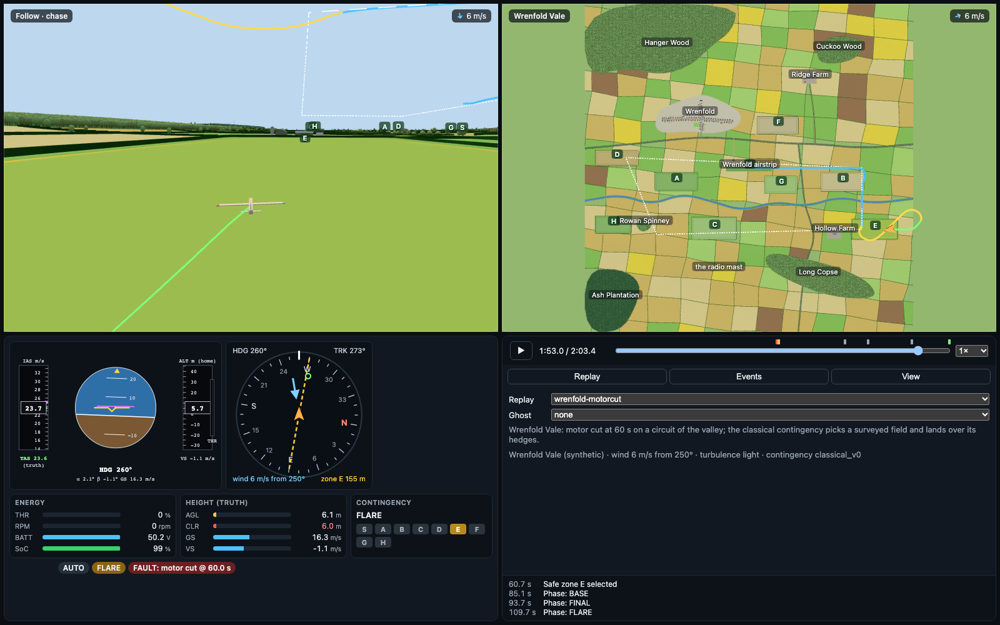

# 07 — Synthetic worlds and the four-panel Skyview

**Status:** built 22 Oct 2026 (week 10 of the amended plan, [03 §7.2](03_uav_architecture_and_six_month_roadmap.md#72-milestones)). Living log in §13.

---

## 0. Why

Until now Skyview drew the flights over Google Photorealistic 3D Tiles of the Cambridge site, while the simulator flew over a flat plane at the height of the take-off field. The two did not agree:

- hills in the picture were not in the simulation;
- trees and buildings in the picture were not there either, so an aircraft gliding into a field could pass straight through a hedge or a tree line, and nothing noticed.

The owner asked for a controlled world instead: a simplified, simulation-style landscape (terrain, roads, a river, fields, woods, a village) where the simulator knows exactly where every obstacle is. That makes the simulation more accurate and easier to debug. Real maps come later, into the same structures.

The second request was a four-panel Skyview:

- **top left:** a follow (chase) view;
- **top right:** a fixed top view of the whole map;
- **bottom left:** the instruments;
- **bottom right:** the controls.

## 1. What was built

1. **A world format and generator** (`src/aeroadapt/world`, `configs/worlds/<id>.yaml`). A world is authored as a map-maker would sketch it. The generator expands it, deterministically, into every field, hedge, tree and building.
2. **Wrenfold Vale** (`configs/worlds/wrenfold.yaml`), the first world: a 3.2 km square English valley. It has:
   - the River Wren;
   - Wrenfold village, with St Michael's Church, a pub and a hall;
   - two farms;
   - five woods;
   - a radio mast;
   - a grass airstrip;
   - 192 hedged fields.

   The site `wrenfold_vale` flies over it.
3. **The simulator touches the world.** Ground contact is now over the terrain. A new termination, `OBSTACLE`, fires when the centre of gravity or either wingtip touches a tree, hedge, building or mast. Wind shear and turbulence use the height above the ground below.
4. **Safe zones come from a survey of the world.** Each zone has a level ground height and a *displaced threshold* for each landing direction. The classical contingency now lands over obstacles instead of through them.
5. **Txt2Fly plans clear the terrain.** Along the whole track the planner keeps at least 40 m above the ground and 30 m above every tree and building. It raises legs where needed and says why. The checker's K4 enforces the same rule.
6. **Skyview's four-panel player**, drawn with three.js over the same world. The real-map (Cesium) player is kept behind `?map=real`.

## 2. Authoring a world

`configs/worlds/<id>.yaml` (schema `aeroadapt.world.schema.WorldSpec`) holds the following. Coordinates are site metres (north, east). Heights are above the **site datum**, the ground at home.

| Block | What it sets |
|---|---|
| `terrain` | A 10 m grid; a gentle eastward slope; ridges (ground rising between two northings); hills (Gaussian bumps); low undulation (four seeded sine waves, ±1.2 m) |
| `river` | Centre line (smoothed), width, depth. The channel is carved into the terrain, with 20 m banks |
| `roads` | Centre lines, widths and kinds (road, lane, street, track). Hedges line both verges unless `hedged: false` |
| `woods` | Outlines (smoothed), canopy height, broadleaf or conifer |
| `village` | Built-up outline, the streets houses line up along, a green, and named buildings (church nave and tower, pub, hall) |
| `farms` | Yard outline and buildings |
| `airstrip` | Centre, heading, size, and buildings (the hangar) |
| `structures` | Masts and silos |
| `fields` | The grid that fields come from (size, rotation, jitter), crop weights, hedge heights, hedgerow-tree spacing |
| `zones` | Landing grounds: a field drawn here, or the field or airstrip containing a point. Each becomes safe zone `id` |

## 3. Generation

`aeroadapt.world.generate(spec)` consumes one seeded generator in a fixed order. A world id therefore names one exact world (tested). For Wrenfold it takes 0.46 s, plus 0.2 s for the obstacle raster. In order, it:

1. Smooths the river, roads and woods (Chaikin corner cutting).
2. Lays out the fields as a jittered grid rotated with the land. Each cell is cut by everything that is not field: river, roads, woods, village, yards, airstrip and drawn landing grounds. Pieces under 1.2 ha become rough grass. The rest are fields, with crops drawn from the weights.
3. Builds the terrain. The landing grounds are **levelled**: each is blended to its mean height over 40 m. Then the river channel is carved, and the grid is shifted so the ground at home is exactly 0.
4. Places the hedges: the grid's edges, the road verges and the drawn fields' boundaries, minus everything built, wooded or wet. Hedges are 2–3 m tall and 2 m wide, split into 20 m segments.
5. Places the trees:
   - **hedgerow trees** (9–15 m) about every 90 m;
   - **willows** along the river banks;
   - **wood trees** on a jittered 7.5 m grid, filling every wood (24,722 at Wrenfold).

   No tree stands on a landing ground's hedges or in its **approach funnels**: 450 m off each end of its long axis, widening by 15 %. A farmer keeps those trimmed, and the survey would otherwise displace the thresholds far into the field.
6. Places the buildings: the authored ones, then houses along the village streets. A house is 9–14 m by 6.5–8.5 m, gable-roofed, set back 5–9 m and spaced 17–26 m apart. Houses keep clear of each other, the roads, the green and the church. 15 % are bungalows. A house may have a garden tree or two.

Wrenfold: 192 fields, 4,633 hedge segments, 25,326 trees, 94 buildings.

## 4. The simulator

`aeroadapt.sim.aerojax.terrain.Terrain` joins `EnvParams`. It holds two grids:

- **terrain:** ground height above the datum, 10 m grid, bilinear;
- **obstacles:** the height of whatever stands on the ground above the terrain, 2 m cells, uint8 in 0.25 m steps (up to 63.75 m), 2.5 MB for Wrenfold.

The obstacle raster (`aeroadapt.world.raster`) is **conservative**. A cell counts as covered when its centre is within half a cell diagonal of a feature. A sloped roof is taken at its highest point in the cell. So every point of every feature lies in a cell at least as tall as the feature (tested). The shapes in the raster:

- woods are solid at their canopy height;
- trees outside the woods are cylinders of their crown radius;
- hedges are 2 m-wide walls;
- roofs keep their gable or spire profile.

What the simulator does with the grids:

- **Atmosphere.** ISA uses the height above the datum (pressure is absolute). The wind profile, thermals and the Dryden turbulence scales use the height above the ground below.
- **Termination** is checked every control step (10 ms):
  - **ground contact:** the CG within 0.15 m of the terrain;
  - **obstacle:** the CG or a wingtip (at ±b/2 along the body y axis) within 0.15 m of an obstacle's top;
  - then out of range, and numerical failure, as before.

  Code 5 is `OBSTACLE`; code 4 stays the vehicle protocol's time limit.
- **Truth and telemetry.** `Truth` gains `clearance`: the least height above the surface at the CG and wingtips. `Truth.alt_agl` is now above the terrain. The recording keeps `truth.alt_agl` as the height above the datum (the frame missions fly in; the same as AGL on a flat site). It adds `truth.hagl` (above the ground) and `truth.clearance`.

  The browser subset gains these, plus ground velocity (for the track), state of charge, rpm and battery voltage (for the instruments).
- **Events.**
  - A touchdown on a world site records the surface (field, crop, zone).
  - It also records the ground's slope and the **closing speed**: the sink rate plus the ground's rise along the track. The touchdown class uses the larger of the sink rate and the closing speed, so flying level into a hillside is no longer a "controlled" landing.
  - An `OBSTACLE` termination becomes a `collision` event naming what was hit ("St Michael's Church tower", "Long Copse (trees)", "a hedge").
- **Flat sites are unchanged to the bit.** Their terrain is a 2 × 2 grid of zeros with no obstacles, and every lookup returns exactly 0. The golden flights pass unchanged.

A world site's ground grids sit in `EnvParams`. A vmapped bench that stacks environments per flight would copy them per flight (3.3 MB each). Benches over world sites should pass the terrain un-batched; none exist yet.

## 5. Safe zones from the world

`aeroadapt.world.survey` turns each landing ground into a site safe zone, as a surveyor would. It records:

- the field inset 15 m from its hedges;
- its level ground height (`elevation_m`);
- for landing along its long axis either way, the **displaced threshold** (`threshold_back_m`, metres before the zone's centre).

The threshold works like an aerodrome's approach surface. A plane rises at 1:15 (3.8°) from the threshold, back along the approach. Every obstacle under it (hedge, tree, building, rising ground) must sit at least 3 m below it. The test corridor is 20 m either side of the centre line, widening by 10 % of the distance, out to 900 m. 1:15 is flatter than the gliding Aerosonde's best on final (L/D 13.5 after the stack's 0.92 efficiency). So an aircraft that reaches the aim point on the glide has passed above the surface, and the obstacles, all the way in.

The classical contingency (`stack/contingency.py`) uses this survey in three ways:

- **Zone heights.** Each zone's reach margin counts from its own ground. Once a zone is chosen, the pattern and the flare use the height above that zone, as ArduPlane uses its land waypoint's altitude. A straight-in landing without a zone still counts from the datum: the stack carries no terrain database.
- **Aim and touchdown.** The glide's aim point moves at least 75 m past the displaced threshold (`THRESHOLD_BUFFER_M`), so the planned glide crosses the threshold about 6 m up. The touchdown point (the aim plus the 60 m float) moves with it. A direction is usable only while 60 m of the zone remains beyond the touchdown (`STOP_M`).
- **Choosing a direction.** If the into-wind direction is not usable, the other one is: a downwind landing beats none.

With no survey (flat sites, every threshold infinite) the arithmetic is bit-identical to before.

The approach funnels (§3) and the buffer came from the first flights over Wrenfold. With the contingency's original aim (a quarter of the field in, no knowledge of obstacles), 6 of 24 forced landings struck a hedge or a barn on the way in. These are the "through the trees" landings the old viewer could not show. §9 has the result now.

## 6. Sites, gazetteer and no-fly areas

A site may now say `ground_model: world` and name its world (`configs/sites/wrenfold_vale.yaml`). It then lists no safe zones: `load_site` fills them in from the survey. Its origin is nominal: it sets the magnetic field and the barometric reference only.

The Txt2Fly gazetteer reads the world as it reads a site's OpenStreetMap extract (`aeroadapt.world.places.world_gazetteer`). Its places are:

- the village and its green;
- the church (nave and tower as one place, 30 m tall);
- the pub, the hall and the hangar;
- the farms, the woods, the mast and the silo;
- the airstrip, the river and the bridge;
- the named roads;
- the landing grounds' names as aliases ("Mill Meadow" is field A).

No-fly areas name world areas (`world_area`):

| Area | Extent |
|---|---|
| The village | Built-up outline + 30 m |
| Each farmyard | Yard + 30 m |
| The radio mast | 80 m radius, for its stay wires |

## 7. Planning over terrain (Txt2Fly)

Plan heights stay **above home**. That is the frame the autopilot flies in, ArduPlane's relative altitude. Terrain following (ArduPlane's `TERRAIN_FOLLOW`) is not modelled.

`aeroadapt.txt2fly.terrain.Relief` holds three conservative 10 m grids:

- the highest ground within the 30 m tracking margin;
- the lowest ground within that margin;
- the highest surface (ground or obstacle top) within it.

From these:

- **The builder** (`_lift`) raises any leg whose preview passes too low. The new height is the lowest multiple of 5 m that keeps `min_agl` (40 m) above the ground and 30 m above every obstacle. It works in up to four passes, raising the leg before if the climb starts too low. The change is explained, for example: "circle Hanger Wood: at 80 m (heights are above home) to keep 30 m above Hanger Wood".
- **The checker's K4** tests the whole preview on a world site, not only each step's height:
  - at least `min_agl` above the ground;
  - at most the ceiling above the low ground;
  - 30 m above trees and buildings.

  Its reasons name the place ("would pass 12 m above Hanger Wood; keep 30 m clear") and suggest a height.

While building this, a bug turned up and was fixed. A turn point that the builder inserts before a return-home circle took height 0 m whenever the leg before it was a circle (`prev_alt` was only updated after waypoints). On flat Cambridge the aircraft dived on the way home and climbed back unnoticed; over Wrenfold it would hit the ground.

The examples:

- **Wrenfold:** `configs/txt2fly/plans/wrenfold_vale/`;
- **Cambridge:** `configs/txt2fly/plans/cambridge_west/`.

`txt2fly-demo` now flies over Wrenfold. `txt2fly-cambridge` is the old demo, kept for the V24–V28 validation. Skyview's example buttons follow the site.

## 8. Skyview: four panels

`web/skyview/src/quad/QuadPlayer.tsx` is the default view for replays and live sessions.

**One WebGL canvas** sits behind the page. It is drawn twice per frame into two panels (scissored viewports, `world3d/WorldView.ts`):

| View | Camera |
|---|---|
| Follow (top left) | **Chase:** 13 m behind and 3 m above, its heading smoothed. **Orbit:** 170 m out. **Free:** drag to orbit the aircraft. The aircraft model is at its real size |
| Map (top right) | Orthographic and north up. Fitted to the geofence (or the world). Scroll to zoom, drag to pan, double-click to refit. The aircraft (and ghost) are arrows of a fixed pixel size |

**The world** is drawn from the server's payload (`world.export.viewer_payload`, 1.2 MB of msgpack). It arrives in the live `hello`, and `export-viz` writes it next to a replay as `world.msgpack`.

| Feature | How it is drawn |
|---|---|
| Terrain | Its own grid, draped with a painted 4096² land-cover canvas: crops with rows, pasture, the village, woods' floor, the river and its banks, roads with verges and centre lines, hedge footprints |
| Hedges | Instanced boxes per segment |
| Trees | Instanced crowns by kind (broadleaf, conifer, willow) and trunks. `?quality=low` keeps every third wood tree, with fuller crowns, for slow GPUs |
| Buildings | One vertex-coloured mesh with gable roofs, flat roofs and the church's spire |
| Mast and silo | The mast with its warning light, the silo |

A transparent overlay canvas on the same terrain mesh carries:

- the safe zones, coloured by reach and choice;
- the no-fly areas and the geofence;
- the plans' ground tracks.

The tracks themselves (the trail by phase, the mission, a proposal, the active plan) are fat lines in 3D. Labels are HTML, projected per view.

**Instruments** (bottom left, `quad/Instruments.tsx`):

- the primary flight display (attitude, speed and height tapes; heights "m (home)" on a world site);
- a heading-up navigation display: compass card, ground track, the wind, and a bearing and distance to the chosen zone or home;
- energy gauges: throttle, rpm, battery, state of charge;
- height gauges (truth): above the ground, clearance above obstacles (amber under 30 m, red under 10 m), ground speed, vertical speed;
- the contingency's phase and zone chips;
- badges, and the touchdown or collision card.

**Controls** (bottom right, `quad/ControlDeck.tsx`):

- the timeline or live bar;
- tabs: Session (scenario, airframe, wind), Plan, Faults, Events, View (follow camera, layers, legend, the link to the real map);
- a ticker of the latest events, always in view.

**The real-map player** (`?map=real`) is the previous Cesium layout, unchanged. Its 3D-tiles terrain is not what the simulator flies; it remains for real sites. CesiumJS now loads only when asked for: the default bundle fell from 5.3 MB to 1.1 MB.

**A site without a world** (the Cambridge scenarios) is drawn as open ground with a 100 m grid. Its zones, no-fly areas and places are shown, with a note pointing to `?map=real`.

## 9. Validation

| Test | What it shows | Tier |
|---|---|---|
| `tests/unit/test_world.py` | Generation is deterministic (terrain, trees, buildings, hedges, raster). Datum and relief are as specified. Landing grounds are level (< 5 cm). The raster covers every tree, hedge, building and wood (and the tower reads 30 m). Every surveyed approach clears its surface by 3 m. The site, gazetteer and no-fly areas are as listed. The simulator's JAX lookups equal the world's (2,000 random points). Flat terrain is exactly zero | fast |
| V29 church tower | Level at 20 m into St Michael's tower: a `collision` naming the tower, within 6 m of it | fast |
| V29 hillside | Level at 25 m up the south ridge over open fields: ground contact where the ground has risen past 15 m. The sink rate is under 1.5 m/s, but the closing speed is over it, and the class is not "controlled" | fast |
| V29 motor cut | `wrenfold-motorcut` lands in zone E (Hollow Pasture), and stays more than 50 m clear of everything before the cut | fast |
| V30 | 24 motor cuts (six points of the circuit × four winds): **20 in a field, 3 short in the next field, 1 hedge strike with no field within glide.** The gate is at least 18 in zone and at most 2 collisions | full |
| V31 lift | Hanger Wood at 50 m: lifted, the note names the wood, and K4 passes. Built literally (`adapt=False`), it fails K4 with the wood named and a height suggested | fast |
| V31 flown | Three plans flown by the full simulator and stock stack: at least 20 m above any obstacle and 35 m above the ground throughout (planned: 30 m and 40 m) | full |
| Playwright | Live: faults over Wrenfold, the Txt2Fly flow (church notes, "Can fly", confirm, AUTO). Replay smoke in both the four-panel and real-map views | e2e |

The golden flights, the V12 contingency cases and the Txt2Fly V24–V28 tests (now on `txt2fly-cambridge`) pass unchanged.

## 10. Fidelity: what is modelled, and what is not

**Backed by code:**

- the terrain the aircraft flies over and lands on;
- every tree, hedge, building and mast it can hit, at the CG and wingtips, to within the 2 m raster (conservative);
- the wind profile and turbulence by the height above the ground;
- zone heights and obstacle-aware approaches in the classical contingency;
- terrain and obstacle clearance in the planner.

**What the views show is what the simulator has:**

- **Same positions and heights.** Every field, hedge, tree and building is where the simulator has it, at the same height. The view comes from the same payload.
- **Two simplifications.** Woods are drawn as trees but simulated as a solid canopy at the wood's canopy height. Tree crowns are drawn round but simulated as cylinders. Both are conservative: the simulator can only be stricter than the picture.

**Not modelled:**

- the airflow round obstacles (no wind shadow or rotor behind woods, no ridge lift);
- the ground roll after touchdown (the simulation ends at contact);
- wires and power lines;
- water landings;
- a terrain database in the flight stack (it flies heights above home, so a straight-in landing without a zone flares from the wrong height over hills);
- terrain in the JSBSim backend, which stays flat.

The world is synthetic. Wrenfold is not a real place, and its origin only sets the magnetic field.

## 11. Files

| Path | What |
|---|---|
| `src/aeroadapt/world/{schema,generate,raster,survey,places,export}.py` | Authoring schema, generator, obstacle raster, safe-zone survey, gazetteer and no-fly areas, browser payload |
| `src/aeroadapt/core/polygons.py` | Zone chords (shared by the survey and the stack) |
| `src/aeroadapt/sim/aerojax/terrain.py` | `Terrain`, `ground_height`, `obstacle_height` |
| `src/aeroadapt/txt2fly/terrain.py` | Relief grids, landmarks for explanations |
| `configs/worlds/wrenfold.yaml`, `configs/sites/wrenfold_vale.yaml` | The world and its site |
| `configs/scenarios/wrenfold-{nominal,motorcut}.yaml`, `txt2fly-demo.yaml`, `txt2fly-cambridge.yaml` | Scenarios |
| `web/skyview/src/world3d/*`, `web/skyview/src/quad/*` | The stylised renderer and the four-panel player |

`aeroadapt serve` now defaults to `wrenfold-nominal`. It compiles one scenario of each other ground (the flat sites) in the background, so switching to one later is quick; `--no-warm-others` skips that.

## 12. Next

- **Real maps into the same structures.** A DEM for the terrain grid; OpenStreetMap land use, roads, woods and buildings for the features. The simulator, survey, planner and viewer would then work unchanged on real sites. The M5 Pathfinder's geodata pipeline (03 §7.2) is the natural home.
- **More worlds from the generator.** Random seeds and layouts for training and the bench, with the terrain passed un-batched (§4).
- **Terrain following** in the stack (ArduPlane `TERRAIN_FOLLOW`, with a coarse terrain database), and plans whose heights are above the ground below.
- **Landing quality.** The remaining V30 misses are energy management: arriving low after a long intercept. They belong to the M5 Pathfinder (glide guidance and flare), with the classical contingency as baseline B2.

## 13. Log

- **22 Oct 2026, built.**
  - World format, generator and Wrenfold Vale. Terrain and obstacles in the simulator. The survey and the contingency's zone heights and thresholds. Planner terrain clearance. The four-panel Skyview.
  - The first sweep, before thresholds, had 6 strikes in 24. The obstacle-aware aim brought that to 2 in 24 (one of them with no field within glide).
  - Three more landing grounds (F, G, H), a longer G and Hollow Farm moved out of field E's approach line brought it to 1 in 24, with 20 in the field.
- **22 Oct 2026, the owner's test map, step 1.** The owner is drawing a second world with me, a feature at a time (`configs/worlds/testmap.yaml`, site `testmap`, scenario `testmap-nominal`).
  - Step 1 is the ground only: 5 km square, home at the centre. A plain rises gently eastwards, about ±5 m round home. Six hills on the eastern side reach 78 m above home.
  - A world may now leave out its field patchwork (open grassland).
  - `tools/world_map.py` draws any world as a map sheet: shaded relief, contours, features, zones, no-fly areas, and a grid labelled every 500 m.
  - Skyview now tints open ground by height and bakes shaded relief (lit from the north-west, as on maps) into the ground texture, so hills read even from straight above. Its lights are a little softer.
  - A **Grid** layer (on by default) draws 100 m lines with 500 m labels on the map, for talking about positions.
