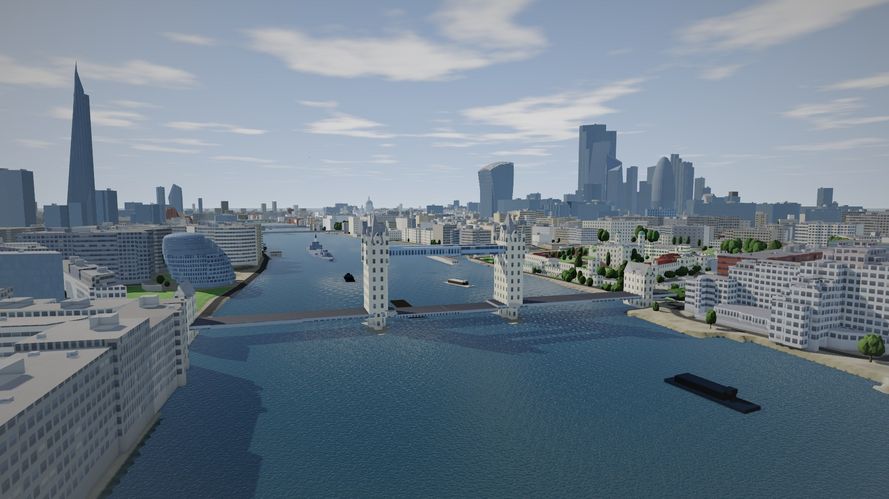
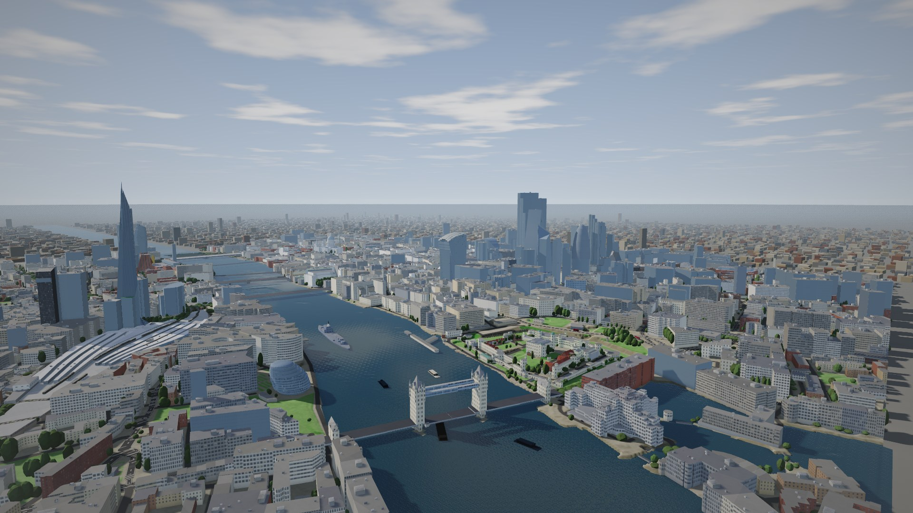
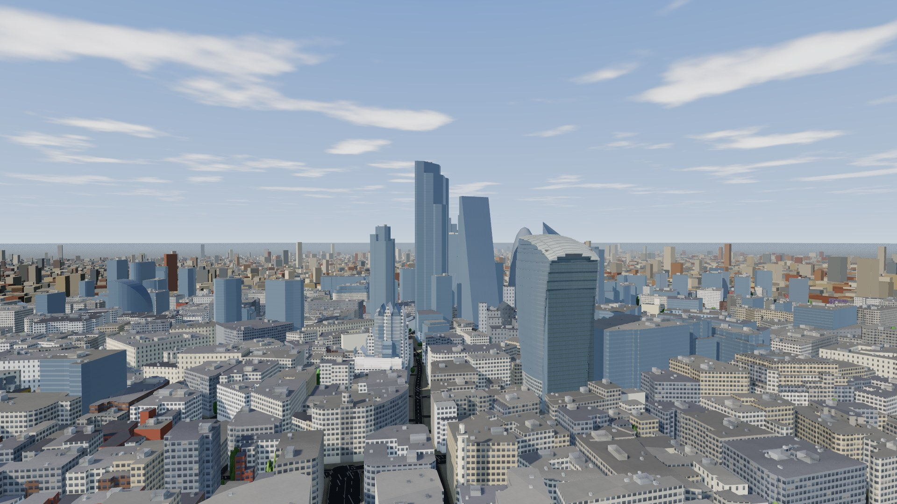
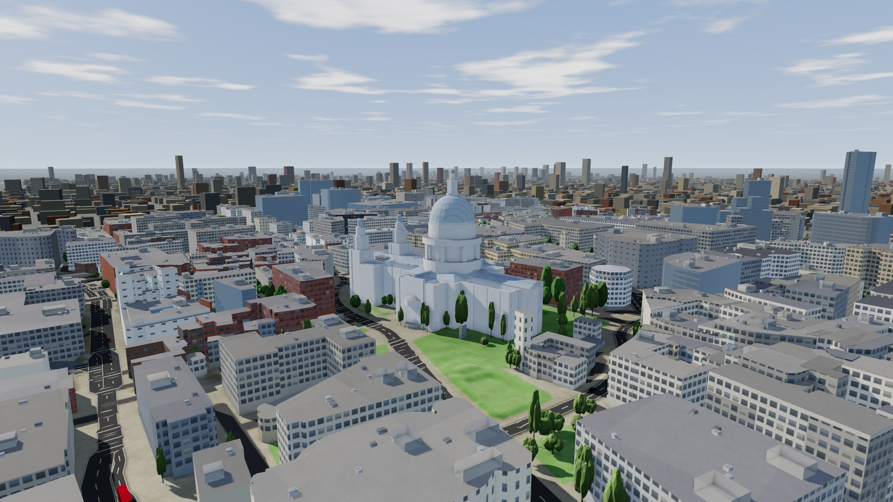

# 08. London: a real city to fly through

**Status:** built, 23 Oct 2026; the small airframe (§5) followed the same day. The owner chose the area (the City and Bankside) and the vehicle (a small fixed-wing). The city trainer flies low along the river and among the City's towers; the Aerosonde flies the higher tours.

## 0. Why

The test map (docs/07 §14) is invented. The second world is real: central London, reproduced from measured data, small enough to curate, and dense enough that a small UAV flies between buildings rather than over fields. It is a demo, and a harder test of everything the stack does near obstacles.

## 1. The area

A box on the National Grid (EPSG:27700), 2.8 × 2.2 km:

- **Easting** 531,300 to 534,100; **northing** 179,700 to 181,900.
- **In latitude and longitude** (WGS84, to a few metres): 51.5010 to 51.5201 N, 0.1098 to 0.0686 W.
- **West:** Blackfriars Bridge. **East:** the Tower, Tower Bridge and St Katharine Docks. **North:** Liverpool Street. **South:** Bankside, Borough Market, London Bridge station and the Shard.
- **Inside:** St Paul's, the City's towers (22 Bishopsgate, the Gherkin, the Scalpel, the Walkie-Talkie, the Leadenhall Building), Tate Modern, the Monument, the river crossings from Blackfriars to London Bridge, and Tower Bridge.

The world is 2.08 × 2.72 km of local metres, true north, about the box's centre (51.51070 N, 0.08925 W). That is the world's origin; its datum is the ground there, 10.85 m above Ordnance Datum.

## 2. Data

All of it is open. None of it is committed raw: it lives in `data/london/`, which is git-ignored. `data/london/manifest.json` records each file's source, SHA-256 and the time it was fetched.

| What | Source | Licence | Fetched |
|---|---|---|---|
| Surface heights: roofs, trees, bridges | Environment Agency, LIDAR Composite DSM, 1 m, last return | Open Government Licence | WCS `GetCoverage` for the box only: a GeoTIFF, 2,800 × 2,200 float32, 31.5 MB (with its tiling) |
| Ground heights | Environment Agency, LIDAR Composite DTM, 1 m | Open Government Licence | the same, 31.5 MB |
| Footprints, building parts, roads, the river, parks, trees, bridges | OpenStreetMap, through the Overpass API | ODbL | one query for the box with a 60 m margin: 31,205 elements, 24 MB of JSON |

The LiDAR comes from the Environment Agency's WCS services, already cut to the box on its native 1 m grid. Its vertical accuracy is ±15 cm (RMSE) per survey. The composite mixes surveys from different years, so recent towers may be missing or half-built.

## 3. The pipeline

Two tools, as for the test map. `tools/london_fetch.py` fetches the three files above into `data/london/`, and nothing else. `tools/london_bake.py` writes `configs/worlds/london.world.npz` (8 MB), `configs/worlds/london.yaml` and the operations of `configs/sites/london.yaml`, in about 7 s.

- **Frame.**
  - OSM's WGS84 goes to the local frame through a tangent plane (millimetres over the box).
  - The LiDAR's National Grid goes there through OSGB36 (the Ordnance Survey's Helmert) and the Transverse Mercator, fitted as a quadratic in (n, e) to 0.1 mm. The grid's convergence there is −1.496°.
  - The Helmert step is good to a few metres, so the LiDAR is then slid onto OSM's footprints, by cross-correlation at 0.5 m. It sits 2.01 m west and 0.04 m south of them.
- **Ground.** The DTM on a 2 m grid. The Thames is flattened to its surface on the survey's day, +3.06 m above Ordnance Datum, with its bed 1.5 m below away from the banks. St Katharine Docks and the Barbican's lakes are flattened at their own levels.
- **Obstacles, measured.** The LiDAR surface above that ground on a 1 m grid: the highest of the four LiDAR cells round each, ignoring anything under 1 m.
- **Buildings.** 6,421 of them, from 5,780 OSM buildings and 3,364 building parts:
  - **Parts.** A building divided into parts is drawn as its parts (OSM's Simple 3D Buildings, once parts cover 30 % of it), and each part takes its building's character (a cathedral, stone, its colours) unless it has its own.
  - **Heights.** OSM's height is used where it agrees with the LiDAR (1,502 times): no higher than the highest the LiDAR saw there, and, for a whole building with a flat roof, no lower than its typical roof (else OSM is out of date). Otherwise the LiDAR's 90th percentile is used (4,921 times). A part may stand under another (Tower Bridge's deck under its walkways, St Paul's floor under its dome), so a part's height is checked only against the highest.
  - **Roofs.** Roof shapes come from OSM: flat; skillion (a single slope, 618 of them with their direction, such as the Shard's eight glass shards); pyramidal and spires; domes. A pitched roof on a rectangle is drawn as a gable. Parts stand clear of the ground where OSM says so (`min_height`): St Paul's drum and lantern, Tower Bridge's walkways.
  - **Colours.** From OSM's tags (2,200 buildings and 2,500 roofs have them), else the material, else a palette by kind. Only the landmarks and towers of 80 m or more keep their names.
  - **Bridges.** 47 bridge decks are drawn from the LiDAR. Tower Bridge is drawn from its parts.
- **Trees.** 7,722 trees, at the tops of the LiDAR canopy away from buildings, bridges and water, with crowns sized by the canopy round them.
- **Railways.** OSM's railways above ground (32 km of track in 218 lines, merged from many short pieces), with the height of the rails from the LiDAR: the lowest within 1.6 m (not a train), and between a station's ends under its roof. Each point is carried by the ground, a viaduct or a bridge. Over land, a bridge is a short span (a street under it); OSM's longer "bridges" are London Bridge's brick viaducts.
- **The rest.**
  - 3,639 pieces of road, by class and width.
  - Parks, gardens, churchyards, squares, yards and water as land cover.
  - The Thames's centre line.
  - 24 named places: the landmarks, the bridges, the stations, the Thames.

**Fixes found by looking.**

- **The Shard.** OSM's 310 m was first thrown out because the LiDAR's 90th percentile over a tapering tower is low. The check now uses the highest the LiDAR saw.
- **St Paul's.** It came out as a 78 m glass block: its outline was drawn over its parts and took the LiDAR's height. Outlines with parts are now left out.
- **Tower Bridge.** A bridge deck drawn from the LiDAR sealed it from the water to its walkways. Bridges mapped in parts are now left to their parts.

## 4. The simulator

- **The obstacle grid follows the world.** A world's obstacle grid takes the cell of its measured obstacles: 1 m here, 2,080 × 2,720 cells of uint16, merged with the baked buildings (the greater of the two in each cell).
- **What the aircraft can hit is the measured surface.** That includes trees, street furniture tall enough to show, whatever cranes stood on the day of the survey, and HMS Belfast. The Shard's measured top is about 290 m; its drawing reaches OSM's 310 m.
- **Bridges are solid down to the water.** The grid holds one height per cell, so nothing can be flown under: not the bridges, not Tower Bridge's walkways. That is conservative; flying under them is not the point.
- **The format is general.** Buildings on their own footprints (with skillion, dome and spire roofs, and parts clear of the ground) and measured obstacles are part of the baked-world format (`aeroadapt.world.baked`), not special to London.

## 5. The vehicle: the city trainer

A small conventional tractor, `city-trainer` in `configs/fleets/city`, written down as one design in `tools/city_airframe.py` rather than sampled. The M2 machinery does the rest (docs/05 §4, §6):

- **Generator.** It lays the design out and computes its mass, aerodynamics (AeroSandbox and NeuralFoil tables) and propulsion.
- **Filters.** aerojax's trim and stability filters pass it.
- **Stack.** It is auto-configured and auto-tuned.
- **Acceptance.** V20 passes it on all 20 of its checks, in calm air and in light turbulence.

| | |
|---|---|
| Span, wing | 1.10 m, 0.20 m² (aspect ratio 6, Clark Y, 4° dihedral) |
| Mass, wing loading | 1.03 kg, 50 N/m² |
| Stall, cruise | 7.6 m/s; 13.5 m/s (the auto-configured cruise) |
| Power | 3S, 206 W (200 W/kg); about 30 minutes |
| Turning | 19 m radius at 45° of bank, at cruise |
| Static margin | 10 % |

- **What it can fly:** above the roofs; along the river (about 250 m wide); straight along the wider streets; through the gaps in the City's cluster of towers. It turns at junctions and open spaces.
- **What it cannot:** weave down narrow streets; hover. That needs a multirotor, which is a different project.
- **Its glTF model** travels with it. The live server sends a scenario's own fleet airframe's model to Skyview, whose chase camera keeps the same framing whatever the aircraft's size (about 5 m behind the trainer, 13 m behind the Aerosonde).

**Fidelity.** It is a generated airframe, not a model of a real one. Its aerodynamics are computed from its geometry, and its mass budget and propeller family are approximate (docs/05 §12), as for every airframe in the fleet.

## 6. Operations

- **Home** is Potters Fields Park, by Tower Bridge: landing ground A, the only one. Launch and recovery there are fictional.
- **Geofence and limits.**
  - The geofence sits 60 m inside the world's edge.
  - The ceiling is 400 m (the Shard is 310 m).
  - The least height above the ground is 30 m.
- **Contingency.** The Thames is the only large open space. A landing on water is not modelled (docs/07 §10), so a forced landing there would count as a ditching.
- **No-fly zones.** Two, closed at all heights, round the Tower of London and St Paul's. They are invented for the exercise; real drone flights in central London need permissions this world does not model.
- **Scenarios.** All three fly clean in a headless 30-minute run: no collision, never in a zone, never out of the geofence.

  | Scenario | Route | Least clearance |
  |---|---|---|
  | `london-tour` | 150 m: up the Thames to Blackfriars, round the north of the City, back by the Tower and Tower Bridge | 60 m above anything measured |
  | `london-river` | 90 m from Tower Bridge to Blackfriars, past HMS Belfast, the Shard, the Millennium Bridge and St Paul's; then the City's northern edge at 190 m | 58 m, over Tower Bridge's towers |
  | `london-city` | The city trainer at 13.5 m/s. 45 m along the Thames from the Millennium Bridge to London Bridge; then through the City's towers at 120 m, along their western edge, with towers rising 60 to 160 m above it on either hand; round the north and back to the river at Blackfriars | 29 m above anything measured; 60 m from anything as tall as itself |

  `london-city`'s way through the towers was planned on the measured obstacles: a search over the free space at 120 m for a path at least 30 m from anything within 25 m of that height. The trainer banks to 49° in its turns and ends the 30 minutes with 19 % of its battery.

## 7. Skyview

- **Flying it live.** Run `uv run aeroadapt serve --scenario london-river`, then open Skyview at `?live=ws://localhost:8765`. Add `&film=1` for the picture alone.
- **The look.** London takes the cinematic look (docs/07 §15) with what a city needs:
  - **Facades.** Curtain walls on the towers, offices with shop fronts, stone with tall windows, homes; each building its own shade.
  - **Roofs.** Plant rooms and air-handling units on the big flat roofs.
  - **Railways.** Ballast, sleepers and rails at their heights; brick viaducts with arches down to the ground; bridges as decks; trains of six carriages. Under a station's roof, the roof stands for them.
  - **Movement.** Traffic keeping left (cars, black cabs, red buses), trains, and boats and barges on the Thames.
  - **Past the edge.** The ground runs on from the map's edge, the Thames carries on past both ends, and an ordinary city fills the rest out to 3.5 km.
- **A fly-by video.** `tools/flyby_path.py london tools/flyby/london.json frames.json` turns camera keyframes into a smooth path, checked clear of everything measured by at least 12 m (this one by 44 m). `web/skyview/scripts/flyby.mjs` renders and encodes it, with the clock stepped frame by frame so traffic and boats move at their speed.
- **Google's tiles.** `?map=real` (Cesium with Google's photorealistic 3D tiles, docs/07) should show the same place from the site's origin, for comparison; it has not been tried with London yet. Those tiles may be shown, but their licence does not allow copying their geometry into the simulator.

## 8. Fidelity

**Measured:**

- the ground;
- every building's footprint, and its height (OSM's where the LiDAR agrees, else the LiDAR's);
- where the roofs and trees are, to a metre across and about 15 cm in height. That is what the simulator flies against.

**Drawn, not measured:**

- facades (windows, glass and stone are patterns);
- roof detail finer than a metre (the plant on the roofs is placed at random);
- the viaducts' arches (the viaducts are where the LiDAR has them; their arches are a pattern);
- the traffic, the trains and the boats;
- the city beyond the box;
- the clouds.

**Not modelled:**

- buildings put up after their survey;
- airflow between buildings (no channelling, no downdraughts);
- GPS among tall buildings (no multipath yet; the fault lab could add it);
- the Thames's tide (its surface is the survey day's).

The world is a model of London on its survey dates, not a live one.

## 9. Licence

The code stays Apache-2.0. The baked world (`london.world.npz`, `london.yaml` and the site's operations) is a database derived from OpenStreetMap and Environment Agency LiDAR. It is under the ODbL, with both attributions, in `configs/worlds/LICENCE-london.md` (and `NOTICE`), as `ardupilot/` will carry GPL-3.0 (ADR-006).

## 10. Steps

1. ~~Fetch the data.~~ 23 Oct.
2. ~~Bake the terrain, buildings and river; look at it in Skyview.~~ 23 Oct.
3. ~~The 1 m obstacle grid, and the simulator on it.~~ 23 Oct.
4. ~~The small airframe.~~ 23 Oct.
5. ~~Operations and two scenarios.~~ 23 Oct.
6. Landmarks: hand-made models for the few that matter most, drawn only. Later, if wanted.
