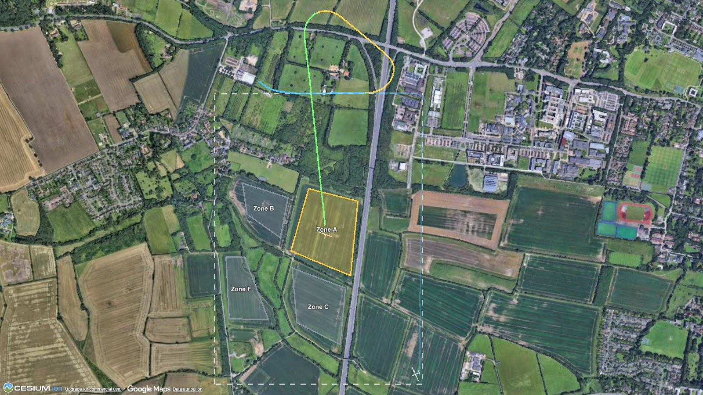
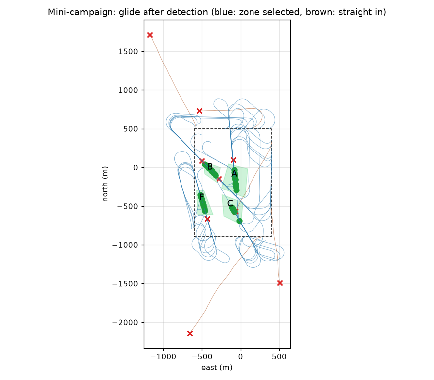
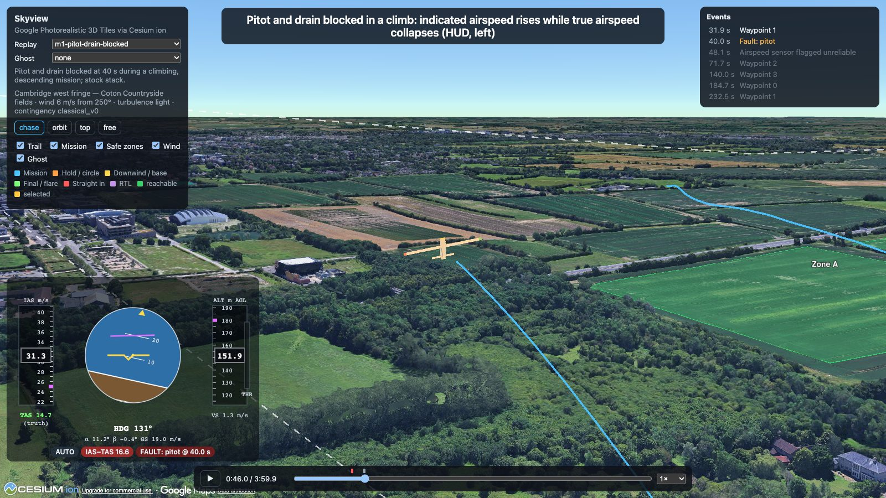

# AeroAdapt-UAV · M1: a motor fails over Cambridge

*Milestone 1 write-up, 15 October 2026. Video: `make demo` regenerates it from seeds (`runs/demo/m1_demo.mp4`).*

An 11 kg fixed-wing UAV flies a survey loop over the Coton fields west of Cambridge. Sixty
seconds in, its motor cuts. Two pilots fly the same seed:

- **Stock ArduPlane logic** (no motor-failure handling, as shipped) keeps flying the mission. TECS
  underspeed protection trades height for speed, and the aircraft glides into the ground 900 m away
  at 6.4 m/s sink.
- **The classical contingency** detects the cut in 0.7 s from ESC telemetry. It checks which of four
  pre-surveyed fields it can still reach in the wind, picks field A, and flies a glider's circuit
  (downwind, base, final). It lands in the field with a 0.9 m/s sink rate.

## What runs underneath

- **aerojax:** a pure-JAX 6-DoF fixed-wing simulator (Beard & McLain Aerosonde).
  - It models actuators with delay, lag and rate limits; a LiPo battery; ISA and wind; MIL-HDBK-1797
    Dryden turbulence; multi-rate sensors with GNSS latency and pitot physics; and fixed-shape fault
    slots for motor cut, pitot blockage and servo jam.
  - It matches an independent NumPy implementation of the book's equations to ~1e-12 (forces,
    moments, trajectories).
- **A stock flight stack, written to ArduPlane's structure.**
  - Navigator: a DCM-class estimator with ArduPilot's GNSS acceleration reference.
  - Guidance and control: L1 guidance, TECS, and roll/pitch/yaw rate loops with a speed scaler.
  - It meets every acceptance criterion (V11: steps, tracking, coordination, limit cycles) in calm air
    and in light turbulence.
- **A classical contingency,** the baseline that later learned components must beat:
  - ESC-rpm detection;
  - wind-triangle reachability;
  - zone selection;
  - a circuit planner whose downwind leg makes the absorbable height continuous;
  - speed-to-fly from the glide polar;
  - a flare.
- **Recording and replay:** deterministic replay bundles (Parquet + Arrow) and **Skyview**, a CesiumJS
  player over Google Photorealistic 3D Tiles. Skyview shows a HUD with *indicated* (sensor) and *true*
  airspeed together, safe zones coloured by live reachability, and a ghost aircraft for side-by-side
  runs.

## Does it work beyond one seed?

The mini-campaign is 50 motor cuts anywhere on the loop, in random wind up to 8 m/s from any
direction, all flown under one JAX `vmap` in under a minute:

| | |
|---|---|
| Failures detected | 50 / 50 (ESC, median 0.73 s) |
| Judged reachable at detection | 45 |
| **Landed inside the selected field** | **41 (91%)** |
| Crashes | 0 |

The four misses landed 106–217 m from the aim point, outside the field but with controlled or hard
touchdowns. Long finals into a headwind are the weak spot.

## The teaser for M4: a blocked pitot tube

In a climb, the pitot *and* its drain hole block. The trapped pressure turns the airspeed indicator
into an altimeter:

- The **indicated airspeed rises from 25 to 31.5 m/s while the true airspeed falls to 14.4 m/s**,
  close to stall.
- The stock TECS believes it is too fast. It cuts the throttle and pitches up, which makes things
  worse.
- ArduPlane-style mismatch checking catches it after 8 s, just in time.

M4's learned fault diagnosis is aimed exactly at this class of confounded, slowly diverging sensor
faults.

## Evidence

[`docs/validation/m1_report.md`](../validation/m1_report.md) recomputes everything:

- parity with the reference (V3) and invariants (V2);
- trims and modal checks against the book (V4/V5);
- RK4 convergence (V6, slope 4.02);
- float32 vs float64 (V7: 5 mm after a 60 s turbulent closed loop);
- Dryden statistics (V8, σ within 2%);
- all 29 autopilot checks (V11);
- the contingency (V12);
- throughput (V15).

**What is not good enough yet:** the backup motor-failure detector for airframes without ESC
telemetry, an energy-rate CUSUM against the autopilot's throttle model, fails V12. Gusts move the
energy rate by about as much as a cut at low throttle does: 73% of cuts are detected within 4 s, and
there are 3 false alarms in 10 hours. Learned diagnosis (M4) is meant to fix this.

## What is next

- **M2:** a JSBSim backend behind the same `Vehicle` interface; a live server with fault injection
  from the browser; the procedural airframe fleet.
- **Later:** learned dynamics, RL, and the move to a real airframe on ArduPilot.
