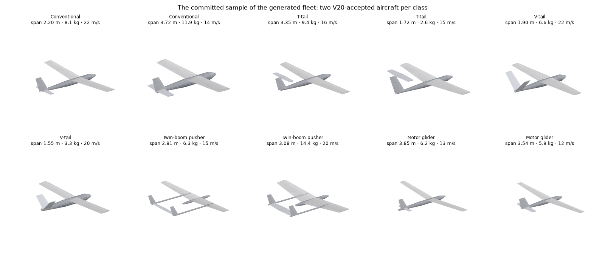
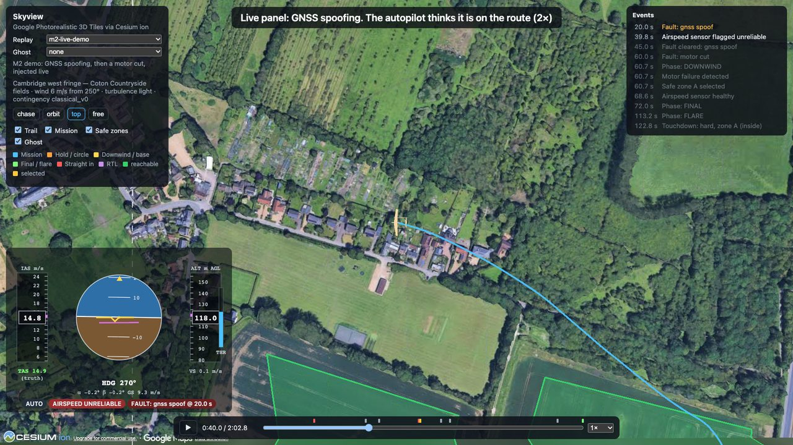
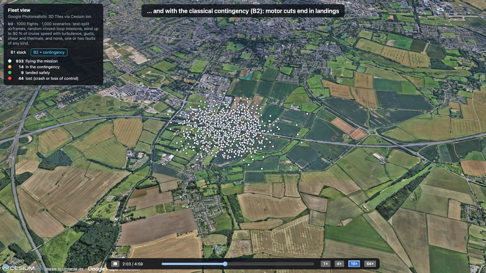

# AeroAdapt-UAV · M2: the fleet

*Milestone 2 write-up, 16 October 2026. Video: `uv run --with imageio-ffmpeg python tools/make_demo_m2.py`
regenerates it from seeds (`runs/demo/m2_demo.mp4`).*

M1 flew one textbook aircraft. M2 builds the instrument a learned pilot will be measured against:

- **10,000 generated aircraft**, each auto-configured;
- **30 kinds of failure** plus weather;
- **a live session** where you break things from the browser;
- **a benchmark** that flies stock baselines through a thousand random bad days.

## A fleet built from geometry

- **How an aircraft is built.** `aeroadapt fleet` draws a design in one of five classes
  (conventional, T-tail, V-tail, twin-boom pusher, motor glider). From the design it computes:
  - its geometry from tail-volume coefficients;
  - its aerodynamics with AeroSandbox's component buildup and NeuralFoil section polars, with forced
    transition so small tails don't get laminar-separation kinks;
  - a mass budget that places the battery to hit a static margin;
  - a sized motor, propeller and battery;
  - a glTF model of the same geometry.
- **How designs are filtered.** Every candidate is trimmed and linearised in the JAX simulator, all
  in one batched call. It is rejected if it can't trim or lacks control authority, or if its modes
  or its directional stability are poor.
- **The fleet:** 10,000 accepted from 14,784 designs.
  - Directional stability (C_nβ ≥ 0.03/rad) is the main filter: 57 % of glider designs fail it,
    as real sailplanes' small fins would suggest.
- **Splits:** 80/10/10 train, validation and test, by a hash of each aircraft's id.

## Every aircraft configures and tunes its own autopilot

- **Configuration from physics.** The stock stack (our ArduPlane-style reimplementation) gets:
  - speeds from the polar;
  - trim schedules from batched trims;
  - loop gains from the stability derivatives.
- **Tuning, as ArduPlane's AUTOTUNE does in flight, but offline and batched.** Each aircraft flies a
  doublet per axis with a grid of candidate gains. The tuner keeps the candidate with the largest
  worst-case margin against the acceptance requirements, scored on two independent noise samples.
- **V20, the acceptance flight** (a reduced V11: steps, limit cycles, line tracking, calm air and
  turbulence), over 1,000 aircraft:

**855 of 1,000 pass (85.5 %), short of the 90 % target.**

| Class | Pass rate |
|---|---|
| Conventional | 90 % |
| T-tail | 87 % |
| V-tail | 83 % |
| Twin-boom | 92 % |
| Motor glider | 54 % |

The misses are marginal: 117 of the 145 failing aircraft fail one check, by a median of 6-18 %.
They are spread over four requirements:
- limit cycles from sloppy servos;
- roll steady-state error;
- sideslip in turns, where adverse yaw is strong;
- airspeed sag when under-powered aircraft climb.

The criteria were not relaxed. Failing aircraft are left out of the benchmark with their reasons,
and closing the gap carries into M3.

Two findings mattered more than any tuning:
- **Noise was seeded by batch position.** The unchanged tuner kept only 86 of 100 passing aircraft
  when they were batched differently. Each aircraft's noise is now seeded by its id, and a test
  checks the invariance.
- **Airborne starts were broken in two ways.** The start state ignored the wind, so a tailwind
  start was nearly stalled. And the navigator's wind estimate started at zero, which in strong wind
  flagged the airspeed sensor permanently. Both are fixed.

## Faults and weather

- **faultlab v1** has 26 new kinds plus M1's four. They sit in fixed-shape slots, so any mix runs in
  one `vmap`, and every kind's effect is tested (V21).
- **Weather:** 1−cos gusts, low-level shear, and thermals with sink rings.
- **Confounded pairs.** Five pairs look alike to the stock monitors over a short horizon, the
  ground truth for M4's diagnosis work:

  | Pair | Shared symptom |
  |---|---|
  | Blocked pitot ↔ sharp tailwind gust | falling indicated airspeed |
  | Slow GNSS spoofing ↔ wind change | estimated-wind drift |
  | Battery sag ↔ propeller damage | throttle rise |
  | CG shift ↔ elevator rigging error | elevator trim change |
  | Floating rudder ↔ moderate turbulence | roll-rate noise |

## Live: break it from the browser

`aeroadapt serve` runs the same compiled simulation as the benchmark, paced to wall-clock time.
Skyview (`?live=ws://localhost:8765`) streams it. From the panel you can:

- inject any of the 30 faults at any moment, with its size;
- clear a sensor fault;
- change the wind;
- switch to any aircraft of the sample fleet, with its own model and tuned autopilot;
- fly a recorded "ghost" of the nominal flight alongside.

Faults act at the next 10 ms control step. Frame timing varies by at most 5.6 ms in 99 % of frames.
Every session is recorded, and its command log re-flies it offline byte for byte (V23).

The demo's live session (`tools/make_demo_m2.py`, re-flown from its command log) flies a
generated twin-boom through three injections:

1. **GNSS spoofing** walks the position fix east. The autopilot steers the believed position back
   onto the route, so the aircraft drifts off it. At 39.8 s the stock airspeed check flags the
   *healthy* pitot as unreliable: the spoofed GNSS velocity corrupts its cross-check, so the
   wrong sensor gets the blame. That kind of confusion is what M4's learned diagnosis is for.
2. **The spoofing is cleared**, and the aircraft returns to the route.
3. **The motor is cut.** The contingency detects it 0.7 s later, picks field A, and lands inside
   it (a hard touchdown) at 122.8 s.

## Bench v0

`aeroadapt bench-run b0` samples 1,000 scenarios on the test split (80 aircraft):

- a random closed-loop mission sized to the aircraft;
- wind up to 80 % of cruise speed, with turbulence following it;
- gusts, shear and thermals;
- none, one or two faults of any kind.

The same scenarios, with the same noise, are flown by:

- **B1:** the stock stack;
- **B2:** B1 plus the classical motor-failure contingency.

| | B1 stock | B2 + contingency |
|---|---|---|
| Survival (no loss of control; no ground contact except a planned landing) | 83.1 % [80.7, 85.3] | 86.4 % [84.1, 88.4] |
| Mission completed | 93.4 % | 92.5 % |
| **Motor cut (34): survival** | **4 (12 %)** | **32 (94 %)** |
| Motor cut: detected / landed in a safe zone | 0 / 0 | 33 / 17 |
| Motor cut: touchdowns controlled / hard / crash | 0 / 2 / 27 | 26 / 6 / 1 |
| False alarms on fault-free flights | 13.6 % (1.6 per flight hour) | the same |

- **Motor cuts.** The contingency does what it should: B2 survives 94 % of them, against 12 %
  for B1, whose four "survivors" were still gliding when the five minutes ran out.
- **Everything else is the next milestone's work:**
  - Actuator faults are survived only two times in three by either baseline.
  - The stock airspeed check raises false alarms in strong, gusty wind.
  - Partial power loss is mistaken for a motor failure, and four of those glides ended in a
    crash.

## Fidelity and limits

- **Aerodynamics** come from a component buildup, not a wind tunnel. Regenerating the Aerosonde and
  the X8 from geometry matches their published lift slopes within 2 % and 8 %. Roll damping is off
  by more (V18), and post-stall is approximate.
- **The world is flat.** The 3D map is a backdrop. A bench mission over the hill west of the site
  flies at its altitude above the flat ground, not above the real terrain (that comes in M5).
- **The autopilot is a subset of ArduPlane.** It is our reimplementation of the cruise-flight laws:
  L1, TECS, attitude loops with the aileron-to-rudder mix, and the glide slope. It has no take-off,
  normal landing or EKF, and it has not yet been compared with ArduPilot SITL (planned for M6).
- **Scenarios start airborne.** The navigator's wind estimate starts converged, as after a
  climb-out (a harness warm start).
- **Simulation only.** Nothing has flown on hardware.

## Evidence

[`docs/validation/m2_report.md`](../validation/m2_report.md) recomputes M1's checks and M2's:

- V14: JSBSim cross-check;
- V16/V17: aero tables;
- V18/V19: the generator;
- V20: fleet acceptance;
- V21: faultlab;
- V22: the bench;
- V23: live mode;
- V15: throughput.

The week-by-week log, with every deviation, is in
[the M2 spec §14](../05_m2_technical_spec.md#14-implementation-log-living-section).
