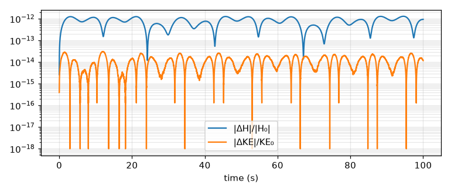
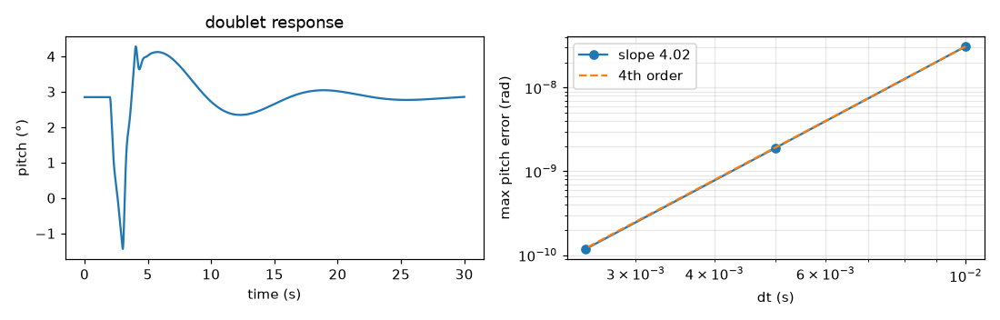
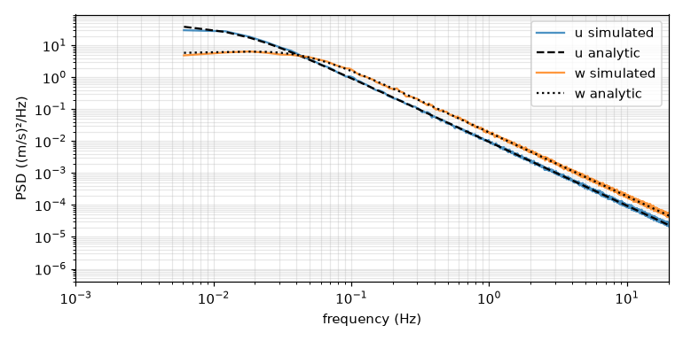
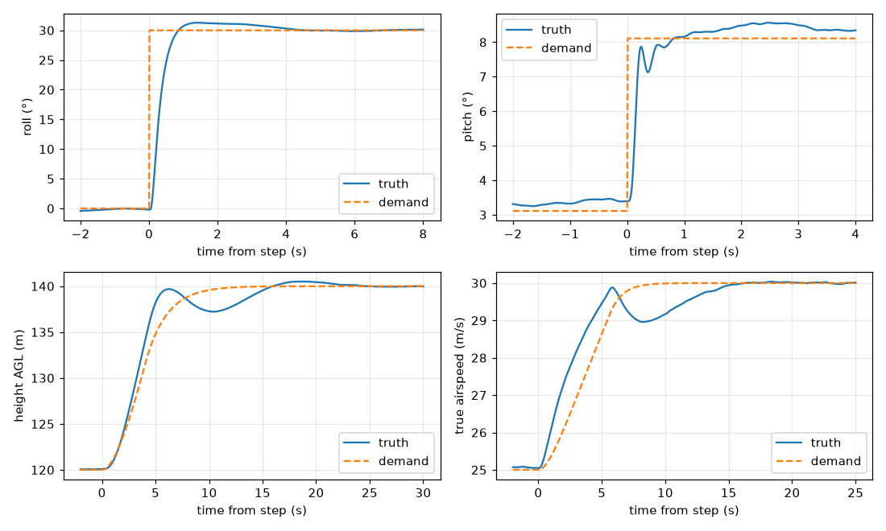
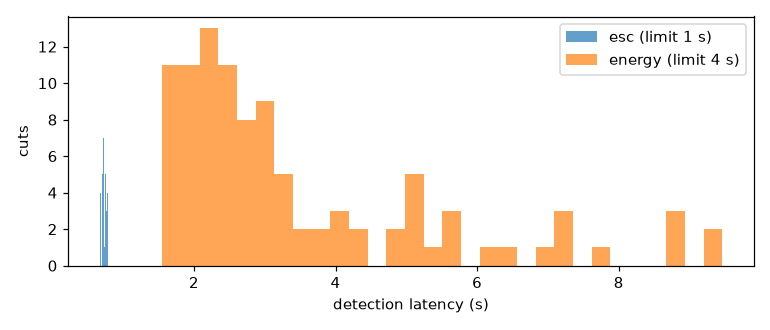

# M1 validation report

*Generated 2026-10-15 by `validation/report.py` · commit `c347a3675d` · arm64 Darwin · Python 3.12.13 · JAX 0.11.2*

Evidence for spec §12. Each section recomputes its results; the pytest tiers gate the same criteria in CI (fast) and nightly (full).

## V3 · N-version parity (aerojax vs NumPy reference)

1,000 random (state, wind, control) tuples, float64, plus three 20 s open-loop trajectories with band-limited inputs and wind.

| Quantity | Max error | Criterion |  |
|---|---|---|---|
| Force (relative) | 2.9e-12 | ≤ 1e-10 | ✅ |
| Moment (relative) | 1.1e-13 | ≤ 1e-10 | ✅ |
| Trajectory state (absolute, 20 s) | 9.1e-13 | ≤ 1e-8 | ✅ |


## V2 · Rigid-body invariants

| Invariant (100 s torque-free spin, f64) | Max drift | Criterion |  |
|---|---|---|---|
| Angular momentum (relative) | 1.3e-12 | ≤ 1e-9 | ✅ |
| Rotational KE (relative) | 3.1e-14 | ≤ 1e-9 | ✅ |
| Quaternion norm | 2.2e-16 | ≤ 1e-12 | ✅ |



*V2: torque-free spin about all three axes, RK4 at 5 ms*


## V4 · Trim

| Case | Residual | α | φ | δe | δt |  |
|---|---|---|---|---|---|---|
| Level, 25 m/s | 3.1e-15 | 2.85° | -0.0° | -7.10° | 0.774 | ✅ |
| 5° climb | 6.5e-15 | 2.80° | -0.1° | -6.98° | 0.858 | ✅ |
| Turn, R = 250 m | 4.4e-15 | 3.02° | 14.5° | -7.77° | 0.774 | ✅ |


## V5 · Linear modes vs Beard & McLain approximations

| Mode | Linearised | B&M approximation | Difference | Tolerance |  |
|---|---|---|---|---|---|
| Roll subsidence (1/s) | -22.44 | -22.63 | 0.8% | 10% | ✅ |
| Short period ωn (rad/s) | 11.02 | 10.00 | 10.2% | 15% | ✅ |
| Phugoid ωn (rad/s) | 0.499 | 0.555 | 10.1% | 20% | ✅ |


## V6 · Integrator convergence

RK4 on a 30 s elevator doublet (±3°) against a 0.5 ms reference: log-log slope **4.02** (criterion 4 ± 0.5) ✅; max pitch error at the chosen 5 ms step **1.9e-09 rad** (criterion ≤ 1e-3) ✅.



*V6: RK4 convergence on an elevator doublet*


## V7 · float32 vs float64

The same 60 s closed-loop flight (stock stack, light turbulence, sensor noise) in float32 and float64: max position divergence **0.005 m** (expected ≤ 1 m) ✅, attitude **0.005°** (expected ≤ 0.5°) ✅. All noise is drawn in float32 and cast, so both runs fly the same realisation; float32 is confirmed as the M2 training precision.


## V8 · Dryden turbulence (light, 120 m AGL)

| Channel | σ simulated | σ MIL-HDBK-1797 | Error | ≤ 5% |
|---|---|---|---|---|
| u | 1.037 | 1.017 | +2.0% | ✅ |
| v | 1.030 | 1.017 | +1.3% | ✅ |
| w | 0.770 | 0.772 | -0.2% | ✅ |



*V8: Dryden PSD, 64 seeds × 10 min*


## V11 · Stock autopilot acceptance (Aerosonde, 25 m/s)

Scored on truth. Steps start at t = 20 s after navigator convergence; light-turbulence step metrics use the ensemble mean over seeds.

| Check | Value | Limit |  |
|---|---|---|---|
| roll step rise 10-90% (calm) | 0.490 s | ≤ 1 | ✅ |
| roll step overshoot (calm) | 4.234 % | ≤ 10 | ✅ |
| roll step steady-state error (calm) | 0.012 deg | ≤ 1 | ✅ |
| \|beta\| in 30 deg turn (calm) | 0.645 deg | ≤ 3 | ✅ |
| pitch step rise 10-90% (calm) | 0.640 s | ≤ 0.8 | ✅ |
| pitch step overshoot (calm) | 2.210 % | ≤ 15 | ✅ |
| alt step error after 20 s (calm) | 0.443 m | ≤ 2 | ✅ |
| alt step overshoot (calm) | 0.503 m | ≤ 3 | ✅ |
| alt step airspeed deviation (calm) | 1.190 m/s | ≤ 2 | ✅ |
| speed step error after 15 s (calm) | 0.060 m/s | ≤ 0.5 | ✅ |
| speed step altitude deviation (calm) | 0.644 m | ≤ 3 | ✅ |
| L1 cross-track RMS (calm) | 1.466 m | ≤ 2 | ✅ |
| servo saturation, mission (calm) | 0.000 % | ≤ 5 | ✅ |
| loiter radius RMS error (calm) | 1.721 m | ≤ 5 | ✅ |
| limit cycle: 0.3-5 Hz attitude RMS (calm) | 0.100 deg | ≤ 0.25 | ✅ |
| roll step rise 10-90% (light turb.) | 0.490 s | ≤ 1 | ✅ |
| roll step overshoot (light turb.) | 4.175 % | ≤ 10 | ✅ |
| roll step steady-state error (light turb.) | 0.344 deg | ≤ 1 | ✅ |
| \|beta\| in 30 deg turn (light turb.) | 0.745 deg | ≤ 3 | ✅ |
| pitch step rise 10-90% (light turb.) | 0.430 s | ≤ 0.8 | ✅ |
| pitch step overshoot (light turb.) | 1.682 % | ≤ 15 | ✅ |
| alt step error after 20 s (light turb.) | 0.381 m | ≤ 2 | ✅ |
| alt step overshoot (light turb.) | 0.524 m | ≤ 3 | ✅ |
| alt step airspeed deviation (light turb.) | 1.325 m/s | ≤ 2 | ✅ |
| speed step error after 15 s (light turb.) | 0.157 m/s | ≤ 0.5 | ✅ |
| speed step altitude deviation (light turb.) | 1.847 m | ≤ 3 | ✅ |
| L1 cross-track RMS (light turb.) | 1.012 m | ≤ 5 | ✅ |
| servo saturation, mission (light turb.) | 0.001 % | ≤ 5 | ✅ |
| loiter radius RMS error (light turb.) | 1.108 m | ≤ 5 | ✅ |



*V11: step responses in calm air (truth vs demand)*


## V12 · Classical contingency

| Detector | Cuts | Median latency | Max latency | Within limit | False alarms |  |
|---|---|---|---|---|---|---|
| esc | 100 | 0.73 s | 0.79 s | 100% (≤ 1 s) | 0 in 10 h | ✅ |
| energy | 100 | 2.74 s | 9.46 s | 73% (≤ 4 s) | 3 in 10 h | ❌ |

**ESC telemetry** (primary) meets the latency and zero-false-alarm criteria. The **energy-residual backup** (CUSUM against TECS's throttle model) does not: gusts in light turbulence move the total-energy rate by ~1.4 m/s RMS, worst in climbing turns, while a cut at low throttle loses only ~1–2 m/s. It is tuned for zero false alarms first; the remaining false alarms and the slow tail are a documented M1 miss, addressed by learned fault diagnosis in M4.



*V12: motor-cut detection latency*


### Mini-campaign (50 motor cuts, onset (20.0, 200.0) s, wind (0.0, 8.0) m/s from any direction)

| Metric | Value |
|---|---|
| Detected | 50 / 50 |
| Judged reachable at detection | 45 |
| Landed in the selected zone (controlled or hard) | 41 |
| **In-zone rate** (criterion ≥ 80%) | **91%** ✅ |
| Crashes | 0 |

Failures (every reachable case not ending inside its zone):

| Scenario | Cause |
|---|---|
| m1-motorcut-classical-022 | landed 106 m short of the aim point |
| m1-motorcut-classical-023 | landed 169 m short of the aim point |
| m1-motorcut-classical-025 | landed 217 m past the aim point |
| m1-motorcut-classical-032 | landed 135 m short of the aim point |


*V12: mini-campaign map; ○ in-zone landing, × other*


## V15 · Throughput (recorded, not gated)

```
device: cpu (cpu) · arm64 · jax 0.11.2 · float32
physics 200 Hz x 2 substeps → control 100 Hz
 batch  compile s   ctrl steps/s  physics steps/s
     1        1.8         55,900          111,800
    64        2.0        601,848        1,203,695
  1024        3.5        798,673        1,597,346
host-stepped: 231 µs per control step → real-time factor 43x
```


*Built in 515 s. V11 test names: roll, pitch, alt, speed, l1, loiter, level.*
