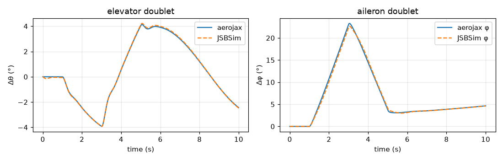
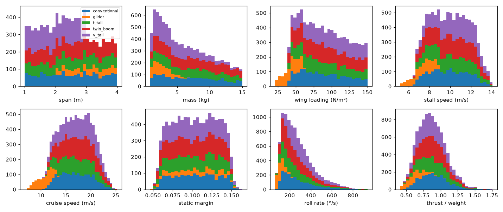

# Validation report (M1 and M2)

*Generated 2026-10-16 by `validation/report.py` · commit `a6ddbc859e` · arm64 Darwin · Python 3.12.13 · JAX 0.11.2*

Evidence for the M1 spec §12 and the M2 spec §10. Each section recomputes its results; the pytest tiers gate the same criteria in CI (fast) and nightly (full). The frozen M1 artefact is [m1_report.md](m1_report.md).

## V3 · N-version parity (aerojax vs NumPy reference)

1,000 random (state, wind, control) tuples, float64, plus three 20 s open-loop trajectories with band-limited inputs and wind.

| Quantity | Max error | Criterion |  |
|---|---|---|---|
| Force (relative) | 2.9e-12 | ≤ 1e-10 | ✅ |
| Moment (relative) | 6.9e-14 | ≤ 1e-10 | ✅ |
| Trajectory state (absolute, 20 s) | 3.4e-13 | ≤ 1e-8 | ✅ |


## V2 · Rigid-body invariants

| Invariant (100 s torque-free spin, f64) | Max drift | Criterion |  |
|---|---|---|---|
| Angular momentum (relative) | 1.3e-12 | ≤ 1e-9 | ✅ |
| Rotational KE (relative) | 3.1e-14 | ≤ 1e-9 | ✅ |
| Quaternion norm | 2.2e-16 | ≤ 1e-12 | ✅ |


*V2: torque-free spin about all three axes, RK4 at 5 ms*


## V4 · Trim

| Case | Residual | α | φ | δe | δt |  |
|---|---|---|---|---|---|---|
| Level, 25 m/s | 3.1e-15 | 2.85° | -0.0° | -7.10° | 0.774 | ✅ |
| 5° climb | 6.5e-15 | 2.80° | -0.1° | -6.98° | 0.858 | ✅ |
| Turn, R = 250 m | 4.4e-15 | 3.02° | 14.5° | -7.77° | 0.774 | ✅ |


## V5 · Linear modes vs Beard & McLain approximations

| Mode | Linearised | B&M approximation | Difference | Tolerance |  |
|---|---|---|---|---|---|
| Roll subsidence (1/s) | -22.44 | -22.63 | 0.8% | 10% | ✅ |
| Short period ωn (rad/s) | 11.02 | 10.00 | 10.2% | 15% | ✅ |
| Phugoid ωn (rad/s) | 0.499 | 0.555 | 10.1% | 20% | ✅ |


## V6 · Integrator convergence

RK4 on a 30 s elevator doublet (±3°) against a 0.5 ms reference: log-log slope **4.02** (criterion 4 ± 0.5) ✅; max pitch error at the chosen 5 ms step **1.9e-09 rad** (criterion ≤ 1e-3) ✅.


*V6: RK4 convergence on an elevator doublet*


## V7 · float32 vs float64

The same 60 s closed-loop flight (stock stack, light turbulence, sensor noise) in float32 and float64: max position divergence **0.081 m** (expected ≤ 1 m) ✅, attitude **0.433°** (expected ≤ 0.5°) ✅. All noise is drawn in float32 and cast, so both runs fly the same realisation; float32 is confirmed as the M2 training precision.


## V8 · Dryden turbulence (light, 120 m AGL)

| Channel | σ simulated | σ MIL-HDBK-1797 | Error | ≤ 5% |
|---|---|---|---|---|
| u | 1.037 | 1.017 | +2.0% | ✅ |
| v | 1.030 | 1.017 | +1.3% | ✅ |
| w | 0.770 | 0.772 | -0.2% | ✅ |


*V8: Dryden PSD, 64 seeds × 10 min*


## V11 · Stock autopilot acceptance (Aerosonde, 25 m/s)

Scored on truth. Steps start at t = 20 s after navigator convergence; light-turbulence step metrics use the ensemble mean over seeds.

| Check | Value | Limit |  |
|---|---|---|---|
| roll step rise 10-90% (calm) | 0.490 s | ≤ 1 | ✅ |
| roll step overshoot (calm) | 4.234 % | ≤ 10 | ✅ |
| roll step steady-state error (calm) | 0.012 deg | ≤ 1 | ✅ |
| \|beta\| in 30 deg turn (calm) | 0.645 deg | ≤ 3 | ✅ |
| pitch step rise 10-90% (calm) | 0.640 s | ≤ 0.8 | ✅ |
| pitch step overshoot (calm) | 2.210 % | ≤ 15 | ✅ |
| alt step error after 20 s (calm) | 0.443 m | ≤ 2 | ✅ |
| alt step overshoot (calm) | 0.503 m | ≤ 3 | ✅ |
| alt step airspeed deviation (calm) | 1.190 m/s | ≤ 2 | ✅ |
| speed step error after 15 s (calm) | 0.060 m/s | ≤ 0.5 | ✅ |
| speed step altitude deviation (calm) | 0.644 m | ≤ 3 | ✅ |
| L1 cross-track RMS (calm) | 1.466 m | ≤ 2 | ✅ |
| servo saturation, mission (calm) | 0.000 % | ≤ 5 | ✅ |
| loiter radius RMS error (calm) | 1.721 m | ≤ 5 | ✅ |
| limit cycle: 0.3-5 Hz attitude RMS (calm) | 0.100 deg | ≤ 0.25 | ✅ |
| roll step rise 10-90% (light turb.) | 0.480 s | ≤ 1 | ✅ |
| roll step overshoot (light turb.) | 4.805 % | ≤ 10 | ✅ |
| roll step steady-state error (light turb.) | 0.155 deg | ≤ 1 | ✅ |
| \|beta\| in 30 deg turn (light turb.) | 0.762 deg | ≤ 3 | ✅ |
| pitch step rise 10-90% (light turb.) | 0.430 s | ≤ 0.8 | ✅ |
| pitch step overshoot (light turb.) | 1.625 % | ≤ 15 | ✅ |
| alt step error after 20 s (light turb.) | 0.380 m | ≤ 2 | ✅ |
| alt step overshoot (light turb.) | 0.524 m | ≤ 3 | ✅ |
| alt step airspeed deviation (light turb.) | 1.253 m/s | ≤ 2 | ✅ |
| speed step error after 15 s (light turb.) | 0.157 m/s | ≤ 0.5 | ✅ |
| speed step altitude deviation (light turb.) | 0.774 m | ≤ 3 | ✅ |
| L1 cross-track RMS (light turb.) | 1.016 m | ≤ 5 | ✅ |
| servo saturation, mission (light turb.) | 0.002 % | ≤ 5 | ✅ |
| loiter radius RMS error (light turb.) | 1.080 m | ≤ 5 | ✅ |


*V11: step responses in calm air (truth vs demand)*


## V12 · Classical contingency

| Detector | Cuts | Median latency | Max latency | Within limit | False alarms |  |
|---|---|---|---|---|---|---|
| esc | 100 | 0.73 s | 0.79 s | 100% (≤ 1 s) | 0 in 10 h | ✅ |
| energy | 100 | 2.53 s | 10.43 s | 79% (≤ 4 s) | 0 in 10 h | ❌ |

**ESC telemetry** (primary) meets the latency and zero-false-alarm criteria. The **energy-residual backup** (CUSUM against TECS's throttle model) does not: gusts in light turbulence move the total-energy rate by ~1.4 m/s RMS, worst in climbing turns, while a cut at low throttle loses only ~1–2 m/s. It is tuned for zero false alarms first; the remaining false alarms and the slow tail are a documented M1 miss, addressed by learned fault diagnosis in M4.


*V12: motor-cut detection latency*


### Mini-campaign (50 motor cuts, onset (20.0, 200.0) s, wind (0.0, 8.0) m/s from any direction)

| Metric | Value |
|---|---|
| Detected | 50 / 50 |
| Judged reachable at detection | 47 |
| Landed in the selected zone (controlled or hard) | 44 |
| **In-zone rate** (criterion ≥ 80%) | **94%** ✅ |
| Crashes | 0 |

Failures (every reachable case not ending inside its zone):

| Scenario | Cause |
|---|---|
| m1-motorcut-classical-016 | landed 170 m short of the aim point |
| m1-motorcut-classical-023 | landed 202 m short of the aim point |
| m1-motorcut-classical-032 | landed 128 m short of the aim point |


*V12: mini-campaign map; ○ in-zone landing, × other*


## V14 · JSBSim cross-check (Aerosonde exported to JSBSim)

The Aerosonde's aerodynamics are exported to a JSBSim model (`tools/jsbsim`); JSBSim supplies its own equations of motion, integrators, WGS84 gravity, rotating Earth and atmosphere. Each simulator finds its own power-off glide trim at 22.5 m/s (ρ = 1.1901 kg/m³ and g = 9.8245 m/s² matched), then flies the same doublets open loop for 10 s.

| Glide trim | aerojax | JSBSim | Difference | Criterion |
|---|---|---|---|---|
| α (°) | 4.567 | 4.558 | 0.0093 | ≤ 0.1 |
| δe (°) | -11.859 | -11.833 | — | — |
| γ (°) | -4.471 | -4.475 | 0.0046 | ≤ 0.05 |

| Response | RMS difference | Criterion |  |
|---|---|---|---|
| Pitch, elevator doublet ±2° | 0.051° | ≤ 0.3° | ✅ |
| Roll, aileron doublet ±2° | 0.311° | recorded (≤ 1°) | ✅ |
| Heading, aileron doublet ±2° | 0.265° | recorded (≤ 1°) | ✅ |



*V14: aerojax and JSBSim from their own power-off glide trims*


## V16 / V17 · Aero v2 tables

Aero v2 tabulates the static coefficients over 360° of α (0.5° grid) and scales the damping and control derivatives by effectiveness tables. **V16**: the B&M formulas sampled onto the grid reproduce the analytic model in the flight envelope (α ∈ [−15°, 20°]):

| Coefficient | Max abs(tabulated − analytic) | Criterion |  |
|---|---|---|---|
| C_L | 9.6e-05 | ≤ 1e-3 | ✅ |
| C_D | 1.4e-05 | ≤ 1e-3 | ✅ |
| C_m | 1.9e-15 | ≤ 1e-3 | ✅ |

The golden flights also pass with tabulated aerodynamics (fast tier: nominal and classical motor cut; full tier: all five). **V17**: the NumPy reference interpolates the tables independently (`np.interp` on an explicit grid, against index arithmetic in aerojax) and agrees to 1e-10 relative on random tables, pointwise and over a 20 s trajectory, and with ground effect enabled near the ground (`tests/validation/test_v16_v17_aero_tables.py`). The JSBSim exporter reproduces aerojax's forces and moments in all six axes to 2e-5 of q̄S (q̄Sb for moments) at random flight conditions, including tables, effectiveness factors, sideslip, rates and ground effect.


## V18 · Generator aerodynamics vs published values

Two real airframes are rebuilt from their published geometry and run through the generator's aerodynamics (AeroSandbox AeroBuildup with tripped NeuralFoil polars). Criteria: C_Lα within 15 %, statically stable, C_ℓp within 25 %; the other derivatives are recorded. Buildup and vortex-lattice estimates typically differ from wind-tunnel or flight-identified values by 20–30 % on secondary derivatives.


### Aerosonde (B&M)

| Derivative | Published | Generator | Difference |  |
|---|---|---|---|---|
| C_L_alpha | 5.6100 | 5.7246 | +2% | ✅ |
| C_ell_p | -0.5100 | -0.8521 | -67% | ❌ |
| C_m_alpha | -2.7400 | -0.8996 | +67% | ✅ |
| C_m_q | -38.2100 | -17.7860 | +53% | recorded |
| C_L_q | 7.9500 | 1.4668 | -82% | recorded |
| C_ell_beta | -0.1300 | -0.0660 | +49% | recorded |
| C_n_beta | 0.0730 | 0.0738 | +1% | recorded |
| C_n_r | -0.0950 | -0.0794 | +16% | recorded |


### Skywalker X8

| Derivative | Published | Generator | Difference |  |
|---|---|---|---|---|
| C_L_alpha | 4.0203 | 4.3323 | +8% | ✅ |
| C_m_alpha | -0.2524 | -0.2659 | -5% | ✅ |
| C_m_q | -1.3012 | -0.9130 | +30% | recorded |
| C_L_q | 3.8700 | 0.6185 | -84% | recorded |
| C_ell_p | -0.4042 | -0.5093 | -26% | ❌ |
| C_ell_beta | -0.0849 | 0.0014 | +102% | recorded |
| C_n_beta | 0.0283 | -0.0005 | -102% | recorded |
| C_n_r | -0.0720 | -0.0062 | +91% | recorded |
| C_Y_beta | -0.2239 | -0.0634 | +72% | recorded |
| C_m_delta_e | -0.2292 | -0.6228 | -172% | recorded |
| C_ell_delta_a | 0.1202 | 0.5236 | +336% | recorded |

**Reading the misses.** The Aerosonde's published C_ℓp (−0.51) is below strip theory for its own rectangular AR-15 wing (≈ −0.9) and below a vortex-lattice estimate (−0.71): the textbook values are not identified from the aircraft, and the book gives no tail geometry, so only the wing-dominated derivatives are meaningful there. The X8's control-power differences come from elevon sizes that are not published (ours follow thin-airfoil theory for the surfaces as sized), and the buildup method under-predicts a flying wing's directional derivatives (C_nβ, C_n,r, C_Yβ). The flying wing class is held out of the training fleet; when the X8 flies, it uses its published coefficients.


## V19 · The generated fleet

`runs/fleets/m2-fleet`: **10,000 accepted airframes** from 14,784 designs (68% yield), every one re-checked in aerojax (trim at three speeds, modes, static margin, roll authority, thrust-to-weight, stall speed and wing loading).

| Class | Tried | Accepted | Yield |
|---|---|---|---|
| conventional | 2957 | 1990 | 67% |
| glider | 2956 | 737 | 25% |
| t_tail | 2957 | 1976 | 67% |
| twin_boom | 2957 | 2607 | 88% |
| v_tail | 2957 | 2690 | 91% |

| Rejection reason | Designs |
|---|---|
| Dutch roll damping | 69 |
| balance: battery station outside the fuselage | 51 |
| directional stability (C_n,beta) | 3556 |
| mass budget: no payload margin | 195 |
| roll authority | 85 |
| spiral divergence | 967 |
| stall speed | 1 |
| thrust-to-weight | 14 |
| trim fast: throttle out of range | 41 |

| Quantity | Min | Median | Max |
|---|---|---|---|
| span (m) | 1 | 2.41 | 4 |
| mass (kg) | 0.801 | 5.54 | 15 |
| wing loading (N/m²) | 20.9 | 85.1 | 150 |
| stall speed (m/s) | 5.17 | 9.87 | 14.1 |
| cruise speed (m/s) | 7.5 | 17 | 25 |
| static margin | 0.0459 | 0.104 | 0.164 |
| roll rate (°/s) | 60.4 | 242 | 937 |
| thrust / weight | 0.41 | 0.856 | 1.76 |



*V19: distributions over the accepted fleet, stacked by class*


## V20 · Auto-configured stock stack across the fleet

The first 1,000 airframes of `m2-fleet`, each auto-configured (`harness/autoconfig.py`) and auto-tuned (`harness/autotune.py`), then flown through a batched V11-lite: roll, pitch, altitude and speed steps, limit cycles and an L1 box in calm air; the L1 box and servo saturation in light turbulence. Dimensional limits scale with cruise speed and GNSS accuracy (`harness/fleet_acceptance.py`).

**855 of 1000 pass (85.5%)** · criterion ≥ 90% ❌ · 103 min on this machine.

| Class | Airframes | Pass rate |
|---|---|---|
| conventional | 200 | 90% |
| glider | 70 | 54% |
| t_tail | 190 | 87% |
| twin_boom | 263 | 92% |
| v_tail | 277 | 83% |

| Failed check | Airframes | Median value / limit |
|---|---|---|
| limit cycle 0.3-5 Hz attitude RMS | 40 | 1.12 |
| roll step steady-state error | 37 | 1.17 |
| |beta| in 30 deg turn | 36 | 1.16 |
| alt step airspeed deviation | 30 | 1.18 |
| pitch step overshoot | 14 | 1.11 |
| roll step overshoot | 9 | 1.06 |
| L1 cross-track RMS (calm) | 4 | 1.08 |
| pitch step rise 10-90% | 3 | 1.03 |
| speed step error after 15 s | 3 | 1.12 |
| speed step altitude deviation | 1 | 1.10 |

Failing airframes fail 1 check: 117, 2 checks: 25, 3 checks: 2, 4 checks: 1. Per the spec (§6), airframes that fail V20 are excluded from the benchmark fleet, with these reasons recorded in `results.parquet`.


## V21 · faultlab v1

**26 v1 kinds** plus the four M1 faults (pitot blockage with the drain open or blocked, servo jam, motor cut), and weather events (1−cos gusts, low-level shear, thermals). (a) and (b), every kind's effect and its absence before onset, are gated in the fast tier (`tests/validation/test_v21_faultlab.py`).

| Family | Kinds |
|---|---|
| sensor | airspeed_bias, airspeed_stuck, airspeed_drift, gyro_bias, accel_bias, imu_vibration, mag_interference, baro_drift, gnss_dropout, gnss_drift, gnss_spoof |
| actuator | hard_over, floating, slow, reduced_throw, backlash, reversed |
| propulsion | partial_loss, prop_damage, thermal_derate |
| energy | cell_failure, abnormal_sag, capacity_loss |
| airframe | cg_shift, payload_drop, wing_damage |

**(c) Confounded pairs** (doc 03 §3.2): each fault is flown against its look-alike and a baseline, with common random numbers. The criterion is that the M1 monitors (airspeed health, motor-failure detection) respond alike within the horizon, that both arms show the symptom within a factor of 2, and that the ground truth differs.

| Pair | Horizon | Symptom | Median a / b | Ratio | Monitors alike |  |
|---|---|---|---|---|---|---|
| battery-sag-vs-prop-damage | 15 s | throttle rise | +0.0334 / +0.0243 | 1.38 | 8/8 | ✅ |
| cg-vs-elevator-offset | 10 s | elevator shift | -0.17 / -0.17 | 1.00 | 8/8 | ✅ |
| floating-vs-turbulence | 10 s | roll rate rms | +0.0254 / +0.0283 | 0.90 | 8/8 | ✅ |
| gnss-spoof-vs-wind-change | 20 s | wind shift | +0.683 / +0.723 | 0.94 | 8/8 | ✅ |
| pitot-vs-airspeed-loss | 4 s | ias drop | -3.26 / -3.16 | 1.03 | 8/8 | ✅ |


## V22 · Bench v0

`aeroadapt bench-run b0`: **1,000 scenarios** (seed 2026) on the test split of the V20-accepted fleet, each flown by B1 (the stock stack) and B2 (B1 plus the classical contingency, which acts only on a detected motor failure), with the same start state and noise. Missions are random closed loops; wind up to 80 % of cruise speed with turbulence following the wind, gusts, shear and thermals; none, one or two faults of any kind. Rates with 95 % Wilson intervals; latency means with bootstrap intervals.

|  | B1 | B2 |
|---|---|---|
| Survival (no loss of control, no ground contact except a planned landing) | 83.1% [81%, 85%] (831/1000) | 86.4% [84%, 88%] (864/1000) |
| Mission completed (one full lap) | 93.4% [92%, 95%] (934/1000) | 92.5% [91%, 94%] (925/1000) |
| Loss of control | 10.5% [9%, 13%] (105/1000) | 10.4% [9%, 12%] (104/1000) |
| Motor cut: survival | 11.8% [5%, 27%] (4/34) | 94.1% [81%, 98%] (32/34) |
| Motor cut: landed in a safe zone | 0.0% [0%, 10%] (0/34) | 50.0% [34%, 66%] (17/34) |
| Motor cut: detected | 0.0% [0%, 10%] (0/34) | 97.1% [85%, 99%] (33/34) |
| Motor cut: detection latency (s) | – | 2.04 [0.91, 3.53] |
| False alarms on fault-free flights | 13.6% [10%, 18%] (45/331) | 13.6% [10%, 18%] (45/331) |
| False alarms per flight hour | 1.632 | 1.632 |

| Survival by fault category | B1 | B2 |
|---|---|---|
| actuator | 66.7% [56%, 76%] (52/78) | 66.7% [56%, 76%] (52/78) |
| airframe | 100.0% [91%, 100%] (38/38) | 100.0% [91%, 100%] (38/38) |
| energy | 100.0% [87%, 100%] (26/26) | 100.0% [87%, 100%] (26/26) |
| multiple | 66.6% [61%, 71%] (219/329) | 73.2% [68%, 78%] (241/329) |
| none | 99.7% [98%, 100%] (330/331) | 99.7% [98%, 100%] (330/331) |
| propulsion | 75.0% [61%, 85%] (33/44) | 93.2% [82%, 98%] (41/44) |
| sensor | 86.4% [80%, 91%] (133/154) | 88.3% [82%, 92%] (136/154) |

B1 and B2 differ on 45 scenarios: B2 survives 39 that B1 does not, B1 6 that B2 does not (fault combinations: accel_bias+motor_cut, airspeed_stuck+abnormal_sag, airspeed_stuck+motor_cut, baro_drift, baro_drift+gnss_dropout, baro_drift+imu_vibration, baro_drift+mag_interference, cell_failure+motor_cut, gnss_dropout+motor_cut, gnss_spoof+baro_drift, gnss_spoof+motor_cut, hard_over+motor_cut, imu_vibration+thermal_derate, motor_cut, motor_cut+cell_failure, motor_cut+gyro_bias, motor_cut+imu_vibration, motor_cut+mag_interference, motor_cut+servo_jam, motor_cut+slow, motor_cut+thermal_derate, motor_cut+wing_damage, partial_loss+motor_cut, thermal_derate, thermal_derate+baro_drift, thermal_derate+gyro_bias, thermal_derate+imu_vibration, wing_damage+motor_cut, wing_damage+thermal_derate).

Reproducibility: the sample bench run twice gives an identical outcome table ✅.


## V23 · Live mode

`aeroadapt serve` steps the same compiled closed loop in 0.1 s chunks, paced to wall-clock time; Skyview injects and clears faults while it flies.

| Check | Result | Criterion |  |
|---|---|---|---|
| Injection latency (fault label after the command) | 10 ms | next control step (10 ms) | ✅ |
| Session bundle vs offline re-fly of its command log | byte-identical | byte-identical | ✅ |
| Pacing jitter at 1x | gated in the fast tier (`test_pacing_jitter_at_real_time`) | p99 ≤ 20 ms |  |


## V15 · Throughput (recorded, not gated)

```
device: cpu (cpu) · arm64 · jax 0.11.2 · float32
physics 200 Hz x 2 substeps → control 100 Hz
 batch  compile s   ctrl steps/s  physics steps/s
     1        1.8         36,478           72,957
    64        1.9        613,085        1,226,169
  1024        3.2        752,326        1,504,652
host-stepped: 233 µs per control step → real-time factor 43x
```

Heterogeneous fleet with faults (M2, `tools/bench_fleet.py`; the GPU figure comes from `notebooks/gpu_throughput.ipynb`):
```
device: cpu (cpu) · arm64 · jax 0.11.2 · float32
heterogeneous fleet (10 airframes cycled) · per-lane wind, turbulence and one fault
  batch  simulator steps/s  closed-loop steps/s
     64            443,563              210,348
    256            510,798              227,543
   1024            552,453              224,896
```


*Built in 611 s. V11 test names: roll, pitch, alt, speed, l1, loiter, level.*
